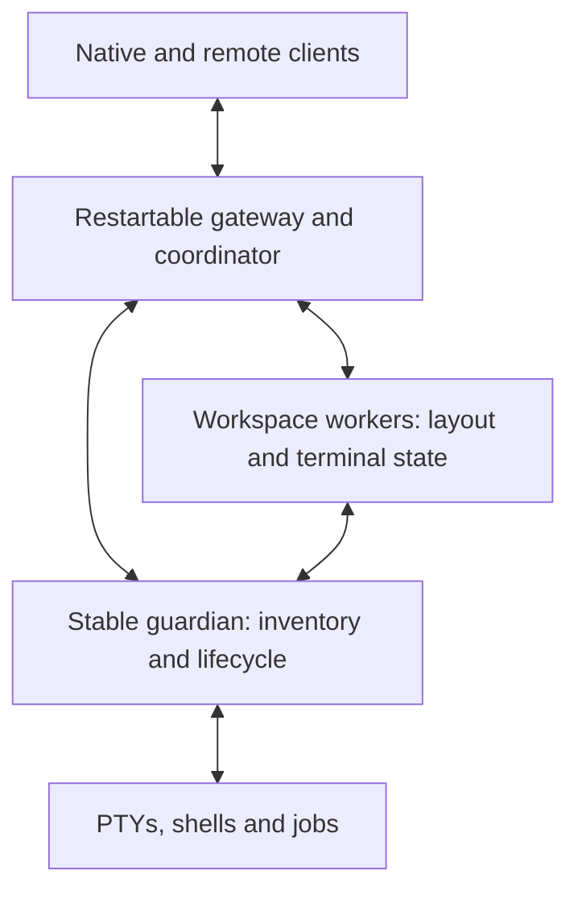

# Spec: Durable SwiftMux sessions and planned worker replacement

**Repository:** [chr33s/swiftty](https://github.com/chr33s/swiftty)  
**Status:** Implementation in progress; signed helper feasibility verified; production durability capabilities not yet enabled  
**Version:** 0.9 — saved layout and output after reboot (§12.2)\
**Date:** 2026-11-21\
**Baseline:** `7d3aa5bc4c3844ab9dc0987c25a630b08adf7018`, inspected working tree  
**Builds on:** [SwiftMux](spec.multiplexer.md), [roaming](spec.roaming.md), [unified service and inbox](spec.inbox.md), [scrollback](spec.scrollback.md), and [JavaScript](spec.javascript.md)  
**Platform:** Native macOS host; existing supported clients; Swift 6.4 in Swift 6 language mode and deployment minimums from [spec.apple.md](spec.apple.md)

## 1. Decision and intended outcome

Deliver three independently releasable capabilities:

1. **Update durability:** app and gateway updates/restarts preserve running sessions. Existing workspace workers continue using their pinned build; new workspaces may use the new build. This requires no terminal checkpoint or replay journal.
2. **Planned worker replacement:** compatible workers transfer complete terminal state during a bounded pause, preserving shells and jobs. This adds an on-demand in-memory checkpoint and a fenced activation transaction, not general crash replay.
3. **Saved layouts (§12.2):** a workspace lost to guardian death, logout or reboot can be reopened as a new workspace with the same layout and fresh shells. This restores no process or terminal state.

Use a stable per-user process guardian, one terminal worker per workspace, and a restartable gateway/coordinator. The guardian owns processes and ordered PTY I/O; workers own workspace semantics and terminal state. Keep the guardian small enough to change infrequently. Its update requires an empty-state barrier.

Exact recovery after an unexpected worker crash remains a future extension (§12.1). Capability C (§12.2) ships after A2 and does not depend on B; neither C nor §12.1 blocks shipping A or B. Do not introduce continuous journals, periodic checkpoints, a session database, synchronous disk commits or speculative pre-copy for Capabilities A and B. Capability C's store is written asynchronously by the gateway and is never on the PTY I/O, command-admission or migration path.

### 1.1 Scope and guarantees

| Event | Update durability | Planned replacement adds |
| --- | --- | --- |
| Client disconnect or frontend update | Shells and workers continue; reattach | Same |
| Gateway/coordinator restart, crash or update | Discover surviving workers and resume the same sessions | Same |
| New worker build installed | Existing workers keep their build; new workspaces use the new build | Compatible live workspaces may migrate |
| Candidate fails before release of the new owner | No migration capability | Resume the unchanged old worker under fresh authority |
| Unexpected active-worker crash | Guardian retains processes; workspace becomes unavailable; exact terminal recovery is not promised | Same, including candidate crash after release |
| Guardian death, logout or reboot | No live-session guarantee; mark old sessions lost | Same |
| Explicit End | Terminate only the authorized target | Same, including during migration |
| Sleep/wake | Preserve sessions if the OS retains their processes; no progress guarantee during sleep | Same |

Capability C changes only the guardian death, logout and reboot row: sessions are still lost, but their saved layouts can be reopened with fresh shells (§12.2).

“Seamless replacement” means preserved process and terminal semantics with a bounded pause on the successful path. It does not mean zero interruption or crash recovery after the new worker starts changing state. A live shell without its terminal state is not a recovered session. Do not claim exactly-once shell-command execution or automatically replay uncertain input.

### 1.2 Simplifications and implementation boundaries

| Decision | Implementation consequence |
| --- | --- |
| Ship update durability before planned replacement | A0–A2 must work with checkpoint and migration support absent; upgrading the app never requires migrating an existing worker |
| Keep the guardian limited to process ownership and I/O | Keep terminal state, history and workspace policy in workers; installation manifests are not a session database |
| Checkpoint only for a requested replacement | Use one bounded in-memory transfer at a frozen cut; omit periodic snapshots, continuous journals and speculative pre-copy |
| Use one irreversible release boundary | Before release, resume the unchanged old worker with fresh authority; after release, report failure as unavailable rather than attempting stale-state rollback |
| Keep one authoritative migration record | Guardian owns the phase and decision; gateway and workers acknowledge transitions rather than maintaining competing ownership state machines |
| Keep preparation handshakes out of the ownership state machine | Import readiness, generation assignment and activation are prerequisites within the frozen phase; only release changes the runnable owner |
| Defer migration when either worker cannot participate | Keep a healthy old worker running; do not add a special old-worker-crash recovery path to planned replacement |
| Treat crash recovery and reboot restoration separately | Retain processes after worker failure and offer targeted End; add recovery or saved presentation only under the separate specifications in §12 |

The required solution includes both capabilities, but each has its own release gate. Implement A0 → A1 → A2, then B0 → B1. Do not add B-only checkpoint formats or migration states to A's readiness criteria. Retain generation fencing, bounded transport, input cancellation and independent helper qualification in A: those establish session ownership and safe reconnect even without migration.

Implement planned replacement as one sequential operation over the guardian's transaction record (§7.1). Reuse the authenticated control channels, operation sequencing, backpressure and build pins from A. Do not introduce a generic transaction framework, separate migration service, persistent decision log or independently authoritative coordinator state. Import readiness and activation remain explicit acknowledgements because they prove different prerequisites; they do not require separate phase machines or watchdogs. The gateway drives the sequential operation, but the guardian enforces its deadlines and decides release or abort even when the gateway disappears. A disconnected coordinator is not required to finish rollback.

## 2. Current implementation and changes to existing contracts

| Baseline | Required change |
| --- | --- |
| [`MuxService`](Sources/SwiftMuxService/MuxService.swift) holds graph, panes and leases in one service | Move each workspace's authoritative graph and terminal semantics into its worker; gateway caches become disposable |
| At baseline, [`PaneRuntime`](Sources/SwiftMuxService/PaneRuntime.swift) owns engine, PTY and child observation | Process/I/O ownership is extracted into [`GuardianPTY`](Sources/SwiftMuxGuardian/GuardianPTY.swift), with a guardian-backed runtime adapter; production routing remains pending (§13) |
| `PaneWriter` owns partial writes, paste envelopes and deferred replies (now extracted to [`SwiftMuxGuardian`](Sources/SwiftMuxGuardian/PaneWriter.swift)) | Move the complete byte-writer state machine into the guardian process; do not split its mutable state between processes |
| [`PaneLauncher`](Sources/SwiftMuxGuardian/PaneLauncher.swift) launches shells (now extracted to the guardian module) | Guardian process becomes the parent/reaper and termination authority |
| [`RoamingHost`](Sources/TerminalHost/RoamingHost.swift) uses an in-process mux adapter | Route through a worker-backed facade without giving network code PTY access |
| [`UpdateCoordinator`](Sources/SwiftMuxClient/UpdateCoordinator.swift) waits for an empty service | Preserve that path for initial adoption and guardian maintenance; add gateway-only updates |
| [`Parser`](Sources/SwifttyEngine/Terminal/Parser.swift) and [`TerminalState`](Sources/SwifttyEngine/Terminal/TerminalState.swift) are noncopyable | Planned replacement needs explicit export/import, never raw memory serialization |

When update durability is implemented, it supersedes the service-loss and ordinary-update requirements in spec.multiplexer.md §8 and the single-process ownership assumption in spec.inbox.md §1. When planned replacement is implemented, it additionally supersedes the exclusion of live engine migration. When saved layouts are implemented, they amend spec.md *Lifetime* ("a service crash, logout or reboot is not restored transparently") and *Startup and discovery* as §12.2 describes. Until each gate passes, existing documents remain the implemented contract.

Preserve observer limits, takeover consent, reply provenance, input cancellation, retained exit screens and screen-only roaming scope. History remains in memory as specified by spec.scrollback.md; the only exception is Capability C's opt-in, bounded saved output (§12.2). Negotiate changed protocol semantics explicitly; do not silently redefine an existing epoch field.

## 3. Processes and ownership



| Owner | Responsibilities |
| --- | --- |
| Guardian | Spawn/reap/terminate, PTY descriptors, reads/resizes, complete byte writers, bounded transport queues, worker supervision, process inventory, owner generations and migration release gate |
| Workspace worker | Workspace graph/revision, launch settings, panes, parsers, terminal/history, semantic input encoding, writer-lease policy, frames/search, workspace attention records |
| Gateway/coordinator | Authentication and endpoints, attachment routing, discovery, update orchestration, service-scoped automation and aggregate inbox presentation |
| Frontend | Rendering and interaction; never authoritative process state |

The guardian has no split-tree model, terminal parser, history store, automation runtime, notification policy, SQLite database or replay engine. Its registry is an in-memory inventory of worker/workspace IDs, pane/process IDs, owner generations, child status and pinned builds. Workers provide names, layout and graph revisions during discovery. Unavailable workers do not disappear from the inventory.

Workers are guardian-supervised children; shell launchers are also spawned by the guardian so worker replacement never transfers child parenthood. The guardian runs independently of the gateway's launchd job. Neither gateway disconnect nor worker teardown closes a live pane's PTY or signals its shell.

Keep process/I/O code in a `SwiftMuxGuardian` target. Share bounded IPC records and ownership-state values in a small protocol module. Reuse `SwiftMuxService` logic for worker commands and the gateway facade. Engine checkpoint codecs belong in `SwifttyEngine` and are introduced only for planned replacement.

### 3.1 Commands and graph consistency

The worker serializes graph mutations. Spawn requests carry idempotency keys; the guardian returns the prior result on retry while the operation remains outstanding. Retire deduplication entries only through an acknowledged bounded sequence window; reject requests older than that window. A full table applies admission backpressure rather than forgetting a request that may be retried. IDs/incarnations, never saved PIDs alone, identify termination targets.

Explicit gateway creation takes a caller-supplied workspace ID before any side effect. Bound retained creation work to four jobs and 4 MiB of launch payload in total. Check current guardian inventory and refuse an already retained ID; submit worker admission once, wait for its authenticated endpoint, then submit the workspace launch once. Retry only definitive read-only not-ready responses while inventory still reports starting or available. One creation deadline covers admission, endpoint readiness and the launch reply (15 seconds by default, at most 30 seconds). Cancellation, timeout or connection loss cancels the wait and closes its client, but neither replays the launch nor issues End; use the known ID to inspect the retained outcome. Guardian inventory keeps a newly adopted child in starting state until its authenticated hello, or until failure/End makes it unavailable.

A spawn in progress prevents a migration cut until its success/failure and graph publication settle. A gateway restart asks the worker for command results and current graph; it never retries an uncertain spawn as a new operation. If a worker crashes with a spawned but unpublished pane, guardian inventory retains it as unavailable and permits explicit termination. It must not start a replacement shell to repair the graph.

## 4. Identity, leases and ordered I/O

Keep host identity independent of process restarts. Guardian start creates a fresh unpredictable incarnation. Workspace/tab/pane IDs survive gateway restart and planned migration; each shell spawn has its own process incarnation. Each worker ownership change advances a guardian-controlled generation. Each gateway and client attachment has fresh authority. Preserve terminal epochs across successful migration; reset/new shell creates a new epoch.

Allocate owner generations monotonically within a guardian incarnation, including when a previously forgotten workspace ID is created again. Refuse allocation on exhaustion rather than wrapping. Retiring a workspace must not make its former authority valid for a later workspace.

All process/I/O requests name guardian incarnation, workspace, worker generation and relevant pane/process identity, with bounded operation sequences. Bind them to authenticated connections. Reject stale generations before side effects. Workers never receive raw PTY descriptors, which would allow them to bypass fencing.

The guardian admits one authenticated gateway connection as current. Replacing it fences the previous gateway and revokes its capabilities before new attachments are admitted. Workers validate that gateway incarnation for graph and terminal mutations as well as input; a stale gateway cannot bypass the guardian by addressing a worker directly.

Forwarding preserves the original transport's trust classification. A gateway sets `Hello.forwardedTransport` from its authenticated ingress, never from a frontend-supplied declaration. Only a workspace-scoped worker bound to that gateway PID accepts it. The worker applies remote restrictions before commands and echoes the accepted value in `Welcome.forwardedTransport`; the gateway refuses missing or mismatched acknowledgement before sending commands. Older workers that ignore the field are therefore incompatible with forwarded remote access, rather than silently treating it as local. The roaming facade must still enforce its screen-only command surface.

Deliver gateway binding changes on the existing authenticated guardian–worker control channel. Revoke old input authority immediately, then wait for each worker to acknowledge closing old gateway connections and clearing their leases before advertising that workspace as ready for the replacement. Acknowledgements name a monotonic binding revision; a superseded acknowledgement cannot establish readiness. Keep at most one binding in flight and the latest desired binding, with a bounded application deadline. Failure leaves that workspace unavailable. Rotating only a writer capability under the same gateway incarnation and PID cancels affected input without disconnecting unrelated gateway connections; it does not constitute gateway replacement.

Workers own the single-controller policy and takeover decisions. The guardian enforces opaque writer capabilities on queued user-input segments so cancellation does not depend on the worker processing a later message. Bind each capability to its gateway connection, attachment and owner. On gateway loss, guardian revokes those capabilities and cancels unwritten user input using the existing paste-cleanup policy; workers clear corresponding leases before admitting new writers. Automatic terminal replies retain distinct provenance and budgets.

Native controller routing establishes gateway input authority with negotiated `ensureWriter(authority:)` support. The guardian validates the full authority and current gateway atomically, returns an existing grant unchanged, or publishes one new grant. Repeated requests do not advance the binding revision, cancel input or displace a controller. The gateway waits for the worker's binding acknowledgement before returning the selected endpoint and verifies that selection still names the same authority. Observer/status routing does not request a grant; attachment and takeover consent remain worker decisions. Keep explicit grant renewal separate. Guardians that omit `supportsEnsureWriter` are refused before this command is sent; do not substitute renewal as a compatibility fallback.

The guardian's byte writer owns input/reply ordering, partial-write offsets, paste state, closing-marker reservations, deferred segments and cancellation. Workers submit ordered typed operations: encoded input, reply, begin/append/end paste, and resize. Preserve `PaneWriter` sanitization/ordering semantics. The writer stays in place during migration; its queued bytes and offsets are not serialized and resubmitted by the candidate.

Use sequenced bounded channels with credits and per-pane read/command watermarks. Output acknowledged as applied by the worker may be released immediately; these queues are transport buffers, not crash journals. Reserve capacity before reading. Backpressure stops PTY reads when the worker cannot consume; it never discards output silently. Reserve separate control capacity for cancellation, barriers and End.

The worker serializes output parsing, semantic input and configuration changes on each pane queue. Resizes use an ordered request/acknowledgement: settle the syscall result and corresponding engine geometry before later geometry-dependent pane operations or a migration cut. Failed resizes do not advance engine geometry or advertise the requested generation as ready.

Represent an asynchronous wait as a bounded pane barrier, never a blocked Dispatch queue. Apply earlier output through the acknowledged cut using the old geometry, commit the successful geometry change, then admit later dependent work. Reserve operation slots as well as bytes before queuing deferred input; zero-byte requests also consume metadata capacity. Coalesce pending resizes using the existing geometry-generation contract.

Reply admission, completion/cancellation of an already-open paste, capability revocation and End must remain able to progress while dependent work waits. Otherwise an open paste can defer a reply needed to finish parsing the very output on which the barrier waits. Cancellation removes affected deferred work and refunds its reservations exactly once. Test this ordering with delayed acknowledgements and reply pressure; do not treat a synchronous local adapter as proof of cross-process behavior.

## 5. Capability A: update durability

### 5.1 Discovery and reconnect

On startup the gateway authenticates to the guardian, enumerates surviving worker IDs/builds, then fetches each worker's graph and subscribes from its revision. Publish a workspace as ready only after that subscription is consistent. Do not create a default shell while discovery is pending or a worker is unavailable.

Keep inventory discovery active for the gateway lifetime using one caller-owned monitoring task. Poll serially (one-second default), with no overlapping requests or catch-up queue after sleep. Worker graph/summary subscriptions provide changes between inventory polls. Cancellation drains subscriptions without ending sessions; discovery failure clears readiness and retains known inventory for explicit End. Retry only read-only discovery on a healthy control connection, never an uncertain mutation.

The gateway runtime owns its guardian control connection, directory monitor and native route owner as one lifetime. Require successful initial inventory before exposing that runtime; per-worker graph discovery may still be pending. Reconcile routes after each completed inventory refresh without creating a second polling loop. Shutdown and monitor failure cancel listeners, drain observations and close the guardian connection without End. Preserve the discovery failure for callers. Explicit End resolves a concrete authority once and delegates to the existing End/Forget sequence; it does not retry an uncertain mutation.

Scoped workers advertise the internal `workspaceGraph` feature. `observeWorkspaceGraph(true)` atomically returns the current graph (or nil when none is published) and rearms one graph-event credit. While an event is outstanding, later changes coalesce; consuming it and rearming returns the latest complete graph at the worker's command-order boundary. Only the current authenticated local gateway may subscribe. Graph metadata does not establish applied PTY geometry, an attachment lease or terminal-frame readiness; those retain their existing acknowledgements.

Resolve workspace selectors against one inventory snapshot. Explicit IDs may identify unavailable workers for End; routing additionally requires current graph/summary readiness. Retain the last known summary only for the same guardian authority, and never use it as readiness evidence. Exact names take precedence over ID prefixes of at least eight hex digits. Reject duplicate names, ambiguous prefixes and tied newest creation timestamps. If an entry has unknown name/creation metadata, require an explicit ID rather than silently excluding it from name or latest selection. An unavailable newest workspace must not cause latest to select an older healthy one. A definitively empty worker has no published workspace to include in name/latest selection.

Clients obtain fresh attachment authority and full frames; discard old delta baselines, frame acknowledgements and resize requests. Stable workspace identity is separate from transport epochs. Preserve explicit takeover; reconnect does not steal another controller's lease. Old grants and uncertain input must not be reused. Add negotiated capability fields or a new protocol revision if existing SMX/RST validation cannot express the distinction.

Native bootstrap uses a separately versioned gateway control endpoint for inventory, route selection, explicit creation and targeted End. A fresh control-server identity fences commands from a replaced listener. Authenticate same-user/signing identity before accepting commands. Keep one outstanding command per connection until its result is acknowledged, with bounded command/result retention, operation and acknowledgement deadlines, and at most one cached retransmission. Identical duplicates never rerun mutations or extend deadlines; conflicting sequences close the connection. Closing this listener closes its transports without ending the runtime or its sessions.

The native control client validates version, OS peer identity, sequence, reply type and endpoint presence before acknowledging a result. A route returns workspace identity and the selected worker's server instance alongside a gateway-owned endpoint. Bind the terminal connection to the authenticated gateway PID and verify the worker server instance through its welcome. Preflight command payloads before encoding or submission. A lost or timed-out command has an uncertain outcome and is never automatically replayed; use the caller-supplied workspace ID to inspect creation. Keep terminal SMX and remote transport negotiation separate from this native bootstrap protocol. The async client owner bounds pending work to 64 commands and 4 MiB of logical payload, including its transmitted command. Cancelling a queued request removes it before submission; cancelling a transmitted request abandons only its caller until the result or connection failure releases the slot and reservation. A command refusal leaves a healthy connection usable. Closing control does not close terminal connections already returned to callers.

A selected-workspace native listener pins the full guardian authority, not just the workspace ID. Authenticate each frontend before requesting its worker endpoint, resolve the endpoint through the current guardian connection, and reject a changed authority. Bound pending admissions together with live relays (64 per listener by default). Closing the listener cancels admissions and channels without granting a writer lease, replaying a command or ending the workspace. The aggregate route owner bounds listeners (32 by default) and shares one connection allowance across them (64 by default), including pending guardian lookups and live relays. Reuse a listener only for the same full authority. Reconcile unavailable, retired or replaced entries before new selections and when processing inventory changes; close their transports without End. Refuse capacity exhaustion rather than evicting another active route. Releasing a failed admission or closing a listener returns its connection allowance exactly once.

Frontend workspace switching owns one selected worker transport and at most one
pending selection. Resolve and attach the destination before retiring the
previous transport; a refused destination must not release the existing lease.
Takeover requires the explicit expected lease generation. After successful
selection, close the old transport, discard its presentation work and establish
fresh geometry/subscriptions/full frames on the new connection. Tag frontend
work with a fresh selection identity so late old events cannot update the new
workspace. Terminal frontends must negotiate the supported terminal profile on each routed worker connection. Suspend input at switch submission, cancel and drain the old event reader, and fence old event, command, paste and input-rejection callbacks before replacing presentation state. Cancel a pending selection by closing its candidate transport, never
by replaying its attach or restoring a controller displaced by an already
accepted explicit takeover. Session closure drains owned transports without End
and leaves shared gateway control caller-owned.

A gateway relay must not return worker frame or inbox credit merely because it consumed an upstream event. Hold delivered frame identities per pane and inbox revisions in delivery order until the downstream consumer acknowledges them. Reject stale, duplicate or out-of-order acknowledgements before forwarding credit. Receiving or caching a frame in the gateway is not proof that the frontend installed it.

Relay inbox subscriptions require negotiated `inboxAcknowledgementTokens` support from both endpoints. Each delivered update carries a fresh opaque token; acknowledge the exact token and revision once, in delivery order. The worker bounds outstanding tokens by its existing inbox credit limit and discards them on unsubscribe. Serialize subscription changes and clear held relay credit after successful unsubscribe. Missing, stale or duplicate tokens cannot release a new subscription’s credit, even when revisions repeat. Legacy direct clients retain their existing protocol; a relay refuses an unsupported inbox subscription before forwarding it.

Worker-owned attention records survive gateway restart. Aggregate them again using workspace/process identities and revision cursors. Keep delivery acknowledgements with the worker so reconnect does not intentionally redisplay acknowledged notifications; an external notification with an uncertain delivery outcome is not automatically retried. The guardian knows nothing about inbox contents.

Service-scoped JavaScript remains in the gateway/coordinator. Gateway restart reloads scripts once and resets volatile script variables; disclose this limitation. It does not reset worker terminal state. Do not replay automation events or external effects merely because the gateway reconnects.

### 5.2 Ordinary update

1. Verify and stage immutable gateway/app and worker builds without changing the selected versions.
2. Pause new worker admission at the guardian and serialize changes to the selected worker build. Let already-admitted launches settle within a bounded wait; unresolved admissions defer the update.
3. Recheck the candidate against fresh guardian inventory and required capabilities, including retained unavailable workers. Verify that both the candidate and retained rollback gateway support the proposed worker selection. On incompatibility, preserve the current selections and resume admission.
4. Replace/re-register only the gateway/app; reconnect to surviving workers. Keep admission paused across gateway replacement.
5. Verify readiness, then select the new worker for future workspaces and resume admission. Existing workers keep running unchanged. On failure, restore the compatible gateway and prior worker selection before resuming admission.
6. Collect only artifacts that are neither pinned nor retained as selected or rollback builds.

An update succeeds without migrating a single live worker. Capability B may subsequently migrate compatible workspaces one at a time. Failure or incompatibility of migration is a deferred worker upgrade, not failure of the already installed app update.

Protocol preflight reads fresh guardian inventory, including unavailable workers
and pending admissions. Worker protocol metadata comes from the retained,
validated immutable build manifest, not from reopening installation paths or
assuming the gateway's current protocol. Missing metadata defers the update.
A compatible inventory snapshot is not an installation permit: the updater must
validate the candidate artifact and prevent admission/build-selection races before
its final compatibility check and replacement.

Rollback requires a gateway compatible with the currently running guardian/workers. Keep a compatible gateway build available; do not imply app rollback reverses live worker state.

Use one guardian-owned admission barrier for this sequence, not a second migration transaction. A `replacing` pause survives gateway disconnect and is inspectable by the replacement gateway. Authenticate changes against the current gateway and a monotonic barrier revision; every accepted change advances that revision so a delayed resume cannot undo a newer pause. Pausing blocks new worker admission, not existing terminal I/O, discovery or targeted End. It grants no installation authority by itself. Record a phase with the pause: `settling` until the updater begins step 4, then `replacing`. Only the current gateway advances it, using the barrier revision. Use a 30-second deadline for settling admitted launches. The guardian enforces it: if the phase is still `settling` at expiry, it resumes admission with the unchanged selections and advances the revision, so the update is deferred even if no updater survives. A gateway that binds while admission is paused in `settling` did not start that update and cannot finish it, so the guardian resumes admission the same way when it binds. If the updater disappears in `replacing`, leave admission paused until its successor verifies the installed gateway and worker selection and explicitly resumes, or restores the rollback gateway and prior selection first; neither timeout nor reconnect implies success, and the settlement deadline does not clear a `replacing` barrier. Updaters enter `replacing` with `GatewaySupervisor.beginGatewayReplacement`.

## 6. Capability B: on-demand checkpoints

Checkpoint only at a planned frozen cut. No periodic snapshots, event journal, disk flush or replay loop is required. The guardian retains the opaque checkpoint in bounded memory until migration finishes, then releases it. It is not a recovery base for later worker crashes.

Use a versioned, sectioned, checksummed format with build/schema identifiers, required features, identities, graph revision, pane watermarks and a canonical logical-state digest. Encode explicit fixed-width values and byte order; never dump pointers, Dispatch objects, spans or Swift object layouts.

| Section | Required content |
| --- | --- |
| Engine | Main/alternate grids, history/order/addressing, cursor, modes, margins, tabs, rendition, palettes, character sets, titles/directories, geometry and input modes |
| Parser | Partial UTF-8 and escape/control sequences, parse state and bounded accumulators |
| Tables | Graphemes, hyperlinks, prompt/command markers and all references needed by retained rows |
| Workspace | IDs, graph/layout revision, active pane/tab, zoom, launch settings, retained exit states and workspace attention/snooze state |
| Continuity | Terminal/frame/geometry revisions, operation watermarks, live controller/observer records and resolved external-operation state |

The guardian writer state is referenced by a frozen writer revision, not copied into the engine checkpoint. Candidate import cannot enqueue input, emit query replies, spawn shells, send notifications or acquire leases. Derived caches may rebuild without changing terminal behavior.

Attachment records are provisional until activation validates their gateway and capabilities against the guardian. Importing them neither creates authority nor revives a revoked lease. Preserve viewer anchors when valid, but rebuild frame queues and require full frames after switching workers.

Before exporting, settle pending frontend clipboard/query operations using their existing completion/cancellation policy. Pause new automation mutations and timer-driven workspace changes. Completed notifications are not reissued. A barrier orders these settlements before the checkpoint; migration must not invent a second external-effect replay system.

Audit every stored field of parser, engine, pane runtime, graph and history types. Maintain a field inventory and round-trip fixtures with documented omissions. Preserve history limits and row addressing; compressed history exports logical content independently of process-local pointers. Validate counts, references, overflow, decompression bounds and budgets before allocation/import. Unsupported or corrupt state cannot partially activate a worker.

Require an explicit supported schema/semantic migration pair between builds. A shared protocol version alone does not establish checkpoint compatibility. Reject migration when the candidate cannot preserve the checkpoint's meaning and canonical state. Retain the old worker.

## 7. Planned replacement and the release boundary

### 7.1 State machine

```text
running(old, g)
  -> preparing(candidate)
  -> frozen(old; establish cut, import and activate with gates closed)
  -> released(candidate, fresh generation > g)
  -> finished(old retired)

Before release: abort -> finished(old resumed under fresh authority)
After release: old state is stale; no automatic rollback
```

The guardian owns one bounded in-memory transaction record containing the transaction ID, workspace, old/candidate identities, owner generation, phase, cut/digest, matching handshake acknowledgements, deadline and terminal outcome. Running is ordinary workspace state; only preparing, frozen, released and finished are transaction phases. At most one migration runs per host initially.

| Current phase | Allowed progress | Failure or cancellation before progress |
| --- | --- | --- |
| Preparing | Validate candidate and resources; close mutation admission and enter frozen | Fence/dispose candidate; leave old worker running |
| Frozen | Establish cut → import → assign generation → activate → release | Fence candidate; resume healthy old worker under fresh authority, otherwise mark unavailable |
| Released | Retire old worker and finish | Keep candidate as owner; failure of candidate makes workspace unavailable |
| Finished | Return the recorded outcome until acknowledged retirement | No further ownership transition |

Import, generation assignment and activation are ordered handshakes within frozen, not additional ownership commits. Each names the transaction, operation and candidate generation. Import must match the settled cut/digest; activation requires matching import readiness. Assignment fences the old generation but grants the candidate no effects while the gates remain closed.

Represent these prerequisites as fields in the transaction record. Derive routing eligibility and candidate effect admission from that record's release decision; do not maintain separately writable “committed”, “routable” or “I/O enabled” ownership flags. Acknowledgements establish prerequisites, not independent authority. Reuse the existing bounded command/result window for retries and outcome retirement rather than adding a migration-specific replay protocol.

The **release boundary** is one serialized guardian decision. Recheck the absolute deadline, matching cut/import/activation acknowledgements and old-worker availability; record release before opening candidate gates. From that decision onward, treat the candidate as changed even if no byte has moved. Routing, full-frame delivery and retirement are consequences of release, never additional commits.

Use this record as the sole authority for ownership and failure disposition:

- Before release, abort fences the candidate and resumes the unchanged, healthy old worker under fresh authority. The cut becomes valid only after all settlement watermarks agree.
- After release, never resume the stale old worker. Cleanup failure leaves retirement pending; it cannot convert release into abort. Keep the old build pinned until its process and resource references are gone.
- Finished retains whether release occurred and whether the old worker resumed or the workspace became unavailable. Cleanup must not erase that decision.

Transitions name the transaction and expected phase. Duplicate transitions or handshakes return the recorded result; conflicts, stale generations and out-of-order handshakes have no effects. Retain terminal outcomes until acknowledged through a bounded retirement window; refuse new migration when that window is full. After an uncertain reply, query the record rather than infer ownership from timeout. The guardian enforces abort and deadlines without a connected gateway (§7.3). No durable log is needed because guardian death already ends the preservation guarantee.

### 7.2 Procedure

1. **Prepare.** Validate signatures, versions, candidate health and peak memory admission while the old worker continues. Start the candidate dormant. Wait, within the preparation deadline, until the workspace has no outstanding spawn, creation or launch. Launches can take up to the 15-second creation deadline (§3.1), longer than the frozen interval allows.
2. **Freeze admission.** Reject new input, graph mutations and resize requests with explicit retryable status. Preserve the distinction between unsent client input and uncertain already-submitted input. Close admission atomically with a check, on the worker's command queue, that no launch is outstanding; if one was admitted since step 1, return to preparation. Settle external operations and timers.
3. **Establish cut.** Pause PTY reads/writes after in-progress syscalls settle. Deliver already-read output and drain already-admitted worker operations through explicit watermarks. Collect resulting writer submissions and acknowledgements without requiring their queued bytes to reach the PTY. If reply pressure prevents reaching a cut, abort; do not deadlock waiting for a write while writes are paused. Old worker confirms its queues and graph are frozen.
4. **Export/import.** Export a complete checkpoint and writer revision. Candidate imports without effects and reports ready with the exact cut/digest. Invalid state aborts migration.
5. **Assign and activate.** Guardian fences the old generation and assigns a new one, while keeping I/O and mutation gates closed. Candidate acknowledges activation and ability to serve. The old worker remains unchanged and available for rollback.
6. **Release.** Guardian validates and records the irreversible release decision on its serialized control path, then opens the candidate's gates and resumes its existing byte writers and output transport. Gateway routes attachments to the candidate and publishes full frames. No queued write is resubmitted.
7. **Retire.** Old worker exits through a migration-only path with no authority to terminate shells. Release checkpoint memory and obsolete build pins when no process/resource references them.

Until release, only barrier/activation protocol messages may reach the candidate; no direct gateway bypass may deliver mutations. Gateway traffic must honor the guardian's gate. Freeze worker timers too. The guardian may observe child exit but holds that status for the selected owner after release/abort. Shells can keep computing; a full PTY buffer may temporarily block their output.

A gateway disconnect or explicit cancellation during the freeze invalidates the cut: abort migration, apply capability revocation and paste cleanup, then resume the old worker. End is serialized against release: before release it aborts the migration; after release it targets the selected new owner without rollback. In either case it terminates only its authorized targets. Do not replay a queued graph mutation into both workers.

Distinguish abandoning replacement from ending the workspace. Cancellation during preparation disposes the dormant candidate without rotating the healthy old worker's authority. Cancellation after admission closes uses the fenced rollback path. An authorized End before release fences the candidate and proceeds directly to termination; it must not briefly resume old-worker input or require successful rollback before terminating retained processes. End/Forget retain their existing lifecycle acknowledgements (§8), with no additional migration teardown protocol.

### 7.3 Deadlines and failures

The guardian owns the migration deadlines. Preparation has a 30-second deadline; expiry disposes the candidate without freezing or changing the old owner. The entire frozen interval, including activation, has one 2-second watchdog. Every settlement, export, import and activation wait uses the remaining time from that same absolute deadline on a monotonic clock; no handshake, retry or coordinator reconnect restarts or extends it. Check expiry on the serialized release path before opening the gates; a delayed timer callback cannot authorize a late release. On expiry before release, fence the candidate and resume the old worker under a fresh generation. If the old worker cannot acknowledge resumption, mark the workspace unavailable; never claim a bounded successful rollback from an unresponsive process.

Start the frozen-interval clock when mutation admission first closes, including settlement and export time. Abort begins by its deadline; allow a further 500 ms for old-worker resumption before reporting unavailable. Report the measured total interruption, including rollback, separately from the successful-migration pause target.

| Failure | Required action |
| --- | --- |
| Candidate fails/hangs before freeze | Dispose candidate; old worker continues |
| Import mismatch, lost activation reply or candidate hang before release | Query transaction; if unreleased, abort and resume old with fresh authority |
| Coordinator disappears before release | Abort; revoke its attachments and apply cancellation before reopening admission |
| Coordinator disappears after release | Candidate continues; replacement gateway discovers it |
| Old worker dies at any point before release | Abort and mark unavailable, even if candidate import is complete; promotion after old-worker failure belongs to deferred crash recovery |
| Candidate crashes/hangs after release | Fence it and mark workspace unavailable; do not unfreeze the stale old worker |
| Late old-worker input, resize, End or frame | Reject by generation before effect or presentation |

On rollback, keep the same guardian writer queues/offsets; never restore a saved writer copy. Rebind internal ownership to the fresh generation only after fencing the candidate. Reuse valid client lease identities only if their gateway is still alive; otherwise cancel them. Discard candidate frames and reset display baselines on every ownership switch.

The migration deadline is independent of the normal worker-health watchdog: a responsive worker can still miss a migration deadline. Expected frozen I/O is not itself a health failure; control and barrier progress must remain observable. Neither watchdog can extend the migration deadline or reopen a released transaction. A worker watchdog must detect nonresponse within 5 seconds using a control path independent of bulk output. Its health acknowledgement must establish pane-queue progress, not just that an unrelated heartbeat thread is alive; ordinary idle panes and explicit transport backpressure remain healthy. Fence on expiry, stop PTY I/O and report unavailable. This bounds detection, not recovery: exact state restoration after release is outside the two capabilities.

## 8. Failure behavior and resource bounds

On active-worker death or watchdog expiry, preserve guardian-owned processes/descriptors, stop reads and writes, and revoke user-input capabilities. Discard output already buffered for that worker and release its budget: no emulator can apply it, and exact recovery is deferred (§12.1). Report “terminal worker unavailable; processes retained” and offer explicit End. Do not attach a fresh emulator, replay input or restart a shell automatically. A fresh workspace is a separate user action; it does not silently terminate retained processes. Retained unavailable panes remain addressable for termination and count toward resource limits.

Workspace teardown has two acknowledgements: End accepts termination; Forget releases the inventory entry, capacity and build pin only after End and all owned workers, panes and pending launches have finished. Both commands validate the current gateway and exact workspace authority on the guardian queue. Premature Forget returns a retryable quiescing result; stale authority has no effect. Retain duplicate results using the existing bounded command window. After a lost connection, inspect inventory before retrying cleanup; an absent entry is already retired, while a different generation is a different owner.

Guardian death creates a new incarnation on restart. Old attachments fail; matching PIDs do not establish ownership. Mark known old sessions lost. This edition does not adopt orphaned shells. Capability C (§12.2) can reopen saved layouts with fresh shells and show saved output read-only; that is not adoption or restoration of the old session.

| Resource | Initial policy |
| --- | --- |
| IPC | Maximum 1 MiB payload chunk; credit-bounded total queues and reserved control capacity |
| Buffered PTY output | 1 MiB per pane, 16 MiB per workspace, 64 MiB host aggregate; stop reads before capacity is exhausted |
| Input/replies | Preserve existing admission budgets, paste reservations and reply provenance |
| Worker command admission | Per workspace, at most 128 outstanding records each for input, replies and controls; encoded-byte limits 8 MiB, 1 MiB and 1 MiB respectively, including the in-flight record |
| Migration | One candidate/checkpoint per host; reserve old worker + candidate + export/import peak before freezing |
| History | Preserve current logical pane/global budgets; compression does not create admission capacity |
| Checkpoints | On demand, memory only; declared sizes bounded by admitted terminal/history plus explicitly accounted metadata |

Numerical budgets are proposed starting limits, not measured guarantees. Account for allocator overhead and frame copies as well as logical payload. A slow worker applies backpressure; memory pressure rejects migration while the old worker keeps running. Disk-full failure can prevent installation but cannot stop existing PTY I/O merely because no snapshot can be saved. Do not introduce a disk dependency into migration.

## 9. Packaging and guardian maintenance

Install a separately signed guardian helper bundle outside the replaceable app, with independent LaunchAgent identity and immutable resources. Qualify the supported Service Management registration mechanism for that layout before implementing the rest. App/gateway replacement must neither unregister that job nor invalidate worker resources. Detaching a child is not a substitute for independent lifecycle qualification.

Apple documents that unregistering a running LaunchAgent terminates it. The existing agent's unregister-and-replace sequence therefore cannot be reused for the guardian during ordinary updates. Verify registration, approvals, update/uninstall and child lifetime in a Developer ID signed build. [Apple: unregister](https://developer.apple.com/documentation/servicemanagement/smappservice/unregister%28%29?language=objc), [Apple: register](https://developer.apple.com/documentation/servicemanagement/smappservice/register%28%29?changes=_4).

If the proposed helper layout fails qualification, revise packaging before claiming durability. This is the first delivery gate. Keep workers, launchers, terminfo, libraries and shipped shell resources such as `swsh` in signed immutable version directories. Pin versions for live processes and pending migrations; collect only unpinned builds. Persist installation manifests as needed for installation integrity, not as live-session authority. Use owner-only directories and validate signatures, paths and symlinks before launch.

The worker registry layout is `<root>/<build>/Worker.app`, with `swiftmux-worker`, `swmux-launcher` and `swsh` in `Contents/MacOS`, and `terminfo` plus `build.json` in `Contents/Resources`. Keep additional libraries/resources inside the same signed bundle. The sealed manifest names its schema, build ID and supported guardian/worker protocol versions. Publish a complete version directory without replacing an existing version in place. The live guardian owns pins and collection decisions; an installer must not infer collectability from its own process-local registry or a stale inventory snapshot. Selected builds remain protected even when no workspace uses them.

A staged gateway bundle carries `Contents/Resources/gateway-build.json` in its
resource seal. Schema 1 declares a bounded build identifier, guardian protocol,
unique supported worker protocols and native control protocol. Validate the
bundle and `Contents/MacOS/swiftmux-gateway` against separate signing requirements
from installation policy; declarations cannot supply their own trust policy.
Reject unsafe paths, malformed/oversized metadata and unsupported declarations.
The candidate must contain exactly the expected LaunchAgent and no LaunchDaemon.
Match its bundle/job identities, gateway executable, guardian/control services,
signing-identity argument, bundle association, lifecycle flags and optional log
paths against installer-owned policy. Reject extra launchd keys, service names
or jobs; a valid signature does not authorize changing the installation topology.
Validation produces preflight metadata, not an immutable pin or install permit;
the updater must own the staged copy and revalidate it before publication.

Gateway candidates use a separate owner-private version root with layout
`<gateway-root>/<build>/Gateway.app`. Copy into a private temporary directory,
validate that copy under the installation policy, then atomically publish with
replacement forbidden. Reject recursive source/destination layouts and invalid
build IDs. Reloading a published candidate revalidates its signatures, metadata
and directory/build agreement. Staging neither registers the candidate nor
changes the selected gateway; collection requires a separate ownership decision.

Publish versions by copying into a private staging directory, validating the copy and atomically renaming it with replacement forbidden. Persist only the selected build and one rollback choice in an owner-only `.selection.json`; flush its temporary file before atomic publication. Changing that choice affects future worker launches, not existing workspace pins. Retain the previous selection until it is superseded or rollback retention is explicitly cleared. This installation metadata neither restores sessions nor permits collection of builds referenced by the live guardian.

Guardian upgrades retain the existing empty-state barrier: settle running, unavailable and retained-exit workspaces, launches and teardowns; unregister with completion ordering; replace/register; verify the new incarnation. Explicitly ending live sessions requires the existing confirmation. Uninstall follows the same rule. OS/user disabling of the background item remains authoritative.

The initial transition from today's monolithic agent also requires the empty-state barrier. Do not attempt live adoption of its shells or terminal state. After transition, never silently fall back to a nonpersistent local shell.

The separate `swiftmux-gateway` executable composes native control and the gateway
runtime. Its installation arguments explicitly name `--guardian-service`,
`--guardian-identifier` and `--control-service`; reject missing, duplicate or
unknown options, invalid identifiers and overlapping service roles. Authenticate
the guardian using both its configured literal identifier and the verified team
requirement. Require team signing before connecting or listening. Expose the
frontend listener only after initial inventory succeeds. SIGTERM/SIGINT close
control ingress, drain work and close the runtime without End. Discovery failure
also drains the runtime and exits for launchd supervision; it never launches a
fallback shell. Do not reuse the monolithic agent's endpoint for this distinct
bootstrap protocol before frontend and installer transition is implemented.

## 10. Security, compatibility and diagnostics

Authenticate same-user IPC peers using the existing signing policy extended to the helper and pinned workers. Bind capabilities to connection, incarnation and generation. No remote peer can submit a guardian checkpoint/build path or directly launch processes. Validate counts, lengths, sequence windows and decompression bounds before allocation or mutation.

Expose separate capabilities for update durability and planned replacement. Show active worker build, deferred migration reason, pause state and unavailable-process state. Do not conflate gateway timeout with shell loss. Preserve local observer restrictions and explicit takeover across local/remote clients.

Record transaction IDs, owner generations, phase/cut, buffered byte counts, pause/activation timings and rejection reasons without terminal/input/clipboard payloads. Status inspection must not acquire a writer lease. A full frame after reconnect proves display readiness, not that uncertain input was never written.

## 11. Independent delivery and acceptance gates

| Stage | Deliverable | Release gate |
| --- | --- | --- |
| A0 | Signed independent guardian lifecycle proof | Gateway unregister/replace leaves guardian, shell PID and job control intact |
| A1 | Guardian I/O + worker-owned workspace + restartable gateway | Existing terminal behavior, cancellation and termination regressions pass |
| A2 | Versioned builds, discovery and compatible updates | UA1–UA8 below pass; ship update durability without checkpoint code |
| B0 | Field inventory and on-demand checkpoint codecs | Canonical state round trips and mixed-version compatibility fixtures pass |
| B1 | Frozen cut, activation/release gate, rollback and deadlines | MR1–MR8 below pass; ship planned replacement independently of §12 |
| C0 | Saved-layout metadata, sealed store, End dispositions, discovery and template reopening (§12.2) | RS1–RS11 pass; requires A2, not B |
| C1 | Opt-in saved output, paged export and read-only viewer (§12.2.5, §12.2.8) | RS12–RS14 pass, with export and write cost measured |

### 11.1 Update durability acceptance

| ID | Scenario | Required evidence |
| --- | --- | --- |
| UA1 | Gateway normal exit, SIGKILL and signed app update, attached and detached | Same guardian/workers/shell/job PIDs, variables, layout and foreground programs |
| UA2 | Local/remote reconnect, stale grants and simultaneous takeover | Stable discovery, full frames, fresh authority and one writer |
| UA3 | Partial write, open paste, deferred reply and gateway loss | Existing cancellation and byte ordering; no duplicated uncertain input |
| UA4 | Mixed worker builds, concurrent admission/selection, updater loss, gateway rollback and artifact collection | Final compatibility check under admission barrier; stale resume rejected; a `replacing` pause survives gateway loss while a `settling` one resumes; compatible rollback; live resources pinned; incompatible update deferred |
| UA5 | Active-worker crash/hang and guardian loss | Honest unavailable/lost states, bounded queues, explicit targeted End, no automatic shell/emulator replacement |
| UA6 | Spawn result lost across gateway restart; natural exit and End races | No duplicate launch/reap, no unrelated PID signalling or resurrected pane |
| UA7 | Spoofed peer, stale generation, memory pressure and full output buffers | Rejection before side effect; bounded backpressure; other workspaces remain usable |
| UA8 | Initial adoption, guardian maintenance, uninstall and reboot | Empty-state ordering, required End confirmation, no false restoration claim |

### 11.2 Planned replacement acceptance

| ID | Scenario | Required evidence |
| --- | --- | --- |
| MR1 | Replacement under interactive input and output load | Same processes, equivalent terminal/history and exact accepted byte-write ordering |
| MR2 | Split UTF-8/escape strings, alternate screen, reflow, compressed history and search anchors | Canonical state and subsequent behavior equal uninterrupted execution |
| MR3 | Partial writes, open paste and reply-pressure stall at cut | Writer stays authoritative; no resubmission; cut succeeds or aborts by deadline |
| MR4 | Candidate crash/hang at every phase and frozen-phase handshake, especially after assignment before release | Fresh-generation rollback before release; unavailable state after release; stale owner fenced |
| MR5 | Lost activation/release acknowledgement, duplicate/conflicting transitions, repeated handshake delays and gateway disappearance | Retained guardian outcome queried; bounded result retirement; one frozen deadline never extended by retries or reconnect; release after expiry rejected even with delayed timer delivery; no guessed ownership or duplicate release |
| MR6 | End, child exit, clipboard completion, timer and automation races | One ordered disposition; End before release terminates without reopening input or waiting for rollback; no duplicate external effects, stale graph mutation or shell recreation |
| MR7 | Incompatible schema, corrupt checkpoint, oversized section and insufficient memory | Bounded refusal; old worker remains usable when healthy |
| MR8 | Old-worker death and rollback failure; signed mixed-version migration | No unsupported recovery claim; successful migration preserves state and resource pins |

Use deterministic protocol/state-machine tests, real-PTY integration tests and signed package lifecycle tests. Compare canonical engine state, history addressing and traced writer output against uninterrupted runs; randomize chunk boundaries and failure timing. Cover native SMX, `swmux`, roaming and supported observers. No passing connection test substitutes for same-process and terminal-semantic evidence.

Measure preparation, total frozen interval, activation/rollback latency, CPU, IPC volume and peak RSS for idle shells, full history, many panes and sustained output. Initial target: p95 frozen interval below 250 ms for a workspace with 16 MiB history on recorded Apple silicon hardware. The 2-second frozen-interval watchdog in §7.3 covers activation too; it is distinct from the 5-second normal worker-health watchdog. If workloads exceed it, defer migration and retain the old worker; pre-copy requires a separate measured design change, not silent deadline expansion.

## 12. Extensions: deferred crash recovery and saved layouts

### 12.1 Exact unexpected-worker-crash recovery

This requires its own specification before implementation. Transport buffers and an old migration checkpoint are insufficient once output has been consumed or terminal state has advanced. Define a complete event/effect journal, checkpoint retention, deterministic replay, budgets and failure behavior.

In particular, distinguish effects that are absent, accepted/unwritten, partially written, completed and cancelled. A reply generated after a crash must be emitted if it was never accepted, resumed only from its recorded offset if partially written, and suppressed if completed/cancelled. “Suppress replay effects” alone loses replies. Define stable effect identities and engine-version replay compatibility; checkpoint compatibility does not imply identical future replay behavior. Prove retirement of events cannot discard unresolved effects.

Guardian survival remains the boundary unless a further design solves guardian ownership and PTY-write ambiguity. A disk transaction and a PTY write are not atomic. Do not claim general exactly-once command execution. This extension needs dedicated crash injection at every event/effect acknowledgement boundary and cannot retroactively strengthen Capability B's current guarantees.

### 12.2 Saved layout and history after reboot

Capability C lets a workspace lost to guardian death, logout or reboot be reopened as a **new** workspace with the same shape: tabs, splits, names and working directories, with fresh shells. Optionally, the earlier main-screen output can be shown read-only. Saved presentation is not live process recovery. Fresh shells require explicit action, fresh process/terminal incarnations and validated launch settings; never replay historical input, commands or external effects.

Keep this storage independent of the guardian's live I/O and migration release gate. Capabilities A and B require no database or periodic disk checkpoint, and C adds none to them: the gateway writes its store asynchronously, off the PTY I/O, command-admission and migration paths. Deliver C0 (saved layout) after A2, and C1 (saved output) after C0. C does not depend on B.

#### 12.2.1 Decisions

| Decision | Consequence |
| --- | --- |
| The gateway owns the store | Only the gateway reads, writes and deletes records. The guardian has no knowledge of the store. Workers supply metadata and exports on request and never touch the disk |
| Follow the graph, but not exits | Layout writes follow `observeWorkspaceGraph` updates. Changes caused by commands are saved promptly. Changes caused by process exit wait out a hold, so shutdown cannot shrink a saved layout (§12.2.5) |
| End carries a disposition | End commands state why the workspace ends. The worker keeps it, with its now-empty graph, until End and Forget retire it; the gateway applies it to the record first (§12.2.6). The guardian learns nothing about saved layouts |
| Save layout by default; save output only by opt-in | Layout makes reboot recovery useful by default. Output can hold secrets, so it stays off until enabled |
| Seal every record | Paths, names and arguments are sensitive too. §12.2.4 states what sealing does and does not protect against |
| Ask before reopening by default | Automatic reopening is a standing user choice and only ever starts login shells |
| The requesting frontend supplies launch settings | Reopening resolves the shell, environment and launch policy exactly as New Workspace does. The record contributes only shape, names, directories and, on explicit request, saved commands |
| Keep saved output outside the terminal engine | A separate read-only viewer renders it. It never reaches a PTY, parser, `TerminalState`, link handler or automation |

#### 12.2.2 Policy

The policy is service-scoped state owned by the gateway, not frontend configuration. App instances with different configuration files, and `swmux`, therefore cannot disagree about it.

| Setting | Values | Default | Meaning |
| --- | --- | --- | --- |
| Save layout | on, off | on | Save layout records for live workspaces |
| Save output | on, off | off | Also save bounded main-screen output (C1). Requires Save layout |
| Reopen at launch | ask, automatic, never | ask | What the app does with Saved records when it launches |
| Retention | 1–365 days | 30 | How long a Saved record is kept after it was first offered (§12.2.9) |

The gateway stores the policy with a monotonic revision in `~/Library/Application Support/SwiftMux/saved-policy.json` (mode 0600). The file sits outside the record store, so deleting the store never resets the policy. A missing file means the defaults. An unreadable or invalid file disables writing and deletion until the user sets the policy again; report it.

Change the policy only with an explicit `setSavedPolicy(expectedRevision:)` gateway control command. The native Settings pane under the app menu's Terminal Service item sends it, as does `swmux saved policy`. Frontends never send the policy on attach or configuration reload. A stale expected revision is refused.

A store operation records the policy revision when it starts. It rechecks the revision on the store's serial queue immediately before publishing, and drops the result if the policy no longer permits its content.
- Turning Save output off cancels running exports and rewrites every record without output under a new key. It deletes the old generations and the old key before the command is acknowledged (§12.2.4).
- Turning Save layout off deletes all records and the key before acknowledgement. The policy file remains.

A workspace can opt out of output saving (**Workspace › Don't Save Output**). The worker keeps the flag as workspace metadata, reports it to the gateway, and carries it into a reopened workspace (§12.2.7).

Remote and forwarded clients cannot list, read, change or reopen saved records; the roaming facade remains screen-only. Saved records are reachable only through the authenticated local native control endpoint used by the app and `swmux`.

#### 12.2.3 Worker metadata and record contents

The graph already carries workspace and tab names, split trees with ratios, the active tab and pane, the zoomed pane and per-pane working directories (`WorkspaceSnapshot`, `TabSnapshot`, `PaneSummary` in `Messages.swift`). It has no per-pane launch command and no cause of change. C0 adds a negotiated `savedLayoutMetadata` feature to the gateway-only graph subscription (§5.1). Frontend snapshots do not change.

| Field | Meaning |
| --- | --- |
| Pane launch | `loginShell`, or `command` with its argv (at most 4 KiB encoded). A longer command is recorded as `commandTooLong` and reopens as a login shell |
| Pane local directory | The last reported directory when it is local (see below); otherwise absent |
| Output opt-out | The workspace's Don't Save Output flag |
| Change causes | The set of causes coalesced into this graph event: `command` (any attachment, CLI or automation command), `exit` (process exit or launch failure) and `metadata` (names and directories) |
| Output revision | Per pane, a counter advanced when applied main-screen content changes (C1). It is read only by export requests and never causes a graph event |

The engine currently accepts any `file://` OSC 7 URL as the working directory (`TerminalState.swift:259-264`). Workers must record the URL's host. They report a local directory only when the host is empty, `localhost`, or the Mac's own host name (case-insensitive, with or without `.local`). Directories reported from SSH sessions are therefore never saved. Split directory inheritance should use the same check.

A record holds:

| Section | Content | Tier |
| --- | --- | --- |
| Header | Format and schema versions, writing build, record ID (the source workspace ID), generation, store sequence, guardian incarnation, layout revision, `savedAt` (UTC, for display only), `firstOfferedAt`, `reopeningAs` and disposition | C0 |
| Workspace | Name, tab order and names, split trees (axis, ratio), active tab and pane, zoomed pane, output opt-out | C0 |
| Panes | Stable slot index, local directory, launch (`loginShell`, `command` argv or `commandTooLong`) | C0 |
| Output | For each pane, the newest main-screen rows in the at-rest row format (§12.2.4) | C1 |
| Previous output | Output carried over from the record this workspace was reopened from, kept until viewed and dismissed (§12.2.8) | C1 |

Never save:
- environment values or program-reported titles;
- tab icons or alternate-screen content;
- cursor, mode or parser state;
- input, paste or clipboard data, including OSC 52 payloads;
- hyperlink targets or OSC 7501 attention records;
- PIDs, leases or capabilities.

#### 12.2.4 Storage format and protection

| Path (under `~/Library/Application Support/SwiftMux/`) | Purpose |
| --- | --- |
| `saved-policy.json` | Policy (§12.2.2); plaintext, with no terminal content |
| `saved/workspaces/<workspace-id>.<generation>.smxs` | Sealed record generations |
| `saved/quarantine/` | At most 8 unreadable files and 64 MiB, oldest dropped first |

`saved/` has mode 0700, its files mode 0600, and it is excluded from backups.

**Sealing.** A file holds the magic `SMXS`, a format version (UInt16, big-endian), flags, a 12-byte random nonce and an AES-256-GCM ciphertext and tag. The additional authenticated data is the magic, format version, flags, and the workspace ID and generation from the file name, so a file renamed to another record or generation fails authentication. The GCM tag is the integrity check; there is no separate checksum. The plaintext is a length-prefixed sectioned body: header, workspace and pane sections as canonical JSON, then any output sections. Validate every declared length, count and reference against §12.2.9 before allocation, as checkpoints do (§6).

**At-rest row format.** Output uses its own versioned binary encoding, not the SMX wire codec. SMX is a Codable JSON IPC codec, and its `PaneFrame` covers one viewport and carries title and cursor state. An output section holds:
- a palette of 256 RGB entries;
- a style table, where each style has foreground, background and underline colors (each default, a palette index or RGB) plus attribute bits;
- a grapheme table of UTF-8 strings, each at most `maxGraphemeScalars` scalars;
- rows, each a wrap flag and cell count followed by, for each cell, a grapheme index, width and style index.

All integers are fixed-width and big-endian. Keep fixtures for every format version and fuzz the decoder.

**Publication.** Write each new generation to a temporary file in the same directory, flush it with `F_BARRIERFSYNC`, and rename it to its final name. Generation numbers increase monotonically for each record. Then delete all but the newest two generations.

Readers use the newest generation that authenticates and validates, and quarantine any newer generation that fails. They ignore temporary files, which the gateway removes at startup. A write torn by power loss therefore falls back to the previous generation instead of losing the record. Routine writes do not use `F_FULLFSYNC`, which flushes the whole drive cache.

**Key.** Keep one 256-bit key in the user's login keychain, as a generic password the gateway creates, with its partition list limited to the gateway's team. Access it with authentication UI disabled, so the gateway never prompts.
- Only `errSecItemNotFound` while records exist means the key is lost. Delete those records, create a new key and report the loss.
- Any other failure (locked keychain, interaction not allowed, access denied, I/O error) makes the store unavailable. Do not read, write or delete records. Retry with backoff and again after the session unlocks, and report **Saved workspaces unavailable**.
- Never fall back to plaintext.

**Threat model.** Sealing keeps saved content unreadable in copied files, in other accounts and in backups. The store is excluded from backups, and the key stays in the keychain. Sealing is not a boundary against code running as the user. Other binaries signed by the same team can read the key without a prompt, and any process running as the user can request it through a visible keychain prompt. Deletion rotates or removes the key. However, APFS local snapshots can keep deleted files until they expire, and the login keychain is itself backed up. State both in Settings.

#### 12.2.5 Writing

- **Dirty tracking.** A graph event marks a workspace dirty only when a saved field changed: structure, ratios, names, active tab or pane, zoom, launch, local directory or output opt-out. A title change alone never causes a write.
- **Command-caused changes.** Write at most once every 5 seconds per workspace, and at most twice per second across the store, with one write in flight per workspace. Writes never block graph consumption, credit rearm or terminal I/O.
- **Exit-caused changes.** Hold a graph event whose causes include `exit` for 10 seconds before it can be written. Discard every held exit-caused change, and keep the last written record, if during the hold the gateway receives SIGTERM, loses its guardian connection or loses the workspace's worker. Command-caused changes coalesced with an exit share its hold. This keeps logout, shutdown and guardian loss from saving a layout that the processes dying around them have already shrunk.
- **Output (C1).** Every 60 seconds, for each live workspace with output saving enabled, request `exportSavedOutput(pane, ifChangedSince: outputRevision)` for its panes. An unchanged pane returns `notModified`. Otherwise the worker copies up to 2,000 main-screen rows or 2 MiB into one bounded export buffer per workspace. It serves the buffer in pages of at most 192 KiB, below `maxControlRecordBytes` and the client's 4 MiB bound, and releases it after the last page, on cancellation, or after 10 idle seconds. Workers refuse exports while the workspace is frozen for replacement (§7) or the pane shows the alternate screen; the previous output section is kept.
- **Shutdown.** On SIGTERM, the gateway gets one best-effort 2-second pass that writes pending command-caused changes only, never held exit-caused ones. Power loss or a crash can lose up to 5 seconds of layout changes and up to 60 seconds of output. Disclose this in Settings.
- **Failure.** A failed write (disk full, store unavailable, I/O error) keeps the newest good generation and shows **Not saved since <time>** for the workspace. It retries on its own timer, with exponential backoff capped at 5 minutes, whether or not the workspace changes again. Never stop PTY I/O, refuse commands or delay migration because of a storage failure (§8).

Measure CPU, write volume and export pauses for idle, busy and full-history workspaces before C1 ships.

#### 12.2.6 Ending and discovery

**Disposition.** End commands carry a disposition, set by whoever issues them. When a workspace ends, its worker reports the disposition in `savedLayoutState` (`SavedLayoutEnd`) and keeps reporting it until the gateway retires the empty worker with End and Forget:

| Disposition | Issued by | Effect on the record |
| --- | --- | --- |
| `ended` | End from a user, CLI or automation command, including `swmux end` and `end-all` | Delete |
| `retained` | End issued by an update with `endWorkspaces` (`UpdateCoordinator.install`), guardian maintenance, initial adoption, or uninstall without purge | Keep it as Saved |
| `exited` | Reported by the worker when the last pane exits | Delete after the exit hold; keep it if SIGTERM or guardian loss intervenes |
| — | Worker lost (unavailable) | Keep: the record stays Unavailable, then Saved under a new incarnation |

The gateway applies the disposition to the record and only then issues End and Forget for the empty worker (§8). A gateway that crashes in between finds the worker still in inventory, reads the same disposition and applies it again; deletion is idempotent. When the gateway itself ends a live workspace, it writes the `ended` disposition into the record before End, so a crash after End still deletes it. A worker shutting down (`prepareToExit`) reports `retained`. The guardian's own SIGTERM path (`GuardianServer.shutdown`) fences workers before terminating panes, so it produces no exit-caused graph changes. Records of the workspaces it stops remain Saved under the next incarnation.

**Classification.** After initial inventory (§5.1), classify each readable record:

| State | Condition | Shown as |
| --- | --- | --- |
| Live | Same guardian incarnation; the workspace is in inventory and available | The live workspace; the record keeps updating |
| Unavailable | Same incarnation; the workspace is retained but unavailable (§8) | The unavailable workspace, plus **Reopen Layout in New Workspace** |
| Saved | A different incarnation, or a `retained` disposition | **Saved**, with `savedAt` and the writing build when it differs |
| Orphaned | Same incarnation, absent from inventory, and no disposition applied | Saved, and logged. Every Forget follows a disposition, so this happens only after outside interference |
| Newer | No readable generation, and the newest is a schema this build does not support | **Saved by a newer version**: listed, left untouched and not reopenable |

A record whose `reopeningAs` equals another record's ID has been superseded by that record, so delete it. This removes the duplicate left when a reopened workspace is itself lost before its source record was deleted.

#### 12.2.7 Reopening

Reopening is a gateway operation. A local frontend requests it from the Open Workspace chooser, from the launch prompt, or with `swmux restore <name|id> [--run-saved-commands]`. When Reopen at launch is set to automatic, the app issues the same request at launch, once for each Saved record, and never runs saved commands. The gateway runs at most one reopen per record at a time and refuses a duplicate request while one is in flight.

1. **Request.** The frontend builds its base `LaunchSpec`, environment snapshot and grid exactly as for New Workspace (spec.md *Launch settings*). It also names the slots, if any, whose saved commands the user chose to run.
2. **Template.** The gateway combines the request with the record. A chosen `command` slot gets its saved argv; every other pane gets the base launch, which starts a login shell. Each pane uses its saved local directory. Name the workspace after the record, adding the lowest free ` (n)` suffix if a workspace in inventory already has that name, because §5.1 rejects duplicate names in selection. Carry over the output opt-out and, in C1, the record's output as the new workspace's previous output.
3. **Mark.** Write a new generation with `reopeningAs` set to a freshly generated workspace ID. If that write fails, refuse the reopen.
4. **Create.** Create the workspace through explicit gateway creation (§3.1), using a new negotiated worker command, `newWorkspaceFromTemplate`, within the existing 4 MiB creation budget and `MuxLimits`. The worker builds every tab and split and launches each pane with fresh process and terminal incarnations.
   - The launcher changes to the requested directory. On failure it falls back to home and reports `directoryFallback`, and the pane header shows **Saved directory unavailable**. The gateway never checks directories itself, so a stale mount or privacy prompt cannot block it.
   - A pane that fails to launch is removed from its split, as an exited pane is today, and reported in the result. Creation fails only if every pane fails.
   - The worker publishes the graph only after the whole template is applied.
5. **Settle.** After a definitive successful result, which includes a non-nil graph, delete the source record; the new workspace saves its own records from then on. After a definitive failure, clear `reopeningAs`. A lost or timed-out creation is uncertain and is not retried. A gateway that restarts with `reopeningAs` set looks up that ID in inventory:
   - **non-nil graph:** the reopen happened. Delete the source record.
   - **definitively empty** (no published workspace): the template was never applied. End and Forget the empty worker, which owns no processes, and clear `reopeningAs`.
   - **unavailable:** keep the record Saved, and list the unavailable workspace for End.
   - **starting:** wait for the next inventory refresh.

Label a reopened workspace and its panes **Reopened from saved layout — earlier processes ended** until the first input. Reopening never sends input and never claims that the earlier session continues.

When Reopen at launch is set to ask, the launch flow in spec.md (*Startup and discovery*) gains one step. If live workspaces exist, behave as before. Otherwise, if Saved records exist, offer them before creating a new one-shell workspace. Listing Saved records to a frontend sets `firstOfferedAt` on any record that lacks it.

#### 12.2.8 Viewing saved output (C1)

A reopened pane whose workspace record holds previous output for its slot shows **Show Previous Output** in its header. The frontend requests that section from the gateway in pages of at most 192 KiB. It renders the rows in a read-only viewer through the shared frame import and Metal renderer, with literal search and copy. Saved rows carry no link targets, and the viewer opens no links. Nothing in the viewer reaches the pane's PTY, parser, history, search index, JavaScript filters, OSC handling or inbox.

The frontend releases the rows when the pane ends or the viewer is closed. The gateway removes the previous output from the record when the user chooses **Discard Previous Output**, when the pane ends, or when Save output is turned off.

#### 12.2.9 Limits, retention and migration

| Resource | Limit |
| --- | --- |
| Saved records | 32. Live and Unavailable records do not count and are never evicted. At the limit, discard the Saved record with the lowest store sequence, which is the least recently written |
| Layout plaintext | 256 KiB per record |
| Output per pane | The newest 2,000 rows or 2 MiB encoded, whichever is smaller |
| Store total | 64 MiB. Over the limit, drop output from Saved records first, oldest store sequence first, then previous output and output of live records. Never drop layout; if layout alone exceeds the limit, report **Not saved** for new writes |
| Retention | A Saved record expires Retention days after `firstOfferedAt`. A record that has never been offered does not expire, and a `savedAt` in the future is treated as now. A clock jump at boot therefore cannot expire records before anyone has seen them |
| Quarantine | 8 files and 64 MiB |

The store sequence is a store-wide counter. At startup it is recovered as one more than the largest value in any readable record. The store sequence, not wall-clock time, orders eviction.

A reader supports its own schema version and the previous one. At startup, the gateway rewrites readable records of the previous version at its own version, so later schema changes never strand them. Generations of a newer version are left untouched. After a gateway rollback, the older gateway keeps saving a Live workspace at its own version. The generation rule eventually removes the newer generation, so fields that only the newer version knew are lost. A record whose newest readable generation fails validation is reported as **Saved layout unreadable**. Never partially reopen a record.

**Delete Saved Workspaces**, in the same Settings pane or as `swmux saved delete (ID | --all)`, deletes the chosen records; `--all` also deletes the key. `uninstall.sh --purge` deletes the store, `saved-policy.json` and the keychain item (`security delete-generic-password`). A plain uninstall keeps them.

#### 12.2.10 Acceptance

| ID | Scenario | Required evidence | Gate |
| --- | --- | --- | --- |
| RS1 | Reboot, logout and guardian SIGKILL with a two-tab, three-pane workspace | Listed as Saved. Reopening reproduces tabs, splits, ratios, names, active pane and zoom, with new PIDs and local directories | C0 |
| RS2 | Gateway SIGKILL and update with live workers | Records stay Live; no Saved duplicates or reopen offer | C0 |
| RS3 | Shells killed around logout, shutdown and guardian loss; user `exit` in one pane, and in the last pane | The saved layout is not shrunk by shutdown. Ordinary exits shrink the record, or delete it, after the hold | C0 |
| RS4 | End, `swmux end-all`, update with `endWorkspaces`, guardian maintenance, gateway crash between disposition and Forget | `ended` deletes and `retained` keeps the record; reapplying is idempotent | C0 |
| RS5 | Crash at every publication step, torn files and power loss, renamed generation or record, wrong key | Falls back to the previous generation or quarantines; no partial reopen; no plaintext | C0 |
| RS6 | Keychain item missing, keychain locked, interaction not allowed, access denied | Only a missing item deletes records. Other failures leave the store untouched and report it unavailable | C0 |
| RS7 | Crash after mark, after create and after the new workspace's first record; reboot of a reopened workspace; concurrent automatic, chooser and `swmux` requests | No duplicate or silently lost workspace; outcome settled from inventory; no automatic retry | C0 |
| RS8 | Command slots chosen and not chosen, `commandTooLong`, missing directory, remote OSC 7 directory, pane launch failure, name collision | Saved commands run only by explicit choice; fallbacks are labelled; remote paths are never saved | C0 |
| RS9 | Concurrent `setSavedPolicy`, stale revision, unreadable policy file, Save layout off, deleting one record and all records, purge | Revisions serialize; an unreadable policy disables writes and deletion; data and key are removed before acknowledgement | C0 |
| RS10 | Schema N−1, N and N+1 records; gateway rollback; 32 Saved records; 64 MiB; clock jump; never-offered records | Rewriting, untouched newer records, eviction by store sequence and no premature expiry, as specified | C0 |
| RS11 | Remote and forwarded clients | Listing, policy changes and reopening are refused | C0 |
| RS12 | Saved output containing escape-like text, OSC 52, OSC 7501 and OSC 8 | The viewer shows cells only: no PTY write, reply, clipboard write, link, inbox item or JavaScript event | C1 |
| RS13 | Save output turned off during an export; per-workspace opt-out; opt-out carried through reopening | The export is cancelled; output is removed and the key rotated before acknowledgement; the opt-out is preserved | C1 |
| RS14 | Paged export, frozen workspace, alternate screen, `notModified`, idle export buffer | Exports are bounded, refused or released as specified | C1 |

Before C1 ships, measure layout write latency and volume under rapid renames and splits, and C1 export pauses and CPU on workspaces with 16 MiB of history.

## 13. Evidence and completion record

Record commit, OS/toolchain, hardware, signing configuration, commands, failure-injection seeds, measurements and deviations here as work proceeds. Mark update durability implemented only after A0–A2 and UA1–UA8 pass; mark planned replacement implemented only after B0–B1 and MR1–MR8 pass. Update README and relevant lifetime/protocol contracts at each release without claiming the deferred extensions.

The first proof is independent signed-helper registration and lifetime. The second release additionally requires the complete checkpoint field inventory and mixed-version compatibility matrix. Neither may rest on an undocumented packaging or serialization assumption.

Entries up to 2026-11-03 cite logs and evidence files under `/private/tmp` and `/private/var/folders`. Those files were not retained, so these entries record what was observed; they are not auditable artifacts. From now on, commit retained evidence (logs, `evidence.json`, measurements) under `Benchmarks/Durability/<date>-<topic>/` and cite that path. Cite a temporary path only alongside a committed copy.

### 13.1 A0 packaging feasibility evidence — 2026-11-02

[`GuardianLifecycleProbe`](Tests/GuardianLifecycleProbe/Probe.swift) and
[`qualify-guardian-lifecycle.py`](Scripts/qualify-guardian-lifecycle.py) create
uniquely named, independent helper and gateway app bundles using SMAppService.
They never register or terminate the installed SwiftMux service. The helper
uses the existing mux as a real-PTY fixture; this proves packaging/lifetime,
not the production guardian/worker split or any UA/MR acceptance gate.

Validated on native arm64 macOS 27.2 (26B123), Apple Swift 6.4.2, with
Developer ID Application signing (team `72KB9YQR7B`), based on the recorded
baseline plus the qualification sources in this working tree:

```sh
swift build --product GuardianLifecycleProbe
swift build --product swmux-launcher
python3 Scripts/qualify-guardian-lifecycle.py \
  --identity 'Developer ID Application: Dot Media CC (72KB9YQR7B)' \
  --bin-dir .build/out/Products/Debug
```

The passing run preserved guardian PID 31450, interactive shell PID 31456,
background job PID 31459, shell variable contents and enabled job control
through gateway SIGKILL and unregister/bundle-replacement/register. The
gateway changed from PID 31452 to 31471. Both fixture registrations were
removed and the fixture workspace ended with no cleanup errors. Raw evidence
was retained at
`/var/folders/nd/0ftffstd2dz0bj7v78hwpf700000gn/T/swiftty-guardian-qualification-9xt48xdw/evidence.json`;
that local artifact may not survive machine cleanup. The script is the
reproducible evidence source. Repeat this gate against the production helper
and final installed paths before release.

Initial production progress: `PaneWriter` was extracted into the engine-independent
`SwiftMuxGuardian` target, with its runtime owner still the existing pane queue.
The subsequent process/I/O extraction is recorded below; worker routing and
planned replacement remain pending.
The existing `PaneWriterCompactionTests`, `StreamedPasteBudgetTests` and
`ReviewTests` suites passed after extraction with
`swift test --filter 'PaneWriterCompactionTests|StreamedPasteBudgetTests|ReviewTests'`.
The captured confirmation run is
`/private/tmp/swiftty-durability-writer-tests.log` (22 tests in the relevant
SwiftMux test run); a source comparison also confirmed no byte-writer logic
changed beyond module access declarations.

### 13.2 Local guardian I/O extraction — 2026-11-02

`GuardianPTY` now owns the PTY descriptors, byte writer, child observation,
reaping, termination and final-output drain. `PaneRuntime` retains the parser,
engine and presentation and calls the guardian through a local callback adapter.
There are no raw PTY reads/writes, descriptor closes, child signals or reaping
calls in `PaneRuntime`. They currently share a serial queue; this is not yet
the independently running guardian/worker system.

`PaneLauncher` and I/O diagnostics also moved into `SwiftMuxGuardian`.
The syscall-only `TerminalProcess` target shares descriptor, allocation,
C-string and child-exit primitives with the engine. Engine type aliases retain
the existing public process API. The guardian depends on `TerminalProcess`
and `SwiftMuxProtocol`, not on `SwifttyEngine` or `SwiftMuxService`.

Validation:

- `swift test --filter 'Pane|InnerProfile|BarrierAndTruncation|ServiceTermination|JavaScript|CStringVector|PTYAllocation|PTYProcess'`
  passed, including 54 tests in the relevant SwiftMux run. This includes real
  launch/early-exit, reply-pressure, JavaScript-filtering and bounded teardown
  cases; full output is `/private/tmp/swiftty-guardian-io-tests.log`.
- `GuardianPTYTests.guardianRetainsChildAndBackpressuresWithoutAReadyConsumer`
  passed with no terminal engine/service in the fixture: a real process remains
  alive behind consumer backpressure, then delivers exactly 128 KiB plus its
  final output, preserves its PID, releases written-input credit and exits with
  the expected status. Output is `/private/tmp/swiftty-guardian-pty-tests.log`.
- The signed lifecycle qualification passed again after extraction: guardian
  PID 41878, shell PID 41884 and background-job PID 41887 survived gateway
  replacement (41880 to 41905), with no cleanup errors. Evidence is
  `/var/folders/nd/0ftffstd2dz0bj7v78hwpf700000gn/T/swiftty-guardian-qualification-axycsiob/evidence.json`.

Outstanding for A1: independent guardian retention/supervision, authenticated
worker transport with bounded credits and ownership fencing, worker-owned
workspace routing, and wiring both native and roaming gateways to that path.
These passing local-adapter tests do not complete A1 or UA1–UA8.

### 13.3 Guardian transport and worker connection — 2026-11-02

`GuardianServer` now provides a bounded XPC worker protocol with same-user and
configured signing checks, one-use admission tokens bound to OS peer PIDs,
guardian/workspace/generation authority, and per-spawn process incarnations.
The supervisor provisions admission and writer capabilities through local APIs;
these APIs are not yet connected to a production supervisor or gateway endpoint.

Command results occupy an acknowledged, bounded deduplication window. Explicit
non-admission preserves the command sequence for retry; retired/conflicting
retries and requests too large to fit the window are refused. Output credit is
reserved before reading, bounded by pane/workspace/host budgets, and returned
only on worker acknowledgement. Launch waits run off the guardian queue; a child
whose launch settles after worker loss remains owned and addressable for End.
Resize results now reflect the actual PTY syscall outcome.

The guardian challenges each worker for queue progress and fences it within
five seconds of its last acknowledgement. Ordinary traffic cannot renew health;
stale probes cannot renew it either. The worker-side `GuardianWorkerConnection`
requires a workspace/pane barrier callback before acknowledging a probe. It
keeps one bounded command in flight, retires received results, retries only
explicit non-admission with identical bytes, and distinguishes unknown execution
after connection loss from an authoritative operation rejection. Output
acknowledgement remains explicit after application by the pane parser.

Validation uses real XPC connections and real child PTYs within the test process;
it does not yet prove separate production worker-process supervision:

- `GuardianTransportTests`: duplicate spawn/input, revoked writers, PID and
  generation admission, command-window backpressure/retirement, oversized-command
  refusal, process-incarnation reuse, exact output after credit exhaustion,
  slow-launch isolation, late-child retention, worker disconnect, progress expiry
  despite command traffic, and healthy control traffic under output backpressure.
- `GuardianWorkerConnectionTests`: more than two full command windows retire
  correctly, real PTY input/output with application acknowledgements, a blocked
  pane queue prevents health renewal despite a responsive workspace queue,
  explicit non-admission retries identical bytes, and connection loss reports
  an unknown outcome without replay.
- `GuardianPTYTests` additionally checks resize before launch fails and resize
  on a live PTY succeeds. The existing `PaneReplyPressureTests` and
  `ServiceTerminationTests` passed with the watchdog and resize changes
  (`/private/tmp/swiftty-guardian-progress-tests.log`, 15 tests in four suites).

The transport/worker test command is
`swift test --filter 'GuardianWorkerConnectionTests|GuardianTransportTests|GuardianPTYTests'`;
its captured output is `/private/tmp/swiftty-guardian-worker-tests.log`.
The confirmation run passed 13 tests in three suites in 9.225 seconds. Strict
Swift formatting and `git diff --check` also passed for this change.
Local logs may disappear during machine cleanup; the checked-in test sources
are the reproducible evidence.

A1 remains incomplete: wire the worker connection into pane/graph ownership,
implement independent worker supervision and production guardian packaging,
and route native and roaming gateways through the surviving workers. A2 still
requires version pinning and update/reconnect integration. B0–B1 checkpoint
codecs and planned replacement remain unimplemented. No new production
durability capability is advertised by these transport tests.

### 13.4 Owned worker supervision and signed cross-process transport — 2026-11-02

The guardian now launches and reaps workspace workers through
`GuardianServer.launchWorker`. Signature verification and executable loading run
off its I/O queue. Admission is bound to the spawned PID; a private descriptor
delivers a bounded bootstrap only after the guardian records ownership. The
worker checks its parent and guardian peer PID. Tokens are absent from argv and
environment. Launch reservations count toward capacity, survive concurrent End
and shutdown, and cannot abandon late children.

Worker exit, connection loss and progress expiry fence the worker and retain
guardian-owned PTYs. Unresponsive workers receive bounded termination escalation.
An unadmitted worker has a five-second handshake deadline. Inventory records the
worker build, PID and collected exit status. Explicitly ended workspaces can be
forgotten only after their worker, pane processes and launches have settled;
unavailable live sessions continue consuming capacity.

`GuardianSupervisionTests` passed real-process checks for private bootstrap,
parenthood, descriptor isolation, natural-exit reaping, handshake expiry with
ignored SIGTERM, capacity reclamation, signature rejection, failed launch and
End/shutdown racing worker launch. The combined guardian and service-termination
suites passed 21 tests in five suites in 20.699 seconds
(`/private/tmp/swiftty-worker-supervision-tests.log`). Strict Swift formatting,
Python compilation and `git diff --check` also passed.

The signed qualification now also supports:

```sh
swift build --product GuardianLifecycleProbe
python3 Scripts/qualify-guardian-lifecycle.py --worker-transport \
  --identity 'Developer ID Application: Dot Media CC (72KB9YQR7B)' \
  --bin-dir .build/out/Products/Debug
```

On native arm64 macOS 27.2 (26B123), the independently registered, Developer ID
signed guardian PID 65647 launched worker PID 65649. That worker authenticated
over the registered Mach service and requested a real PTY child, PID 65650; OS
parenthood inspection confirmed the guardian owned both children. The worker
received and acknowledged the expected PTY output. All three PIDs survived
gateway SIGKILL and unregister/replace/register (gateway 65651 → 65666).
Worker SIGKILL was reaped while the same PTY child remained alive and unavailable;
explicit End then reaped that child. Fixture registration cleanup had no errors.
Evidence is retained at
`/var/folders/nd/0ftffstd2dz0bj7v78hwpf700000gn/T/swiftty-worker-qualification-en3l1i30/evidence.json`.

This qualification uses the actual guardian supervision/transport primitives in
separate signed processes, but its worker only acknowledges raw PTY output and
its gateway remains an independent lifecycle fixture. It does not implement a
terminal engine, workspace graph, reconnect facade, immutable build installation
or planned replacement. Integrating those components and repeating acceptance
against production packaging remain required; A1 and subsequent gates are open.

### 13.5 Worker output parsing and reply/paste continuity — 2026-11-02

`GuardianPaneOutput` now provides the worker-side bounded output consumer. It
validates consecutive record sequences, retains at most 128 records / 1 MiB of
raw output plus one filtered chunk, resumes parsing within a partially applied
record, and acknowledges only fully applied records. Filtering runs once per
record. Parsing yields after a bounded byte turn so workspace control and health
barriers can run. Malformed or over-budget output fails the stream rather than
acknowledging dropped data.

The guardian protocol now reports released terminal-reply credit and early child
exit separately from final drained exit. A worker can stop generating replies
for a dead child and finish applying final output without waiting for that child
to read. Final worker-side exit delivery waits for pending reply admission
results as well as parsing; tests caught and corrected a disposal/credit race
when the final PTY event arrived before a reply rejection.

Paste cancellation is an idempotent guardian command. Its result reports whether
payload bytes actually reached the PTY, using the existing authoritative writer;
the worker does not reconstruct partial-write offsets. Separate credit events
cover discarded input and released deferred replies. A real-PTY test verifies
empty/partial cancellation, retry without duplicate closing markers, deferred
reply ordering and exact once-only input/reply credit release.

`GuardianTerminalOutputTests` connects the real `Parser` and `TerminalState` to
the XPC transport and output consumer, with no worker-owned PTY. It runs the
existing real-child color-query pressure fixture: generated replies stall within
the reserve, the child receives the exact expected replies after its read gate
opens, and final output/status survive both normal draining and exit under
reply pressure. Additional tests cover partial record application, once-only
filtering, and record/byte limits. The signed raw-output worker fixture also uses
the new consumer.

Validation:

- `swift test --filter 'Guardian|PaneReplyPressureTests|StreamedPasteBudgetTests|PaneWriterCompactionTests|ServiceTerminationTests'`
  passed 36 tests in nine suites in 20.720 seconds; output is
  `/private/tmp/swiftty-guardian-terminal-tests.log`.
- After tightening the per-turn parsing byte bound,
  `swift test --filter 'GuardianTerminalOutputTests'` passed three tests,
  including both parameterized pressure cases; output is
  `/private/tmp/swiftty-guardian-output-confirmation.log`.
- Strict Swift formatting and `git diff --check` passed.
- Signed `--worker-transport` qualification passed with the new consumer:
  guardian 74079, worker 74081 and PTY child 74082 survived gateway replacement
  (74083 → 74095). Worker loss retained the same child; explicit End reaped it;
  registration cleanup had no errors. Evidence is
  `/var/folders/nd/0ftffstd2dz0bj7v78hwpf700000gn/T/swiftty-worker-qualification-1d237d4f/evidence.json`.

The normal service still uses the local `GuardianPTY` adapter. Replacing its
synchronous input/paste/resize assumptions with acknowledged worker operations,
wiring this consumer into `PaneRuntime`, and moving the complete graph and
presentation paths into supervised workers remain A1 requirements. The engine
fixture proves transport/parse continuity, not completed workspace routing,
checkpoint support, or a production durability release.

### 13.6 Completion-driven service launch and paste admission — 2026-11-02

`PaneRuntime` now uses a `PaneProcess` boundary, with `GuardianPTY` as the default
local implementation. Workspace-host configuration selects the internal process
adapter; frontends cannot select it. Launch, paste admission and paste
cancellation return through completions. The runtime no longer subtracts mutable
writer counters to infer paste admission or releases cancellation credit itself;
the process owner reports actual admission, credit release and whether payload
was written.

`MuxService.spawnPane` keeps launch/history reservations until the completion
arrives and applies the existing quiescence/end-all generation check then. A
late success during shutdown is retained for termination and never joins the
workspace graph. Terminal parser, history, frame and attention behavior remain
in the existing runtime rather than a parallel reduced terminal implementation.

`PaneProcessAdmissionTests` delays responses around real `GuardianPTY` operations:

- A real shell exists while launch completion is withheld. Service shutdown
  waits; releasing completion retires and reaps that same child without
  publishing a workspace or leaking the launch reservation.
- Bracketed-paste opener/payload bytes reach the PTY before their admission
  responses. Conservative reservations reconcile to the exact closer credit,
  cancellation releases that credit once, and its delayed result reports
  `partial`. The child verifies the exact opener/payload/closer stream.

The initial regression run
`swift test --filter 'Pane|StreamedPasteBudgetTests|ServiceTerminationTests|JavaScript'`
passed, including 61 tests in the relevant SwiftMux run
(`/private/tmp/swiftty-pane-process-tests.log`). After adding the delayed-response
fixtures and host adapter selection, the confirmation command
`swift test --filter 'PaneProcessAdmissionTests|StreamedPasteBudgetTests|InputCancellationTests|ServiceTerminationTests|JavaScriptPaneTests'`
passed 39 tests in five suites in 20.951 seconds
(`/private/tmp/swiftty-pane-admission-tests.log`). Strict Swift formatting and
`git diff --check` passed.

This is an integration boundary in the actual service path, not the completed
remote adapter. Input admission, reply ownership, ordered asynchronous geometry,
the guardian output consumer and worker loss must still be connected through it
before supervised workers can replace the default local owner. Workspace and
gateway routing, immutable builds and all planned-replacement gates remain open.

### 13.7 Resize output cuts and worker parsing barriers — 2026-11-02

Successful guardian resize results now include the last output sequence sent
before the PTY resize. The result remains in the command deduplication window,
so retries preserve the same cut instead of issuing another syscall. Failed
syscalls still return rejection and do not authorize an engine geometry change.

`GuardianPaneOutput.afterApplying` installs one bounded barrier at receipt of
that result. Earlier records finish under the old geometry, pending reply
admission settles, and the geometry commit runs before later records are
parsed. Stale, future and overlapping cuts fail the stream. The adapter must
hold later geometry-dependent semantic work while leaving reply and
cancellation/control traffic available to resolve backpressure; this API does
not block its Dispatch queue or the guardian control connection.

A real-PTY test pauses worker parsing after the child writes `BEFORE`, resizes
the PTY to 100×30, and lets the child report that size and write `AFTER` while
parsing remains paused. Resuming applies `BEFORE` with the old 80-column engine,
commits 100×30, and applies `AFTER` with 100 columns. The terminal retains both
strings. Deterministic tests separately verify the barrier waits for reply
admission and rejects invalid/overlapping cuts.

`swift test --filter 'GuardianTerminalOutputTests|GuardianTransportTests|GuardianWorkerConnectionTests'`
passed 19 tests in three suites in 9.320 seconds
(`/private/tmp/swiftty-guardian-resize-tests.log`). Strict Swift formatting and
`git diff --check` passed. This verifies the transport cut and parsing barrier;
the normal service's geometry scheduler and remote `PaneProcess` implementation
still need integration, including coalescing and control progress during reply
pressure. A1 and all later release gates remain incomplete.

### 13.8 Bounded runtime input admission — 2026-11-02

The actual service/runtime path now reserves both estimated bytes and one input
operation before scheduling encoding. Each pane allows at most 128 input
operations awaiting processing/admission, including zero-byte operations.
Writing bytes releases byte credit but does not release the operation slot;
only the process owner's admission response does. Ordinary input now uses the
same completion-driven boundary as paste begin/chunk. Empty, rejected and
no-longer-running paths release their operation slots without sending input.
Filter expansion reserves additional bytes on the existing operation rather
than taking another slot. Negative/overflowing reservations are refused before
arithmetic or scheduling.

The delayed-response real-PTY fixture fills all 128 slots with one-byte records.
The bytes reach the child and byte credit returns, but the next operation is
refused until an admission response arrives. Releasing one response admits one
new record. Cancellation still executes while the operation window is full;
the child verifies the exact accepted byte stream. This bounds input-operation
metadata before introducing waits for asynchronous geometry or remote admission.

`swift test --filter 'PaneProcessAdmissionTests|StreamedPasteBudgetTests|InputCancellationTests|JavaScriptPressureTests'`
passed 34 tests in four suites in 0.544 seconds
(`/private/tmp/swiftty-input-operation-tests.log`). Strict Swift formatting and
`git diff --check` passed. The geometry-dependent runtime scheduler, remote
adapter, reply/control admission and full workspace routing remain outstanding;
the new input window alone does not establish those bounds or complete A1.

### 13.9 Acknowledged runtime geometry — 2026-11-02

`PaneProcess.resize` now completes on the pane queue with the ordered syscall
result. `PaneRuntime` commits engine geometry and its generation only after
success, retaining one running request and one coalesced pending request until
completion. A rejected resize preserves the previous geometry and returns the
failure through frame capture instead of advertising the requested generation
as ready. Retained screens without a live PTY can still resize locally.

The real-PTY delayed-response fixture verifies that geometry stays unchanged
while the acknowledgement is withheld, ten subsequent requests coalesce into
one, and input cancellation executes during the wait. Injected rejection leaves
the last successful geometry intact and produces a frame error.

`swift test --filter 'GeometryAdmissionTests|PaneProcessAdmissionTests|PaneReplyPressureTests|ServiceTerminationTests'`
passed 14 tests in four suites in 20.772 seconds
(`/private/tmp/swiftty-async-resize-tests.log`). After adding the explicit failure
assertions, `swift test --filter 'PaneProcessAdmissionTests'` passed four tests
in 0.123 seconds (`/private/tmp/swiftty-async-resize-confirmation.log`). Strict
Swift formatting and `git diff --check` passed.

This establishes the completion boundary, not the complete pane barrier.
Deferred input/configuration ordering, reply/control admission and the remote
adapter still require integration before enabling supervised workspace workers.
Production routing, immutable installation and planned replacement remain open.

### 13.10 Bounded input waits during resize — 2026-11-02

The runtime now defers ordinary input and new paste envelopes while a resize
completion is pending. These records retain their existing byte and operation
reservations, so zero-byte requests cannot create an unbounded wait queue.
Each deferred paste begin permits only one deferred end marker. Successful
completion drains the accepted work in order; cancellation, termination, final
process exit and resize rejection remove affected pending work and refund its
reservations. An already-open paste may continue, end or cancel during the wait
so replies deferred behind its envelope can make progress. Reply processing and
the pane Dispatch queue remain available.

The delayed-response test fills all 128 operation slots while resize is held,
checks that no input reaches process admission, cancels and reclaims those
reservations, and verifies that subsequent input is admitted only after resize
completion. A deferred begin/chunk/end is discarded on injected resize failure.
The real-child paste test now holds a resize response while payload and paste
cancellation reach the child; its exact bracketed byte stream remains intact.

`swift test --filter 'PaneProcessAdmissionTests|GeometryAdmissionTests|StreamedPasteBudgetTests|InputCancellationTests|PaneReplyPressureTests|ServiceTerminationTests|JavaScriptPressureTests'`
passed 45 tests in seven suites in 20.863 seconds
(`/private/tmp/swiftty-geometry-barrier-tests.log`). Strict Swift formatting and
`git diff --check` passed.

This covers input waiting at the runtime boundary. Configuration/history/view
operations still need their ordering policy, and the remote process adapter must
connect resize completion to the guardian output cut. Production worker/gateway
routing, immutable installation and all planned-replacement gates remain open.

### 13.11 Ordered pane controls and presentation — 2026-11-02

Scroll, viewport, search, link/output queries, clear/reset and frame captures now
wait behind a pending resize in the same FIFO as deferred input. Their separate
128-record allowance rejects excess work with `resourceLimit`; production
service callers propagate errors, and clear/reset commands acknowledge their
actual completion. Input revocation does not cancel admitted pane controls.
Resize failure or termination completes deferred controls with an error rather
than running them against an unapplied geometry.

Theme and detach-viewport settings retain one latest pending value each, ordered
with other pane work. Clipboard completions bypass this wait so terminal replies
can settle. These settings also apply to retained screens if the resize fails
or the process exits; they do not falsely acknowledge a new geometry.

The delayed real-PTY fixture fills the control allowance, verifies overflow,
checks that all admitted controls remain pending through input cancellation and
observe the committed generation, and verifies that a reset awaiting a failed
resize receives the error. The main command
`swift test --filter 'PaneProcessAdmissionTests|GeometryAdmissionTests|TerminalParityTests|ReviewTests|ServiceTests|SwiftMuxExtensionTests'`
passed, including 87 tests in ten suites in the SwiftMux run
(`/private/tmp/swiftty-geometry-control-tests.log`). The final confirmation
`swift test --filter 'PaneProcessAdmissionTests|InputCancellationTests|PaneReplyPressureTests|ServiceTerminationTests'`
passed 28 tests in four suites in 20.950 seconds
(`/private/tmp/swiftty-geometry-control-confirmation.log`). Strict Swift
formatting and `git diff --check` passed.

The remote adapter, reply/control transport scheduling, production workspace and
gateway routing, immutable installation and checkpoint/replacement implementation
remain required. These local delayed-completion tests do not complete A1.


### 13.12 Workspace command admission — 2026-11-02

`GuardianWorkerCommands` now provides bounded workspace admission ahead of the
single-command `GuardianWorkerConnection`. Input, replies and controls have
separate record/encoded-byte allowances; admitted work retains FIFO order.
Results release the transport slot immediately, before any subsequent pane
parsing barrier. Progress probes and output acknowledgements bypass this queue.
The scheduler owns all command submissions on its connection after welcome.

Revocation can remove unsent input or a selected paste without sending it or
consuming protocol sequences. Its completions report definitive rejection;
already-sent work remains subject to the guardian's result and cancellation.
Connection loss resolves the active command as unknown and queued work as
unexecuted, exactly once, without replay. Explicit local non-admission also
remains a definitive result. Encoded-size checks account for JSON escaping and
base64 before admission.

`GuardianWorkerCommandsTests` exercises full input windows with reserved reply
and control admission, byte limits, targeted cancellation/refunds, loss and late
callbacks, synchronous completions and explicit local refusal. The actual
parser/real-PTY fixture in `GuardianTerminalOutputTests` now routes commands
through this scheduler, including resize cuts and query-reply pressure.

`swift test --filter 'GuardianWorkerCommandsTests|GuardianWorkerConnectionTests|GuardianTerminalOutputTests|GuardianTransportTests'`
passed 25 tests in four suites in 9.623 seconds
(`/private/tmp/swiftty-guardian-command-confirmation.log`). Strict Swift
formatting and `git diff --check` passed.

The scheduler is not yet connected to a production `PaneProcess` adapter or
workspace host. Pane reply-credit accounting and loss propagation, complete
worker/gateway routing, immutable builds and planned replacement remain open.


### 13.13 Guardian-backed runtime adapter — 2026-11-02

`GuardianPaneProcess` now implements the actual service's `PaneProcess` boundary
using guardian commands and `GuardianPaneOutput`. It owns no PTY descriptors or
child reaping and uses the existing runtime/parser rather than a reduced engine.
Its transport contract requires pane-queue callbacks in wire order; a production
workspace broker still needs to provide that routing across multiple pane queues.

Spawn, input/paste admissions, reply-credit release, early/final exit and ordered
resize cuts pass through the adapter. Reply capacity accounts for commands
awaiting results as well as accepted unwritten bytes. Local reply non-admission
retains the engine buffer and uses one bounded retry timer; uncertain wire
outcomes are never retried. The output consumer abandons retained records and
barriers on loss. A pending resize completes with an error, frame capture remains
unavailable, and neither `finished` nor an exit status is invented.

Paste cancellation now carries an explicit error through the process/runtime
boundary. The service reports failure instead of synthesizing `aborted` from an
unknown outcome. Existing local cancellation behavior remains unchanged.

`GuardianPaneProcessTests` connects `PaneRuntime` to a real guardian-owned PTY
over XPC. It verifies query replies (including repeated local non-admission),
input, physical/engine resize, final output and exit status; exact bracketed paste
bytes and credit refunds; and the existing drain/exit reply-pressure fixture.
Disconnect during a held resize preserves the live child, fails capture and
cancellation, and never emits a false process exit. The fixture shares the
workspace transport and pane queue; it does not prove multi-pane broker routing
or independent production worker-process lifetime.

`swift test --filter 'GuardianPaneProcessTests|PaneProcessAdmissionTests|GuardianTerminalOutputTests|StreamedPasteBudgetTests|InputCancellationTests|ServiceTerminationTests'`
passed 46 tests in six suites in 20.835 seconds
(`/private/tmp/swiftty-guardian-adapter-final.log`). Strict Swift formatting and
`git diff --check` passed.

The default service still uses local process ownership. Production workspace
hosting, cross-queue routing and capacity integration, unavailable-workspace
presentation, native/roaming gateway discovery, immutable installation and
checkpoint/replacement remain required before the release gates can close.

### 13.14 Workspace broker and pane-queue routing — 2026-11-03

`GuardianWorkspaceTransport` multiplexes one guardian connection across bounded
registered pane routes. Spawn results install the process incarnation before
subsequent events enter the pane queue. Results, output, released credits and
exit events retain wire order. Pane queues reserve commands synchronously on the
broker; the broker never synchronously calls a pane queue. Progress probes use
asynchronous barriers on every registered pane queue.

Writer replacement closes local writer admission, cancels unsent input, and
orders pane cleanup before exposing the new supervisor-provided capability.
Guardian capability grant/revocation remains the supervisor's responsibility.
Forget retains live ownership on rejection and removes a route only after the
guardian accepts retirement. Failed launches can retire their unlaunched routes.
Workspace loss fails all routes and queued work without inventing process exits.

Real-PTY tests run two independent pane queues. A paused parser backpressures
one child while the other receives replies, resizes, accepts input and exits;
health remains valid across multiple watchdog intervals. Suspending the pane
queue instead prevents progress renewal and retains both children after fencing.
Additional cases cover route capacity, retirement, writer replacement, failed
launch cleanup and refusal to forget a live child.

`swift test --filter 'Guardian|PaneProcessAdmissionTests|ServiceTerminationTests'`
passed 46 tests in ten suites in 20.704 seconds
(`/private/tmp/swiftty-workspace-broker-confirmation.log`). Strict Swift formatting
and `git diff --check` passed. This proves cross-queue broker behavior in a test
process, not a completed independently installed workspace worker.

### 13.15 Single-workspace service integration — 2026-11-03

The internal service configuration can now bind a worker to one supervisor-issued
workspace identity. Creation reserves that identity through the asynchronous
launch, and successful use consumes it for the worker lifetime; End cannot make
the same worker create a new session under that identity. An uncertain launch
also keeps the claim. A scoped worker requires an explicit process adapter.
Ordinary local services retain their existing workspace allocation behavior.

Process adapter construction can throw. The service constructs it on its assigned
pane queue before automation/launch/history reservations and passes that same
owner and queue into the existing runtime. Failure returns to the caller with
no local process fallback. This permits the actual service graph and presentation
path to use `GuardianWorkspaceTransport`, rather than a parallel worker model.

The native-client integration fixture creates the pinned workspace, attaches,
validates a rendered frame, types into the guardian-owned shell, splits into a
second guardian pane, and Ends the workspace. It rejects a second workspace both
before and after End. Separate checks reject a missing adapter and verify that
adapter construction failure leaves no graph, panes or launch/history reservations.

`swift test --filter 'GuardianWorkspaceTransportTests|PaneProcessAdmissionTests|GeometryAdmissionTests|ServiceTerminationTests|ServiceTests'`
passed, including 36 tests in eight suites in the SwiftMux run in 20.703 seconds
(`/private/tmp/swiftty-worker-service-confirmation.log`). Strict Swift formatting
and `git diff --check` passed.

The default app remains on the local service path. Production worker entrypoints,
automatic broker-route retirement on service disposal, authenticated gateway and
writer-capability orchestration, unavailable-workspace presentation, discovery,
immutable installation and all checkpoint/replacement gates remain outstanding.

### 13.16 Acknowledged pane retirement — 2026-11-03

Service removal and failed launches now retire their process adapter explicitly.
The guardian-backed adapter asks the workspace broker to forget the pane; that
operation releases guardian inventory and the broker route only after acceptance.
The local owner acknowledges retirement only after exit or a failed launch with
no open process. Retained exit screens continue holding their pane until removed.

Removed panes retain capacity/history reservations in the service until retirement
completes. The empty-state and shutdown barrier includes these retirements.
Explicit `resourceLimit` non-admission uses one retry timer per retained pane;
other failures remain recorded and cannot falsely release capacity or declare the
service empty. Unknown outcomes are never automatically resubmitted.

A delayed-response test verifies that pane/history capacity and shutdown remain
reserved until retirement acknowledgement. Failure injection verifies that only
explicit capacity refusal retries, while connection loss retains the barrier
without another attempt. The native-client guardian fixture now Ends a split
pane and creates another at the same two-pane limit, proving automatic guardian
and broker capacity reclamation through the actual service path.

`swift test --filter 'GuardianWorkspaceTransportTests|GuardianPaneProcessTests|PaneProcessAdmissionTests|ServiceTerminationTests|ServiceDisposalTests|PaneLaunchFailureEvidenceTests|ReviewTests'`
passed, including 40 tests in eight suites in the SwiftMux run in 20.700 seconds
(`/private/tmp/swiftty-retirement-final.log`). Strict Swift formatting and
`git diff --check` passed.

Production worker entrypoints, gateway orchestration and discovery, unavailable
workspace presentation, immutable installation and planned replacement remain
outstanding. This closes the automatic route-retirement gap identified in §13.15;
it does not complete A1 or change the default app's local service path.

### 13.17 Worker endpoint publication and discovery primitive — 2026-11-03

`SMXChannel` can explicitly transfer an anonymous XPC listener endpoint with a
bounded record. A receiver must opt into endpoint records; ordinary command
channels reject them rather than interpreting only their data payload. Receive
size limits apply before copying endpoint-record data. Endpoint possession does
not confer writer authority or replace peer authentication.

An admitted worker can publish one service endpoint and server instance on its
guardian connection. The guardian validates its PID, incarnation, workspace and
owner generation, then acknowledges publication. Registry entries remain across
gateway replacement and are removed on worker loss. Local supervisor discovery
returns the endpoint with the expected worker PID, service instance and guardian
authority so the eventual gateway can validate its destination. An unadmitted
publisher cannot create a registry entry, and publication cannot replace an
existing endpoint in place.

`GuardianWorkspaceTransport` exposes acknowledged, time-bounded publication for
the workspace host. The scoped service integration test now connects the native
client through the guardian-discovered endpoint, validating its server instance
before exercising the existing graph/terminal path.

`GuardianEndpointTests` verifies endpoint relay after the publishing connection
closes, receive-limit and opt-in enforcement, authenticated guardian publication,
gateway replacement continuity, duplicate-publication refusal and withdrawal on
worker loss. The fixture activates listeners before exporting their endpoints.

`swift test --filter 'GuardianEndpointTests|ConnectionTests|GuardianWorkerConnectionTests|GuardianTransportTests|GuardianWorkspaceTransportTests'`
passed, including 35 tests in five suites in the SwiftMux run in 9.531 seconds
(`/private/tmp/swiftty-endpoint-final.log`). Strict Swift formatting and
`git diff --check` passed.

Discovery currently has a guardian-local supervisor API. Authenticated external
gateway discovery, peer validation at gateway attachment, production worker
entrypoints and signed cross-process publication still require integration.
This primitive does not complete update durability or planned replacement.

### 13.18 Supervised worker host and entrypoint — 2026-11-03

`WorkspaceWorkerHost` composes the scoped service, workspace transport and
acknowledged endpoint publication. It retains graph/terminal state across gateway
binding changes. The worker service rejects connections until an explicit gateway
PID binding is installed, in addition to the existing same-user/signing checks.
Changing gateway incarnation fences all old service connections, orders lease
and queued-input cleanup, then exposes the replacement capability and PID.
Repeating an identical completed binding is idempotent. Revocation closes access
without terminating guardian-owned shells. Guardian loss fails the host closed.

The new `swiftmux-worker` executable reads the guardian's private descriptor
bootstrap before starting the host, derives sibling immutable-resource locations,
and exits on loss of guardian authority. It accepts no command-line bootstrap and
has no local-shell fallback. The host's trusted binding API is currently an
in-process integration point: delivery of authenticated guardian/gateway binding
changes to the standalone executable remains required. Until then, its published
endpoint deliberately remains closed to gateways by default.

Host tests create and render the pinned workspace through a native client,
replace the gateway under the same OS PID with a fresh incarnation, and verify
that old connections fail while the same shell PID and variable survive through
a fresh attachment. They also cover identical-binding retry, revocation and
wrong-PID access. These are real-XPC/PTY tests in one test process, not the final
signed cross-process worker qualification.

`swift test --filter 'WorkspaceWorkerHostTests|GuardianWorkspaceTransportTests|GuardianEndpointTests|ConnectionTests|InputCancellationTests'`
passed, including 45 tests in six suites in the SwiftMux run in 15.572 seconds
(`/private/tmp/swiftty-worker-host-confirmation.log`).
`swift build --product swiftmux-worker` passed
(`/private/tmp/swiftty-worker-host-build.log`). Direct subprocess checks with
closed inherited descriptors returned status 78 without bootstrap and status 64
for an extra command-line argument. Strict Swift formatting and `git diff --check`
passed.

Authenticated binding delivery, external gateway discovery/routing, signed
production packaging, unavailable-workspace presentation, immutable updates and
all checkpoint/replacement gates remain outstanding. The existing app remains
on its default local service path.

### 13.19 Authenticated gateway binding delivery — 2026-11-03

The guardian now delivers gateway identity, OS PID and writer capability over
the authenticated worker connection after service endpoint publication. Workers
acknowledge a binding revision only after applying the connection and input
barriers. Discovery readiness requires acknowledgement of the latest revision.
The guardian keeps one update in flight and coalesces later changes to the latest
binding. A five-second application deadline fences a worker that cannot apply
the update, independently of normal progress probes.

`WorkspaceWorkerHost` consumes this stream directly; its binding methods are
private. Replacement or revocation closes old service connections and clears
their leases before acknowledging the new binding. Writer-only renewal under
the same gateway identity and PID clears old queued input but preserves existing
service connections. Failure closes access without terminating retained shells.

Tests hold a binding acknowledgement through 100 gateway replacements and verify
coalescing, latest-revision readiness, explicit rejection and application timeout.
The host integration test uses guardian-delivered bindings to create a workspace,
renew writer authority on the existing connection, replace the gateway and
reconnect to the same shell variable and PID, then revoke access. It also checks
wrong-PID rejection. These tests exercise real XPC and PTYs within one process;
they do not establish final signed cross-process packaging or gateway routing.

`swift test --filter 'WorkspaceWorkerHostTests|GuardianEndpointTests|InputCancellationTests'`
passed 26 tests in three suites in 15.507 seconds
(`/private/tmp/swiftty-binding-renewal-tests.log`).
`swift build --product swiftmux-worker` passed
(`/private/tmp/swiftty-binding-renewal-build.log`). Strict formatting of the
changed Swift files and `git diff --check` passed.

This closes the binding-delivery gap in §13.18. External gateway registration,
discovery and native/roaming routing, immutable installation, unavailable-state
presentation and checkpoint/replacement implementation remain outstanding. The
default app still uses its local service path; A1 is not complete.

### 13.20 External gateway control listener — 2026-11-03

`GuardianGatewayServer` exposes a separate local XPC listener with same-user and
configured gateway-signature checks. Each admitted connection receives a fresh
guardian-issued gateway identity bound to its OS PID. Replacement cancels the old
control connection and revokes its input authority; a late close from that old
connection cannot revoke its successor. Disconnect revokes access without ending
the worker or its shells. Production packaging must supply the designated
gateway signing requirement and register the separate Mach service.

The control protocol supports inventory, ready worker endpoint discovery, writer
capability grants and targeted End. Endpoint results carry worker authority,
server instance and expected PID along with the XPC endpoint. Readiness requires
the worker's latest binding acknowledgement. End validates gateway and complete
workspace authority atomically on the guardian queue, including for unavailable
workers; it acknowledges admission, with inventory reporting eventual reaping.

Each connection retains one unacknowledged command/result. An identical retry
returns that result, including the same writer token, without repeating the
operation. Explicit acknowledgement retires it; conflicting, retired, skipped
or stale-authority requests fence the connection. Handshakes have a five-second
deadline, at most eight peers may connect, and record sizes are checked against
the existing guardian limit. This protocol does not accept executable paths or
worker bootstrap credentials from a gateway.

`GuardianGatewayTests` drives the listener over real XPC against the actual worker
host and PTY: it discovers the endpoint, creates a workspace through the native
client, replaces the gateway, checks that its old client is fenced, preserves the
child through disconnect, refuses stale-generation End, and reaps the child after
authorized End. It also checks grant retry identity and rejection of conflicting
requests, wrong incarnations/identities, sequence gaps, retired requests, repeated
hello and oversized records. This remains an in-process test, not a signed
separate-process qualification.

`swift test --filter 'GuardianGatewayTests|WorkspaceWorkerHostTests|GuardianEndpointTests|GuardianSupervisionTests'`
passed 13 tests in four suites in 15.560 seconds
(`/private/tmp/swiftty-gateway-control-confirmation.log`).
`swift build --target SwiftMuxGuardian` passed
(`/private/tmp/swiftty-gateway-control-build.log`). Strict formatting of the
changed Swift files and `git diff --check` passed.

The external control listener is not yet wired into production installation or
a gateway client/facade. Worker creation through a pinned build registry,
native/roaming routing, signed lifecycle qualification, immutable updates,
unavailable-state presentation and planned replacement remain required. Neither
A1 nor update durability is complete.

### 13.21 Gateway control client and worker peer validation — 2026-11-03

`GuardianGatewayConnection` now consumes the external supervisor protocol. It
checks same-user peer identity, configured signing policy and an optional expected
guardian PID. A single command may be outstanding; local non-admission does not
invoke a completion or submit the command. Handshake and command responses have
bounded deadlines. Loss or timeout resolves admitted work once as an uncertain
failure, closes the connection and never automatically resubmits it.

Responses must match the outstanding sequence and operation. Endpoint results
require the out-of-band XPC endpoint, matching guardian/workspace authority,
positive owner generation and valid PID. Other result types cannot carry an
endpoint. Successful validation retires the result before invoking its callback;
explicit command rejection remains distinct from uncertain connection failure.

`MuxConnection.connectWorker` checks the discovered worker PID, service instance,
same-user identity and configured signing requirement before returning a usable
connection. Identity mismatch, closure or cancellation closes that connection.
The gateway integration fixture now uses the control client for replacement,
writer grant, endpoint discovery and stale-generation End. It connects through
the discovered endpoint and verifies wrong-PID and wrong-instance rejection.

Failure-injection tests cover handshake/command timeout, guardian peer mismatch,
connection loss during an admitted command, wrong sequence/result type, missing
or extra endpoints and mismatched endpoint authority. They check one completion,
no replay, no acknowledgement of invalid responses and bounded local admission.

`swift test --filter 'GuardianGatewayConnectionTests|GuardianGatewayTests|ConnectionTests|HandshakeCancellationTests|WorkspaceWorkerHostTests'`
passed, including 20 tests in six suites in the SwiftMux run in 15.613 seconds
(`/private/tmp/swiftty-gateway-client-confirmation.log`).
`swift build --product swiftmux-worker` passed
(`/private/tmp/swiftty-gateway-client-worker-build.log`). Strict formatting of
the changed Swift files and `git diff --check` passed.

The gateway control client and listener remain integration components. The
production facade, pinned-build workspace creation, native/roaming routing,
installed guardian entrypoint and signed cross-process qualification still need
integration. Immutable updates, unavailable-state presentation and all planned
replacement gates remain open; the default app is still the local service.

### 13.22 Signed real-worker and gateway lifecycle qualification — 2026-11-03

The lifecycle probe now has a `--workspace-worker` mode. It signs and registers
unique guardian and gateway fixture bundles, launches the actual `swiftmux-worker`
as the guardian's child, and uses `GuardianGatewayConnection` plus authenticated
`MuxConnection.connectWorker` discovery. The worker runs its real workspace graph,
terminal engine and native frame path. The gateway is a qualification fixture,
not the product facade. No installed SwiftMux registration is modified.

The gateway creates one interactive shell, sets a variable and starts a background
job. Each gateway incarnation submits a fresh nonce and validates its response
in a rendered frame, including the preserved shell/job PIDs and job-control flag.
Replacement frames must also contain the preceding gateway's output. The script
checks OS parentage and liveness independently. It then kills the worker, verifies
the guardian retains its shell as unavailable, and sends targeted End through the
external gateway control connection before unregistering the fixtures.

Validated on native arm64 macOS 27.2 (26B123), using Developer ID Application:
Dot Media CC (`72KB9YQR7B`), the baseline commit plus this working tree:

```sh
swift build --product GuardianLifecycleProbe
swift build --product swiftmux-worker
swift build --product swmux-launcher
python3 Scripts/qualify-guardian-lifecycle.py \
  --workspace-worker \
  --identity 'Developer ID Application: Dot Media CC (72KB9YQR7B)' \
  --bin-dir .build/out/Products/Debug
```

The final passing run retained guardian 80577, worker 80579, shell 80581 and
background job 80582 across gateway 80580 → 80612 after SIGKILL/restart and then
80617 after unregister, signed bundle replacement and registration. Workspace
`CC60857F-92DC-4745-BCF5-8078B841B5B8` and worker service instance
`88CC4BBD-775E-4F80-97E4-9D191CA42098` remained unchanged. Worker SIGKILL was
reaped while the shell remained alive; gateway-issued End subsequently reaped
the shell. Cleanup recorded no errors, and separate launchctl/process checks
confirmed both registrations and the owned processes were gone.

Evidence is retained at
`/var/folders/nd/0ftffstd2dz0bj7v78hwpf700000gn/T/swiftty-worker-qualification-lbxpe918/evidence.json`.
That temporary artifact may be removed by machine cleanup; the script is the
reproducible source. Earlier failed runs exposed interactive shell history
expansion of `$!` in the fixture. The probe now disables it on a separate input
line and retains the last rendered frame and per-job stderr for diagnosis.
Probe/worker builds, Python syntax compilation, strict Swift formatting and
`git diff --check` passed.

This establishes a signed separate-process subset of UA1 and UA5 for the actual
worker, including retained presentation and external control. It does not qualify
the native/roaming product gateway, full multi-pane workload matrix, final
installed paths, immutable build selection/collection or app updater. Those A
requirements and all B checkpoint/replacement gates remain outstanding.

### 13.23 Validated build registry and workspace resource pins — 2026-11-03

`GuardianBuildRegistry` validates version directories and the fixed worker bundle
layout in §9. It rejects unsafe build identifiers, symlinked roots or tree entries,
hard-linked files, foreign ownership and writable-by-others resources. Root and
version directories must be owner-only. Tree traversal and manifest reads have
explicit size/count limits. Manifest schema, build identity and protocol versions
must match; configured signature validation covers the bundle, nested code and
each required executable before granting a pin.

The registry serializes validation, selection, pinning and collection. A selected
build cannot be collected; switching selection preserves every older live pin.
`GuardianBuildPin` retains the complete bundle, not just its worker executable.
Guardian worker launch can now accept a validated pin, retaining it throughout
asynchronous spawn/adoption and in the workspace inventory. It remains retained
after worker exit or loss and is released when the explicitly ended workspace
is forgotten after all processes and launches settle. Pane spawns in a pinned
workspace use its version's launcher and terminfo directory.

Tests verify selection changes, multiple pin lifetimes, refusal to collect a
selected/referenced build, unsafe paths/permissions, manifest mismatches, missing
resources and invalid signatures. A real supervised child consumes its private
bootstrap and exits; the workspace still blocks build collection until End and
acknowledged retirement. Registry fixture executables are intentionally unsigned;
valid signed bundle publication and mixed-version resource routing still need
installer-level qualification.

`swift test --filter 'GuardianBuildRegistryTests|GuardianSupervisionTests|GuardianTransportTests|GuardianWorkspaceTransportTests'`
passed 26 tests in four suites in 9.621 seconds
(`/private/tmp/swiftty-build-registry-confirmation.log`). Guardian builds, strict
formatting of the changed Swift files and `git diff --check` passed.

This is the live pinning/validation mechanism, not the complete immutable updater.
Atomic installation publication, persistent selection/rollback metadata,
gateway-driven creation through this registry, full shipped-shell/resource
selection and signed mixed-build qualification remain open. Legacy direct-path
launch is still used by existing fixtures, and the default product remains on
the local service path. A1–A2 and all B gates are not complete.

### 13.24 Gateway-driven worker creation from the selected build — 2026-11-03

The gateway control protocol now accepts a workspace identity for worker creation.
The guardian's local configuration supplies the build registry and worker Mach
service; the request contains no executable path, build override or admission
token. Acceptance reserves identity and capacity before off-queue validation and
spawn. Its response acknowledges admission, not workspace or display readiness.
The gateway must still discover a ready endpoint and submit the worker's graph
creation command before reporting a usable terminal to a frontend.

Inventory now includes pending worker identities with `starting` set and retains
validation/launch failures as unavailable entries with a launch error. Gateway
disconnect does not cancel an admitted launch or erase its identity. Retrying a
retained identity, including through a replacement gateway, returns its existing
authority and never spawns a second worker. A failed creation does not silently
retry when a valid build later becomes selected. Failed entries consume capacity
until explicitly ended and retired. Generation-checked End also marks pending
creation for termination during adoption.

Tests create through the real gateway control client and listener, consume the
guardian bootstrap in a supervised child, then switch selected builds. A fresh
gateway retries the first identity and observes the same PID/build; another
identity launches the newly selected build. They also cover retained validation
failure, capacity pressure, explicit retirement and immediate End during creation.
These tests use unsigned worker fixtures, not the final signed mixed-build
installer or native/roaming facade.

`swift test --filter 'GuardianBuildRegistryTests|GuardianGatewayTests|GuardianGatewayConnectionTests|GuardianSupervisionTests'`
passed 13 tests in four suites in 5.880 seconds
(`/private/tmp/swiftty-workspace-creation-tests.log`).
`swift build --product swiftmux-worker` passed
(`/private/tmp/swiftty-workspace-creation-worker-build.log`). Strict formatting
of the changed Swift files and `git diff --check` passed.

This connects the registry to external creation admission. Atomic installation,
persistent selected/rollback metadata, signed mixed-build qualification and the
product gateway's full creation/discovery/routing flow remain required, together
with unavailable-state presentation and every planned-replacement gate.

### 13.25 Atomic version publication and persisted selection — 2026-11-03

The build registry now installs a bundle through a private staging directory,
validates source and copy, and publishes with an exclusive atomic rename. An
existing version is never replaced, even by another otherwise valid bundle with
the same build ID. Failed staging/publication removes its own temporary directory
and leaves existing versions and selection untouched. Publication does not select
the new version automatically.

`GuardianBuildSelectionStore` persists only schema, selected build and rollback
build. It validates bounded regular files, ownership, private permissions and
link count; it refuses symlinks. Writes use a newly created private file, complete
write accounting, fsync and atomic rename. Registry memory changes only after
publication succeeds. Registry startup validates the metadata and referenced
builds before restoring selection, without reconstructing any process authority
or live pin. No power-loss recovery or disk-full qualification is claimed by the
tests below.

Selecting another build retains the former selection for rollback. Rollback
selection exchanges those choices for future launches without changing existing
workers. Both choices block collection independently of workspace pins. Explicit
rollback-retention release persists before permitting collection; it never
overrides a live reference.

Tests cover install/select/reopen/rollback, refusal to overwrite an installed
version while it is pinned, staging cleanup, failed installation and publication,
unchanged in-memory selection on failure, unsafe/corrupt selection files, unknown
schema and missing selected builds. Existing worker creation, gateway replacement,
pin-retirement and supervision tests pass with the persisted rollback protection.

`swift test --filter 'GuardianBuildRegistryTests|GuardianGatewayTests|GuardianGatewayConnectionTests|GuardianSupervisionTests'`
passed 16 tests in four suites in 5.861 seconds
(`/private/tmp/swiftty-build-installation-confirmation.log`).
`swift build --product swiftmux-worker` passed
(`/private/tmp/swiftty-build-installation-worker-build.log`). Strict formatting
of the changed Swift files and `git diff --check` passed.

These APIs are not yet connected to the product installer/update coordinator or
qualified with signed mixed-version bundles. Compatibility checks against every
active worker, gateway rollback packaging, final installation/guardian entrypoint,
native/roaming routing and unavailable presentation remain open, as do all planned
replacement gates. The app's default service remains monolithic.

### 13.26 Signed build publication, selection and resource-pin qualification — 2026-11-03

`qualify-guardian-lifecycle.py --worker-builds` now builds two independently sealed
worker bundles containing the real worker, launcher, `swsh`, terminfo and manifest.
Its guardian fixture installs both through `GuardianBuildRegistry.install`, selects
build one, and accepts worker creation through the external gateway protocol.
The fixture then selects build two and creates another workspace through a second
gateway. Both bundles use the same current worker implementation under different
build IDs; this is not evidence of cross-version engine compatibility.

The shell's rendered response checks its version-specific `TERMINFO_DIRS`, variable,
shell/job PIDs and job-control flag. OS parentage checks independently verify that
the guardian owns both workers and both shells, with each job parented by its
shell. Restarting the first gateway must recover the same old worker/service
instance and shell state, preserve earlier terminal output, and continue using
build one's resources despite build two being selected.

The fixture clears rollback retention and attempts to collect build one while its
workspace is live; collection must remain blocked by the live pin. After explicit
End, child reaping and workspace retirement, collection must succeed while the
selected build two remains installed. All fixture registrations and observed
guardian, gateway, worker, shell and background-job PIDs must be gone after cleanup.

Reproduce on the same native macOS/signing setup as §13.22:

```sh
swift build --product GuardianLifecycleProbe
swift build --product swiftmux-worker
swift build --product swmux-launcher
swift build --product swsh
python3 Scripts/qualify-guardian-lifecycle.py \
  --worker-builds \
  --identity 'Developer ID Application: Dot Media CC (72KB9YQR7B)' \
  --bin-dir .build/out/Products/Debug
```

The final run passed on macOS 27.2 (26B123). Guardian 96923 owned worker 96926
on build one and worker 96934 on build two. The first gateway changed from 96925
to 96943 while worker 96926, shell 96927 and job 96928 remained unchanged.
The second workspace used shell 96935 and job 96936. Collection and persisted
selection checks passed, cleanup errors were empty, and the process audit passed.

Evidence is
`/private/var/folders/nd/0ftffstd2dz0bj7v78hwpf700000gn/T/swiftty-build-qualification-0ffhiqlm/evidence.json`;
the temporary file may be removed by machine cleanup. The reusable script and
fixture sources are the reproduction mechanism. Probe/worker builds, Python
syntax compilation, strict Swift formatting and `git diff --check` passed.

This strengthens the resource-pinning and selected-build subset of UA4 with
actual signed bundles and independent processes. Product installer/update
integration, gateway compatibility/rollback across distinct implementations,
final helper installation, native/roaming routing and unavailable presentation
are still required. A1–A2 and all planned-replacement gates remain open.

### 13.27 Guardian executable and private installation configuration — 2026-11-03

The `swiftmux-guardian` product now composes the validated build registry, worker
listener and gateway control listener through `GuardianHost`. It runs directly
under launchd, has no idle exit, creates no default workspace and provides no
local-shell fallback. Its only startup argument is `--config ABSOLUTE_PATH`.
SIGTERM/SIGINT performs guardian shutdown and child collection; this is the
guardian-loss boundary, never the ordinary gateway update path.

The schema-1 configuration supplies distinct worker/gateway Mach services, the
gateway's code-signing identifier, build root and guardian launcher path. Loading
requires a bounded owner-only regular file with no hard links, traversal or
user-created symlinks. Resource paths normalize macOS system aliases such as
`/private/var` and `/var` consistently. Invalid schemas, service collisions,
signing-requirement injection, malformed files and unsafe permissions fail before
listener creation. The helper requires a team-signed identity, validates its
launcher and installed builds against that team, and adds the configured signing
identifier to gateway admission.

`GuardianPeerSigningPolicy` now lives in the engine-independent guardian target;
the service's public `PeerSigningPolicy` name remains a type alias. Its existing
failure-injection tests still pass. The package dependency graph confirms that
the daemon depends only on `SwiftMuxGuardian` and `SwiftMuxProtocol`, and the
guardian target depends only on `TerminalProcess` and `SwiftMuxProtocol`.
No workspace service, engine or roaming host is linked through those targets.

`swift test --filter 'GuardianDaemonConfigurationTests|PeerSigningPolicyTests|GuardianGatewayTests|GuardianSupervisionTests'`
passed 19 tests in four suites in 5.878 seconds
(`/private/tmp/swiftty-guardian-daemon-confirmation.log`).
`swift build --product swiftmux-guardian` passed
(`/private/tmp/swiftty-guardian-daemon-build.log`). Subprocess checks returned 64
for missing arguments and 78 for invalid configuration. An explicitly ad-hoc
signed temporary copy returned 78 with the required team-signature rejection
(`/private/tmp/swiftty-guardian-daemon-startup-check.json`). Strict formatting and
`git diff --check` passed.

This executable is not yet registered by the product installer. Prior signed
lifecycle evidence used the qualification host's composition root; the exact new
executable still requires signed registration/launch qualification. Installer and
maintenance control integration, native/roaming gateway routing, unavailable-state
presentation, compatibility/rollback across different builds and every planned
replacement gate remain open. The app's default service is unchanged.

### 13.28 Exact signed guardian executable qualification — 2026-11-03

The `--guardian-daemon` lifecycle mode now registers `swiftmux-guardian` itself as
the helper job's `BundleProgram`. The probe executable only prepares the signed
worker installation/private configuration and invokes Service Management. Process
inspection uses `proc_pidpath` to verify the exact guardian, gateway and immutable
worker executables; launchd's argument name alone is not executable-path evidence.

A separate signed gateway creates and attaches to a pinned worker through the
actual guardian control listener. Another executable, signed by the same team
but with a different identifier, must fail admission. The authorized gateway must
then still complete both a guardian inventory request and a worker status request.
The run subsequently kills/restarts the gateway and unregisters/replaces/registers
its signed bundle while checking preserved worker/service identity, shell/job
PIDs, variables, job control, version-specific terminfo and prior frame content.
Worker SIGKILL must leave the shell/job alive until gateway-issued End.

Reproduce with the same macOS/signing setup as §13.22, after building the helper,
worker, launcher, `swsh` and qualification probe:

```sh
swift build --product swiftmux-guardian
swift build --product GuardianLifecycleProbe
swift build --product swiftmux-worker
swift build --product swmux-launcher
swift build --product swsh
python3 Scripts/qualify-guardian-lifecycle.py \
  --guardian-daemon \
  --identity 'Developer ID Application: Dot Media CC (72KB9YQR7B)' \
  --bin-dir .build/out/Products/Debug
```

The passing run retained guardian 8595, worker 8598, shell 8599 and job 8600 across
gateway 8597 → 8613 after SIGKILL/restart and 8628 after signed bundle replacement.
The wrong-role executable exited 1 after its guardian connection was rejected;
authorized control and worker access remained healthy. Explicit End reaped the
retained shell/job after worker loss. Cleanup errors were empty, launchctl
registration checks passed, and all recorded process PIDs were gone.

Evidence is
`/private/var/folders/nd/0ftffstd2dz0bj7v78hwpf700000gn/T/swiftty-daemon-qualification-ft1t4vpx/evidence.json`.
As with earlier qualification artifacts, that temporary file may be removed by
machine cleanup; scripts and fixtures provide reproduction. Probe/worker builds,
Python syntax compilation, strict Swift formatting and `git diff --check` passed.

This closes the exact-executable registration gap from §13.27 using unique
fixture jobs. It does not register the user's production helper, integrate the
installer/update/maintenance flow, or replace the app's monolithic native/roaming
service. Those requirements, unavailable-state presentation, compatibility across
distinct implementations and all planned-replacement gates remain outstanding.

### 13.29 Authenticated workspace retirement — 2026-11-03

Gateway control now exposes authority-checked Forget after End. The guardian
validates the current gateway and workspace generation on the same queue as
retirement, rejects premature cleanup, and removes the workspace only when all
owned processes and launches have settled. Removal releases inventory capacity
and the retained build pin. The existing bounded result window preserves a
successful Forget response for an exact duplicate request; the typed gateway
client accepts that result only for its matching command.

Owner generations now come from a guardian-wide monotonic allocator. Pending
worker admissions retain their assigned authority through discovery, End,
launch failure and adoption. Recreating a forgotten workspace ID cannot reuse
its previous authority, and generation exhaustion rejects admission.

The gateway integration test exercises a real shell, premature/stale retirement,
End/reap, duplicate Forget, workspace-ID reuse, stale End against the replacement,
and successful retirement through the typed client. Existing build-pin and
supervision tests exercise the shared retirement path. The targeted gateway,
gateway-client, build-registry, supervision and transport run passed 27 tests in
five suites in 9.547 seconds:

```sh
swift test --filter 'GuardianGatewayTests|GuardianGatewayConnectionTests|GuardianBuildRegistryTests|GuardianSupervisionTests|GuardianTransportTests'
swift build --product swiftmux-guardian
```

Logs: `/private/tmp/swiftty-gateway-retirement-tests.log` and
`/private/tmp/swiftty-gateway-retirement-build.log`. Strict Swift formatting and
`git diff --check` passed. Production gateway orchestration of End/poll/Forget,
installer/maintenance integration, native/roaming routing and planned worker
replacement remain incomplete; this control primitive does not enable a product
capability by itself.

### 13.30 Shared gateway supervisor and signed lifecycle use — 2026-11-03

`SwiftMuxGateway.GatewaySupervisor` now provides async access to the guardian
control link with a 64-command admission bound. It serializes wire requests;
cancelling a queued request removes it, while cancelling an admitted request
retains its wire slot until the result arrives. Connection loss fails all
waiters without replay. Handshake cancellation closes the connection.

Typed operations cover inventory, explicit creation, writer grant, verified
worker connection and End/Forget. Discovery does not create shells or grant
writer authority. Worker connection checks the requested authority against the
discovered endpoint, then validates the peer PID, signing requirement and server
instance through `MuxConnection`. It returns a transport, not graph consistency,
a lease or display readiness. End is submitted once; teardown retries only
explicit quiescing responses to Forget, within its retry window. An admitted
control request retains the underlying response deadline; callers reconcile
unknown outcomes from inventory after connection loss.

The signed gateway fixture now uses this implementation instead of its separate
control wrapper. Qualification waits for the gateway to observe successful
Forget and absent workspace inventory, in addition to checking process exit.
The older workspace-worker qualifier also recognizes completed retirement rather
than expecting a retained inventory tombstone.

Tests cover saturated admission, queued and in-flight cancellation, retained wire
credit, ordered progress after cancellation, disconnect with pending work, and a
real shell surviving supervisor replacement before End/Forget. The combined
supervisor/gateway/gateway-client run passed five tests in three suites in 0.421
seconds (`/private/tmp/swiftty-gateway-supervisor-confirmation.log`). Probe and
worker builds, strict Swift formatting, Python syntax checks and `git diff
--check` passed.

The signed exact-daemon qualification (§13.28 command) passed with guardian
19336, worker 19340, shell 19341 and job 19342 retained across gateways
19339 → 20154 → 20274. Worker loss retained shell/job until explicit End;
Forget and absent inventory were acknowledged. Wrong-role admission was rejected,
cleanup errors were empty, and all recorded processes were gone after cleanup.
Evidence:
`/private/var/folders/nd/0ftffstd2dz0bj7v78hwpf700000gn/T/swiftty-daemon-qualification-m3q4kftu/evidence.json`.

The product gateway still needs native/roaming command routing, graph/event
aggregation and readiness integration. Installer/maintenance control and every
planned-replacement gate remain outstanding. The shared supervisor and its signed
fixture use do not enable durability in the default app service.

### 13.31 Ordered worker metadata observation — 2026-11-03

`GatewayWorkspaceObservation` now owns a verified worker connection and its sole
metadata event consumer. Opening uses the existing atomic
`observeWorkspaces(true)` command, whose reply includes the initial snapshot;
it does not perform a separate list-then-subscribe sequence. Initial and later
snapshots must contain at most the one workspace named by guardian authority.
An empty snapshot never authorizes shell creation. Observation does not attach,
grant a writer, resize, or acquire a controller lease.

Cancelled or timed-out waits leave the subscription usable. Concurrent consumers
are rejected, connection/protocol failure clears the cached summary and closes
the observation, and callers must drain the bounded underlying event stream.
Metadata availability is explicitly distinct from full graph/subscription and
terminal-frame readiness; aggregate starting/unavailable presentation and graph
routing remain integration work.

The live-worker observation test exposed a missing notification in the earlier
asynchronous workspace-creation refactor: the graph was committed and the creator
received success, but workspace observers were not notified. Creation now
publishes the workspace list after committing the graph. The regression test
observes creation and rename without a lease, cancels a wait without losing the
subscription, checks invalidation on gateway loss, and rediscovers the preserved
metadata after replacement before End/Forget.

Validation:

```sh
swift test --filter 'GatewaySupervisorTests|WorkspaceWorkerHostTests|LeaseTests|ServiceTests'
```

All matching runs passed: 25 tests in seven SwiftMux suites, two worker-lease
tests, and eight tests in three integration suites. Log:
`/private/tmp/swiftty-gateway-observation-confirmation.log`. Strict formatting
and `git diff --check` passed. This turn did not repeat signed lifecycle
qualification or enable the product durability capabilities. Production routing,
installer/maintenance integration and planned replacement remain incomplete.

### 13.32 Bounded aggregate workspace discovery — 2026-11-03

`GatewayWorkspaceDirectory` now reconciles guardian inventory with independent
worker metadata observations. Records distinguish starting, discovering, empty,
available metadata and unavailable states. Membership comes only from the
authenticated inventory; a worker failure retains its authority/process inventory
for explicit End. Empty metadata never triggers shell creation, and observations
never acquire controller leases. Summary availability still does not establish
full graph or frame readiness.

The directory admits at most four concurrent observation openings, limits its
inventory to a configured capacity (defaulting to the service pane limit), and
bounds all active or retiring observation tasks to capacity plus four. Oversized
inventory produces an explicit resource-limit failure rather than truncation.
Per-entry tokens reject callbacks from replaced or retired observations. Closing
cancels and drains owned tasks without ending processes. Inventory refresh is an
explicit operation; the product gateway still needs to schedule membership
refresh and present these states. Worker summary changes flow independently after
subscription, so one failed worker does not stop healthy observations.

The integration test uses two guardian-backed worker hosts and one admitted but
unconnected worker. It verifies empty discovery without shells, creation/rename
updates without leases, retained processes after one worker fails, continued
updates from the other, End/Forget retirement, and no late repopulation. It also
checks capacity refusal and closing a directory during observation setup without
terminating its sessions.

```sh
swift test --filter 'GatewayDirectoryTests|GatewaySupervisorTests|GuardianGatewayTests'
```

Five tests in three suites passed in 0.089 seconds. Log:
`/private/tmp/swiftty-gateway-directory-confirmation.log`. Strict formatting and
`git diff --check` passed. Signed lifecycle qualification was not repeated for
this metadata-only layer. Native/roaming routing, full graph readiness, product
discovery presentation, installer/maintenance integration and planned replacement
remain incomplete; no production durability capability is enabled by this change.

### 13.33 Authenticated forwarding transport classification — 2026-11-03

Gateway-to-worker connections can now declare their original local/remote
transport in `Hello.forwardedTransport`. A workspace-scoped service accepts the
declaration only on XPC from its currently bound gateway PID, after the existing
same-user/signature admission. It applies the remote classification before command
handling and echoes the accepted declaration in `Welcome`. Ordinary monolithic
services and in-process clients cannot use the declaration to change authority.

`MuxConnection.connectWorker` and the gateway supervisor expose this package-only
connection option. They require matching acknowledgement before returning a usable
connection; absent or mismatched acknowledgement closes the connection with an
incompatible-version error. Both wire fields are optional, preserving ordinary
client handshakes. A worker that predates the field cannot silently accept a
forwarded remote connection as a local one.

Tests verify ordinary-service rejection for local and remote declarations,
missing/wrong acknowledgement with no subsequent commands, remote lease-holder
identity through the real guardian-backed worker, and denial of local-only
observer and automation operations. Existing gateway replacement, worker-binding,
lease and matching protocol coverage also passed:

```sh
swift test --filter 'GatewayForwardingTests|GatewaySupervisorTests|ProtocolTests|LeaseTests|WorkspaceWorkerHostTests'
```

The four matching test-target runs passed 2, 11, 107 and 4 tests respectively
(124 total). Log: `/private/tmp/swiftty-forwarded-transport-confirmation.log`.
Strict formatting and `git diff --check` passed. Signed remote-forwarding lifecycle
qualification and the actual native/roaming routing facade remain outstanding.
The future facade must derive this declaration from trusted ingress and retain the
roaming screen-only command policy; the declaration does not authorize exposing
all SMX commands remotely. Installer/maintenance integration and planned worker
replacement remain incomplete.

### 13.34 Scoped graph subscription with bounded notification credit — 2026-11-03

Workers now advertise the negotiated `workspaceGraph` feature and handle the
internal `observeWorkspaceGraph` command. Only a scoped service's currently bound
local gateway can use it; ordinary services and forwarded remote clients are
rejected. The initial reply contains the current complete workspace graph or nil.
Creation, layout changes, metadata publication and removal produce graph updates.
Existing frontend event switches explicitly ignore this internal event, which is
sent only to subscribers.

Each subscriber has one outstanding graph-event credit. Further mutations coalesce
until rearm; rearm returns the latest complete graph and opens the next credit at
the same service ordering point. `GatewayGraphObservation` verifies feature
support, workspace identity and absence of attachment authority, owns the event
consumer, and rearms after consumption. Cancellation before consumption preserves
the subscription; cancellation during rearm closes it because the credit outcome
is uncertain. Graph metadata is not terminal-frame or applied-geometry readiness.

Tests exercise actual guardian-backed worker graph discovery, creation and rename
revisions, identity/state across gateway replacement, removal, and remote/ordinary
service rejection. A scoped-service credit test holds notification credit through
12 renames, verifies that no second event is queued, then obtains the latest graph
on rearm and observes removal. That credit test uses a local process adapter;
the lifecycle test uses the real guardian-backed adapter.

```sh
swift test --filter 'GatewayGraphTests|GatewaySupervisorTests|GatewayForwardingTests|GatewayDirectoryTests|CommandAdmissionTests|LeaseTests'
swift build --product swiftty
```

The matching test-target runs passed 2 and 28 tests (30 total), with the SwiftMux
run completing in 5.091 seconds. Logs:
`/private/tmp/swiftty-gateway-graph-confirmation.log` and
`/private/tmp/swiftty-gateway-graph-app-build.log`. Strict formatting and
`git diff --check` passed. Signed graph-subscription qualification was not repeated.
Aggregate graph readiness and native/roaming routing still need integration;
installer/maintenance control and planned worker replacement remain incomplete.

### 13.35 Aggregate graph availability and signed discovery qualification — 2026-11-03

Directory records now expose the worker graph alongside their summary. An entry
remains discovering until both initial subscriptions are established; available
requires both a summary and a graph, while empty requires both to be absent.
Creation/removal can briefly straddle the two ordered streams and stays discovering
during that interval. These are independent metadata streams, not an atomic merged
snapshot; graph revisions and attachment/frame acknowledgements remain authoritative
for their respective operations.

Each workspace observation owns a structured pair of readers. Failure of either
clears both cached values and cancels/drains its sibling. Retirement tokens fence
late callbacks, and closing the directory drains all owned roots and readers.
The existing capacity-plus-four bound applies to observation roots, each with at
most two connections and two child readers; at most four roots establish
subscriptions concurrently. Unsupported graph features leave the workspace
unavailable rather than falling back to a fresh shell.

Integration coverage now checks graphs on available records, tab creation through
a controller, graph/summary updates, and graph invalidation when a worker fails
while its shell remains retained. Four tests in three suites passed in 0.111
seconds (`/private/tmp/swiftty-directory-graph-confirmation.log`). Probe, worker
and guardian builds, strict formatting, Python syntax checks and `git diff
--check` passed.

The signed gateway fixture now establishes the aggregate directory before attach.
The exact-daemon qualification (§13.28 command) compares graph revision, tab and
pane identities across gateway crash/restart and bundle replacement, and checks
directory retirement after End/Forget. Its passing run retained guardian 50100,
worker 50103, shell 50104 and job 50105 across gateways 50102 → 50269 → 50281.
Graph revision remained 1, tab `520175ED-A499-4A40-B641-8CE7EB62DEC5` and pane
`864A8DFD-C7F6-401A-89AB-7864907D9379` remained unchanged, and prior terminal output
and shell variables survived. Wrong-role admission was rejected; registration
cleanup succeeded, all recorded processes were gone and cleanup errors were empty.

Evidence:
`/private/var/folders/nd/0ftffstd2dz0bj7v78hwpf700000gn/T/swiftty-daemon-qualification-q1r047ow/evidence.json`.
This qualifies the shared directory and graph subscription across signed process
boundaries. It does not yet implement the native/roaming client routing facade,
product discovery presentation, installer/maintenance control, cross-implementation
compatibility or planned worker replacement. Production durability remains disabled.

### 13.36 Explicit downstream credit for worker relay connections — 2026-11-03

The package-only worker connection path and gateway supervisor now support an
explicit relay acknowledgement mode. It reuses existing bounded command/input
admission and peer validation. Consuming a delivered frame or inbox event no
longer automatically acknowledges it in that mode; ordinary client behavior
remains the default. Frames discarded by the existing stale-frame filter retain
its existing handling and are not exposed as downstream deliveries.

Held frame identities are bounded by the worker's pane limit and inbox credits by
its advertised pending-update limit. Explicit frame acknowledgement validates the
server, current attachment and exact delivered identity. Inbox acknowledgement
must match the oldest delivered revision. Consumed credits cannot be released
again; detachment/new attachment, layout removal and connection closure invalidate
applicable frame credits. The gateway can therefore wait for frontend consumption
without letting its own event reader release worker backpressure or establish
Ready prematurely.

Real-PTY tests prove that consuming a frame leaves Ready unset and blocks the next
frame until an exact acknowledgement, rejects a forged revision and duplicate,
and rejects a stale acknowledgement after detach. Inbox tests hold two delivered
updates, verify a third remains deferred, reject out-of-order and repeated
acknowledgements, then receive the coalesced resync after returning credit.

```sh
swift test --filter 'RelayAcknowledgementTests|GatewaySupervisorTests|FrameFairnessTests|InboxTests|ConnectionTests'
```

All matching test-target runs passed: 29, 29, 27 and 15 tests (100 total), including
existing frame, inbox, connection and roaming coverage. Log:
`/private/tmp/swiftty-relay-credit-confirmation.log`. Strict formatting and
`git diff --check` passed. This provides upstream credit control, not a complete
native/roaming relay: frontend routing, envelope/authority mapping, subscription
lifecycle integration and signed relay qualification still remain. Installer and
maintenance integration and all planned-replacement gates are also incomplete.

### 13.37 Selected-workspace native XPC relay — 2026-11-03

`GatewayNativeRelay` now connects an accepted native frontend channel to one
authenticated guardian-discovered worker endpoint. It verifies same-user/signing
policy, worker PID/server identity and acknowledged local forwarding before
exposing the worker welcome. The native frontend cannot supply a forwarding
classification; the relay sets it from the local ingress. Internal graph
observation is hidden from the welcome and refused at this frontend boundary.

The relay preserves request/input IDs, attachment identities, frame data and
frontend acknowledgements without replay or an intermediate automatic consumer.
It admits at most 64 outstanding commands/4 MiB and 256 ordinary input records/
4 MiB, with a separate 32-record/64 KiB reserve for paste End/Cancel. Replies and
input acknowledgements retire their actual charges. Handshake and input waits have
five-second deadlines checked independently of delayed timer delivery. Unknown
replies/acknowledgements and duplicate outstanding IDs fail the connection rather
than overwrite accounting. Frame and inbox acknowledgement ledgers enforce the
worker's negotiated credit bounds.

Attachment changes cannot start while old input acknowledgements remain
outstanding; new input is refused during an attachment transition. This prevents
ambiguous sequence reuse across leases. Detach/End remain available to settle
existing input. Successful attachment/subscription changes and graph removal
invalidate applicable frame credit. Closing either channel closes its peer and
releases the worker connection; guardian-owned processes are not ended.

The guardian-backed integration test now connects its native client through the
relay, renders a frame, writes a shell command, observes its output, detaches and
reattaches. It also verifies the forwarded welcome identity, hidden graph feature
and internal-command rejection. A controlled worker test fills all 64 command
slots, checks refusal of request 65, returns one real reply to admit request 66,
and verifies that a duplicate outstanding ID closes the relay.

```sh
swift test --filter 'NativeRelayTests|GatewaySupervisorTests'
```

Three tests in two suites passed in 0.121 seconds. Log:
`/private/tmp/swiftty-native-relay-confirmation.log`. Strict formatting and
`git diff --check` passed. This is a selected-workspace relay, not the aggregate
product endpoint: global discovery/selection, cross-workspace switching,
subscription-lifecycle orchestration, global End/update commands, roaming routing
and signed native-relay qualification remain open. Installer/maintenance and
planned replacement remain incomplete, and production durability is not enabled.

### 13.38 Inbox delivery tokens across subscription changes — 2026-11-03

Inbox delivery now negotiates an optional acknowledgement token through client
capabilities and service features. The worker records each token with its revision
inside the existing bounded subscriber credit window. Unsubscribe destroys that
window; missing tokens, stale tokens, incorrect revisions and duplicate
acknowledgements cannot consume current credit. Legacy direct-client messages
without a token still decode and retain their existing behavior.

Both typed worker relay connections and the native XPC relay retain exact delivery
tokens, serialize inbox subscription changes and clear held inbox credit on
successful unsubscribe. Relay subscription requires token support at both ends;
unsupported subscriptions fail before reaching the worker. This avoids a separate
subscription-generation protocol and reuses the existing acknowledgement window.

Tests cover stale acknowledgements across unsubscribe/resubscribe, duplicate and
wrong-revision tokens, bounded resync credit, legacy message decoding, unsupported
worker negotiation and two inbox subscription cycles through a real
guardian-backed native relay and shell.

```sh
swift test --filter 'InboxTests|InboxHubTests|InboxCapacityTests|RelayAcknowledgementTests|NativeRelayTests|GatewaySupervisorTests|ProtocolTests'
```

All four matching test-target runs passed: 22, 107, 33 and 11 tests (173 total).
Log: `/private/tmp/swiftty-inbox-credit-tokens-confirmation.log`. These tests use
local XPC endpoints and PTYs; they do not qualify this relay between separately
signed production executables. Aggregate routing, roaming, installer/maintenance
integration and planned worker replacement remain incomplete. Production
durability remains disabled.

### 13.39 Continuous gateway inventory discovery — 2026-11-03

`GatewayWorkspaceDirectory.monitor` now owns periodic discovery for a gateway
lifetime. Its caller owns the task; only one monitor is admitted. Inventory reads
run serially with a one-second default interval and no queued catch-up polls.
Existing worker subscriptions continue to deliver graph and summary changes.
Cancellation or discovery failure drains observation tasks without ending
processes. Closing a failed directory preserves its original diagnostic.

The directory integration test now discovers an added admission and its retirement
without explicit refresh, rejects a second monitor, and cancels a monitor with
live subscriptions while verifying that the shell survives and observation tasks
drain. Existing independent-worker, unavailable-state and graph-change checks run
under continuous monitoring. Five tests across four suites passed:

```sh
swift test --filter 'GatewayDirectoryTests|GatewayGraphTests|GatewaySupervisorTests|GuardianGatewayConnectionTests'
```

Log: `/private/tmp/swiftty-directory-monitor-confirmation.log`. Strict Swift
formatting and `git diff --check` passed.

The signed gateway fixture now uses this monitor for initial discovery and waits
for automatic inventory retirement after End/Forget. Exact guardian-daemon
qualification passed with guardian 31066, worker 31095, shell 31135 and job 31136
surviving gateway 31071 → 34250 → 34260. Graph revision, workspace/tab/pane IDs,
terminal server identity and shell state survived. Worker loss retained processes
until explicit End; automatic discovery observed retirement. All owned processes
were gone and registration cleanup reported no errors.

Evidence:
`/private/var/folders/nd/0ftffstd2dz0bj7v78hwpf700000gn/T/swiftty-daemon-qualification-908aqtv9/evidence.json`.
This qualifies continuous discovery in the signed fixture, not the production
aggregate endpoint or UI. Native global routing, roaming, installer/maintenance,
cross-implementation compatibility and planned replacement remain incomplete.
Production durability is still disabled.

### 13.40 Gateway-owned native listener and signed relay — 2026-11-03

`GatewayNativeEndpoint` now owns the selected-workspace listener, bounded pending
admissions and live native relays. It authenticates each frontend, resolves the
worker through the current guardian connection and checks the full pinned
authority before admitting a relay. The default limit is 64 pending/live
connections combined; closing the listener cancels its work and channels without
ending guardian-owned processes. `GatewaySupervisor.workerEndpoint` shares the
authority check with typed worker connections.

The guardian-backed integration test now uses this listener instead of wiring
relays directly. It verifies capacity refusal, capacity reuse after disconnect,
stale-generation refusal and shell survival after listener closure, along with
existing frame/input/inbox and forwarding checks.

Signed qualification exposed a libxpc trap: both admission and relay setup assigned
the same peer-signing requirement. `SMXChannel.requirePeer` now retains the first
configuration result, reuses an identical policy and refuses a different policy
or first-time assignment after activation. It never weakens or replaces the
installed requirement. A regression test exercises repeated and conflicting
policy requests before and after activation. The fixture records startup stages
to localize future failures.

```sh
swift test --filter 'GatewaySupervisorTests|NativeRelayTests|GatewayDirectoryTests|GatewayForwardingTests|RelayAcknowledgementTests'
```

Nine tests across five suites passed. Log:
`/private/tmp/swiftty-native-endpoint-confirmation.log`. Strict Swift formatting
and `git diff --check` passed.

The signed lifecycle fixture now sends its native client traffic through
`GatewayNativeEndpoint` and `GatewayNativeRelay`. Exact guardian qualification
passed: guardian 63496, worker 63517, shell 63593 and job 63595 survived gateways
63502 → 64314 → 64355. Terminal content, shell variables/job control, worker build,
server identity and graph revision/tab/pane IDs remained intact. Worker death
retained shell/job until End; monitoring observed retirement. All owned processes
were gone and registration cleanup had no errors.

Evidence:
`/private/var/folders/nd/0ftffstd2dz0bj7v78hwpf700000gn/T/swiftty-daemon-qualification-rzxob0yo/evidence.json`.
The native consumer is inside the signed gateway fixture; the relay-to-worker and
guardian links cross signed process boundaries. A separately launched production
frontend and aggregate workspace selection/switching are not yet qualified.
Global routing and End/update semantics, roaming, installer/maintenance,
cross-implementation compatibility and planned replacement remain incomplete.
Production durability remains disabled.

### 13.41 Inventory-based workspace selection — 2026-11-03

The gateway directory now resolves explicit IDs, exact names, ID prefixes and
latest against one inventory view. Initial discovery reports quiescing instead
of presenting an authoritative empty inventory. Duplicate names, shared prefixes
and tied creation timestamps require an explicit ID. Unknown metadata cannot be
silently excluded from name/latest selection. A newest unavailable workspace
remains the selected record rather than redirecting to an older healthy worker.

The directory retains the last known summary across observation failure and
inventory refresh only while the full guardian authority remains unchanged.
Readiness and graph state still clear on failure. A definitively empty workspace
clears its summary; a new authority for a reused workspace ID inherits none of
the old metadata. `nativeAuthority(for:)` requires available graph/summary state,
while `resolve` can return unavailable inventory for explicit End. Native listener
admission continues to revalidate the selected authority with the guardian.

Selection tests cover duplicate names, prefix ambiguity, exact-name precedence,
missing metadata, creation-time ties and unavailable latest selection. The
multi-worker integration test selects one of two live workers, connects through
its native listener and verifies that only the selected workspace is returned
without taking a lease. It checks retained metadata after worker loss and a
subsequent inventory poll, routing refusal for that worker, and metadata removal
when the same workspace ID is admitted under new authority.

```sh
swift test --filter 'GatewaySelectionTests|GatewayDirectoryTests|GatewayGraphTests|GatewaySupervisorTests'
```

Seven tests across four suites passed. Log:
`/private/tmp/swiftty-workspace-selection-confirmation.log`. Strict Swift
formatting and `git diff --check` passed. This supplies selection for the aggregate
router; its frontend command dispatch, bounded listener ownership, cross-workspace
switching and global End/update semantics remain to be integrated. Roaming,
installer/maintenance and planned replacement are also incomplete. Production
durability remains disabled.

### 13.42 Bounded native route ownership and shared admission — 2026-11-03

`GatewayNativeRoutes` now owns selected-workspace listeners with a default bound
of 32 routes. Selection uses the directory's readiness/identity checks, reuses a
listener only for the same authority and prunes unavailable or retired routes
before new selections. Explicit reconciliation supports inventory-change handling.
Route operations serialize admission and refuse overlap; capacity exhaustion does
not evict another active route. Closing the owner cancels all its listeners.

All owned listeners share one `GatewayNativeAdmission` allowance, defaulting to
64 frontend connections total. A retained permit follows each connection through
pending guardian lookup and live relay ownership. Failure, disconnect or closure
returns the permit once; local shutdown snapshots release before `close()` returns.
Standalone listeners retain their own bounded allowance.

The two-worker integration test now uses this owner. It verifies listener reuse,
route-capacity refusal, a shared connection limit across different listeners,
re-admission after disconnect, isolated retirement and zero resources after End.
A concurrent test issues 128 admission attempts against four slots and checks
complete release. Stale-authority lookup failure also verifies permit release.

```sh
swift test --filter 'GatewayDirectoryTests|GatewaySupervisorTests|NativeRelayTests|GatewaySelectionTests|RelayAcknowledgementTests'
```

Eleven tests across five suites passed. Log:
`/private/tmp/swiftty-native-routes-confirmation.log`. Strict Swift formatting and
`git diff --check` passed.

The signed lifecycle fixture uses the shared route owner for its interactive
session after initial workspace creation/discovery. Exact guardian qualification
passed with guardian 30401, worker 30532, shell 30595 and job 30598 surviving
gateways 30521 → 33727 → 33888. Terminal content, shell/job-control state, worker
build, terminal server and graph identities survived. End/Forget additionally
verified zero owned routes and connection permits. All owned processes were gone;
registration cleanup had no errors.

Evidence:
`/private/var/folders/nd/0ftffstd2dz0bj7v78hwpf700000gn/T/swiftty-daemon-qualification-rkbvpixq/evidence.json`.
The native consumer still runs inside the signed gateway fixture. The production
aggregate frontend protocol/dispatch, automatic route reconciliation in that
runtime, cross-workspace switching, global End/update commands, roaming and
installer/maintenance integration remain open. Planned replacement is incomplete
and production durability remains disabled.

### 13.43 Shared gateway runtime and automatic route retirement — 2026-11-03

`GatewayRuntime` now owns the authenticated supervisor, directory and native route
owner as one lifetime. Startup requires a successful inventory read and starts
one cancellable monitor; it does not create a default workspace. The directory
monitor invokes route reconciliation after inventory refresh, so retirement no
longer needs a separate timer or manual fixture call. If selection already owns
route reconciliation, that read-only work waits until the next poll instead of
accumulating tasks.

The runtime exposes discovery records, selected native endpoints and explicit
workspace End using a resolved authority. Shutdown cancels the monitor, closes
listeners, drains observations and closes the supervisor without ending processes.
Monitor failure performs the same cleanup and retains its diagnostic. Cancelled
or invalid startup releases the supervisor it took ownership of.

The lifecycle integration test creates a real guardian-backed shell, closes the
runtime, verifies zero route/connection/observation resources and a surviving
shell, then starts a replacement runtime and reconnects to the same worker server.
Runtime-issued End automatically removes inventory and routes. Guardian connection
loss stops monitoring with a retained connection-loss error. Parameterized startup
tests cover cancellation and invalid capacity without creating sessions.

```sh
swift test --filter 'GatewayRuntimeTests|GatewayDirectoryTests|GatewaySupervisorTests|NativeRelayTests'
```

Eight tests across four suites passed (including both startup cases). Log:
`/private/tmp/swiftty-gateway-runtime-confirmation.log`. The updated qualification
probe builds, strict Swift formatting and `git diff --check` pass.

The signed lifecycle fixture now uses `GatewayRuntime` for discovery, selected
routing, End and automatic retirement. Qualification passed with guardian 49791,
worker 49841, shell 49895 and job 49904 surviving gateways 49828 → 51870 → 51895.
Terminal contents, shell/job-control state, pinned build, server and graph
identities survived. End/Forget was followed by zero routes/connections without
manual reconciliation. All owned processes were gone and cleanup errors were empty.

Evidence:
`/private/var/folders/nd/0ftffstd2dz0bj7v78hwpf700000gn/T/swiftty-daemon-qualification-qkpgblg4/evidence.json`.
This qualifies shared runtime composition in the signed fixture. Production
aggregate frontend protocol/dispatch, workspace creation orchestration,
cross-workspace switching, global update/End-all semantics, roaming and installer
integration remain open. Planned replacement is incomplete; production durability
remains disabled.

### 13.44 Explicit bounded workspace creation — 2026-11-03

`GatewayWorkspaceCreator`, owned by `GatewayRuntime`, now coordinates explicit
worker admission and workspace launch. The caller supplies the workspace ID before
side effects. A fresh guardian inventory check rejects an existing ID, then the
creator submits admission once, waits for the authenticated endpoint and sends one
`newWorkspace` command. Only definitive read-only not-ready responses are retried.
The returned graph must name the requested workspace.

The creator admits at most four jobs and 4 MiB of retained payload, using the same
logical command-size accounting as `MuxConnection`. One deadline covers the entire
operation (15-second default, 30-second maximum). Timeout, cancellation and runtime
shutdown cancel jobs and close clients without replay or End. Failed and uncertain
outcomes remain addressable by their caller-known identity. Runtime monitor failure
also drains creation jobs before releasing its guardian connection.

Signed qualification caught a startup-state error: inventory classified an adopted
child awaiting its first authenticated hello as unavailable. It now remains
starting while its bootstrap token is pending, and becomes unavailable on failure
or End. The unresponsive-worker regression verifies starting before admission
timeout and not-starting after termination.

Controlled protocol tests verify one launch, refusal of an existing identity,
unknown launch outcomes after timeout/cancellation, no automatic End, worker startup
failure retention, duplicate pending IDs, job-capacity refusal, per-request and
aggregate payload limits, and release of cancelled jobs.

```sh
swift test --filter 'GatewayCreationTests|GatewayRuntimeTests|GatewaySupervisorTests|GuardianSupervisionTests|GuardianBuildRegistryTests'
```

Twenty-one tests across five suites passed. Log:
`/private/tmp/swiftty-workspace-create-confirmation.log`. Strict Swift formatting
and `git diff --check` passed. A stale generated codesign `.cstemp` artifact from
an unsuccessful build was removed before the successful verification run.

The exact signed guardian fixture now uses runtime creation for its initially
absent requested workspace. Qualification passed with guardian 65074, worker
65201, shell 65202 and job 65203 surviving gateways 65200 → 66762 → 66774. The
shell's variables, job control, resource paths and terminal content survived,
along with graph and server identities. Runtime End/Forget released the workspace
and routes; all owned processes were gone and cleanup errors were empty.

Evidence:
`/private/var/folders/nd/0ftffstd2dz0bj7v78hwpf700000gn/T/swiftty-daemon-qualification-b0nos5i7/evidence.json`.
The signed success path complements controlled uncertain-outcome tests; it does not
establish the full creation/End failure matrix. Production frontend dispatch,
writer-grant orchestration, cross-workspace switching, global update/End-all,
roaming and installer integration remain open. Planned replacement is incomplete
and production durability remains disabled.

### 13.45 Stable writer preparation for native controller routes — 2026-11-03

The guardian now advertises optional `supportsEnsureWriter` support and accepts
`ensureWriter` with a full workspace authority. Admission validates the current
gateway and exact authority on the guardian queue. An existing grant is returned
unchanged; an absent grant is created and published. Explicit `grantWriter`
retains its renewal/cancellation semantics. Neither path admits an ending worker.

`GuardianGatewayConnection` refuses the new operation locally when support was
not advertised, without advancing its wire sequence or falling back to renewal.
Legacy welcome decoding remains valid in both directions. The supervisor submits
one ensure request, then waits using read-only endpoint discovery for the worker
to apply the binding.

`GatewayRuntime.nativeEndpoint` defaults to observer/status routing, which does
not grant input authority. Explicit controller routing prepares the grant and
pins subsequent route selection to that same authority. Worker attachment and
takeover policy still decide who controls the workspace; preparing a second route
does not transfer the lease.

The real-PTY runtime test verifies an absent grant after observer routing,
controller input, unchanged capability and binding revision on repeated requests,
stale-generation rejection, refusal to displace an existing controller, continued
input on that controller and a fresh usable grant after gateway replacement.
Compatibility tests verify old guardians receive no unsupported command and that
old/new welcome records decode across the added optional field.

```sh
swift test --filter 'GatewayRuntimeTests|GatewaySupervisorTests|GuardianGatewayTests|GuardianGatewayConnectionTests|GuardianTransportTests'
```

Nineteen tests across five suites passed. Log:
`/private/tmp/swiftty-stable-writer-confirmation.log`. Strict Swift formatting and
`git diff --check` passed.

The signed fixture no longer grants writer authority manually. Controller routing
through the runtime established input before and after gateway crash/replacement.
Qualification passed with guardian 47506, worker 47531, shell 47650 and job 47652
surviving gateways 47530 → 49006 → 49021. Terminal content, job-control state,
resource paths and graph/server identities survived. End/Forget and route cleanup
passed; all owned processes were gone and registration cleanup had no errors.

Evidence:
`/private/var/folders/nd/0ftffstd2dz0bj7v78hwpf700000gn/T/swiftty-daemon-qualification-4r3s4_9_/evidence.json`.
Production update preflight must account for the new guardian capability. The
aggregate frontend protocol/dispatch, cross-workspace switching, global update/
End-all, roaming and installer integration remain incomplete. Planned replacement
is not implemented and production durability remains disabled.


### 13.46 Native gateway control boundary and typed client — 2026-11-03

`GatewayControl` defines versioned inventory, route, creation and targeted End
requests. `GatewayControlServer` exposes these runtime operations on an
authenticated native XPC listener. It bounds peers and outstanding jobs to 64,
records to 4 MiB, and retained request/result charges to 8 MiB in aggregate.
Creation charges include logical launch-container storage. Cancelled jobs retain
their reservation until completion. One result remains outstanding per peer;
identical requests can receive one cached retransmission without rerunning the
operation or extending its deadline. Acknowledgement releases the reservation.
Listener shutdown drains work and leaves the runtime and shell lifetime intact.

`GatewayRuntime.nativeRoute` returns the selected worker instance with its
gateway-owned endpoint, preserving exact-authority checks through writer
preparation and route selection. `GatewayControlConnection` in SwiftMuxClient
implements the queue-confined client protocol with one outstanding command,
pre-encoding payload checks, handshake/response deadlines, exact sequence and
reply validation, and no mutation replay. It authenticates the gateway peer and
returns that PID with a validated route descriptor so terminal connection setup
can verify both gateway process and worker server identity. A local payload
refusal consumes no sequence; malformed replies close the connection and fail
an outstanding caller once.

Real-PTY tests exercise inventory, route transfer, terminal traffic, repeated
result acknowledgements, cached End, stale control identity, conflicting
commands, aggregate retention pressure and capacity reuse. Closing and replacing
the control listener preserves the shell. The typed client interoperates with
the actual server, survives a local oversized-creation refusal, performs
successive inventory requests, and opens a validated native terminal route.
Ten adversarial client cases cover handshake/command timeout, wrong PID, lost
creation reply, wrong sequence/type, missing/extra endpoints, wrong workspace
and incompatible version. Uncertain creation is submitted once; invalid results
receive no acknowledgement.

```sh
swift test --filter 'GatewayControlConnectionTests|GatewayControlTests|GatewayRuntimeTests|GatewayCreationTests|GatewaySupervisorTests|NativeRelayTests'
```

Fourteen tests across six suites passed, including the ten parameterized client
cases. Log: `/private/tmp/swiftty-control-client-confirmation.log`. Strict Swift
formatting for changed Swift files and `git diff --check` passed. This is local
XPC and real-PTY evidence, not independent signed frontend/control-server
qualification. Earlier signed runtime evidence does not prove this new boundary.

The async product-facing control owner, production registration/frontend use,
cross-workspace switching, aggregate inbox/global commands, roaming and installer
integration remain incomplete. Checkpoint codecs and planned replacement remain
unimplemented; production durability is still disabled.


### 13.47 Async native gateway client and lifecycle fixture — 2026-11-03

`MuxGatewayConnection` is the public async owner of the native gateway control
connection. It exposes workspace inventory, explicit creation with a caller-owned
ID, targeted End and native terminal-route opening. Its serial executor is the
underlying channel queue. Pending commands are limited to 64 and 4 MiB of logical
payload, including the active command. Queued cancellation refunds immediately;
active cancellation retains its wire slot and payload until completion. There is
no mutation replay. Local validation failures and remote command refusals refund
reservations while preserving the connection; transport failure drains all work.

Opening a workspace verifies both the authenticated gateway PID and selected
worker server instance using the existing terminal connection handshake. It
retains the configured signing requirement. Attachment remains explicit. Closing
the control owner leaves an already returned terminal connection usable; closing
or cancelling during route opening disposes a newly opened transport before it
can escape to the caller.

Tests cover the 64-command limit, aggregate payload pressure, active and queued
cancellation, reservation reuse, remote disconnect, remote command refusal and
JSON-escaping overflow after logical admission. The real-PTY control test uses
the public API for inventory and route opening and verifies the returned terminal
transport still answers after its control owner closes.

```sh
swift test --filter 'MuxGatewayConnectionTests|GatewayControlConnectionTests|GatewayControlTests|GatewayRuntimeTests'
```

Seven tests across four suites passed, including ten parameterized low-level
client cases. Log: `/private/tmp/swiftty-async-gateway-client-confirmation.log`.
Strict formatting of changed Swift files and `git diff --check` passed.

The signed lifecycle fixture now creates, discovers, routes and ends workspaces
through `GatewayControlServer` and `MuxGatewayConnection`. Internal guardian
inventory remains available for process-identity assertions and older fixture
modes retain their explicit initial worker bootstrap.

```sh
swift build --product GuardianLifecycleProbe
python3 Scripts/qualify-guardian-lifecycle.py --guardian-daemon \
  --identity 'Developer ID Application: Dot Media CC (72KB9YQR7B)' \
  --bin-dir .build/out/Products/Debug
```

Signed qualification passed on macOS 27.2 (26B123). Guardian 96091, worker 96192,
shell 96313 and job 96356 survived gateway 96142 → 3971 → 4490, including bundle
replacement. Worker server `5F333313-D6E6-46CE-88D8-A51717BB49F2`, graph identities,
terminal output, shell variables and job-control state were preserved. Worker
loss retained processes until targeted End through the new client; inventory and
route retirement completed. All owned processes were gone and cleanup reported
no errors.

Evidence:
`/private/var/folders/nd/0ftffstd2dz0bj7v78hwpf700000gn/T/swiftty-daemon-qualification-68ir8hk8/evidence.json`.
The native control client and server run inside the fixture gateway process;
worker and guardian are separate signed processes. This is not an independently
packaged frontend or production registration proof, nor a cross-implementation
version-compatibility result. Production frontend registration/routing,
cross-workspace switching, aggregate inbox/global operations, roaming and
installer integration remain incomplete. Planned replacement is not implemented;
production durability remains disabled.


### 13.48 Standalone native gateway executable — 2026-11-03

Added the `swiftmux-gateway` product and `SwiftMuxGatewayDaemon` target. It derives
its team requirement from verified signing metadata, restricts its guardian peer
to the configured identifier, starts `GatewaySupervisor` and `GatewayRuntime`,
and publishes `GatewayControlServer` only after successful initial inventory.
Its lifetime retains SIGTERM/SIGINT dispatch sources; cancellation drains control
work and runtime resources without End. A runtime discovery failure follows the
same cleanup and exits with temporary-failure status. Invalid installation or
unsigned/ad-hoc execution exits before any guardian connection or listener.

`GatewayDaemonConfiguration` accepts exactly three named installation options in
any order. It rejects duplicate/unknown/missing flags, colliding control/guardian
service names and identifiers containing requirement syntax, NUL, non-ASCII text,
empty values or more than 255 UTF-8 bytes. It does not load service names or
signing expressions from a frontend or environment variable.

```sh
swift build --product swiftmux-gateway
swift test --filter 'GatewayDaemonConfigurationTests|MuxGatewayConnectionTests|GatewayControlTests|GatewayRuntimeTests'
```

Build passed. Eight tests across four suites passed, including ten invalid
configuration cases. Logs: `/private/tmp/swiftty-gateway-daemon-build.log` and
`/private/tmp/swiftty-gateway-daemon-confirmation.log`. Strict formatting and
`git diff --check` passed. Direct executable checks verified missing options
and an ad-hoc helper both exit 78. A temporary Developer ID signed copy passed
signing validation, attempted a unique absent guardian service and exited 75
with connection loss; that copy was removed. No production registrations were
changed by these checks.

This establishes the executable composition and fail-closed startup path. Exact
signed gateway registration, graceful shutdown/restart against a live guardian
and an independently running frontend still need lifecycle qualification; the
previous fixture ran gateway composition inside its probe executable. The app
installer and current frontends still use the monolithic agent. Aggregate inbox,
global operations, roaming, compatible update orchestration and planned worker
replacement remain incomplete. Production durability is not enabled.


### 13.49 Exact gateway daemon with an independent signed frontend — 2026-11-03

The new `--gateway-daemon` lifecycle mode registers the actual `swiftmux-guardian`
and `swiftmux-gateway` executables in unique signed helper bundles, installs the
actual pinned worker bundle and invokes a separate signed frontend executable.
`NativeGatewayProbe` owns only `MuxGatewayConnection` and the returned terminal
connection; it cannot use a fixture-local gateway runtime or guardian connection.
Its creation request supplies the workspace ID before any side effect.

The runner validates daemon and worker executable paths using `proc_pidpath`,
compares process identities across restarts and verifies the frontend PID differs
from those processes. The frontend establishes a shell variable and background
job, reads proof from terminal frames, and checks the previous proof remains in
the terminal after reconnect. Workspace, tab, pane and worker-server identities,
shell/job PIDs and shell job-control flags must remain unchanged. Each frontend
invocation closes its connections, so the restart cases here exercise detached
sessions. This does not replace attached-client failure qualification.

```sh
swift build --product GuardianLifecycleProbe
python3 Scripts/qualify-guardian-lifecycle.py --gateway-daemon \
  --identity 'Developer ID Application: Dot Media CC (72KB9YQR7B)' \
  --bin-dir .build/out/Products/Debug
```

Qualification passed on macOS 27.2 (26B123). Guardian 64718, worker 64788, shell
64822 and job 64832 survived gateway 64750 → 65230 (SIGTERM) → 65857 (SIGKILL) →
66030 (signed bundle replacement). Worker server
`383B9074-6E3D-4A1E-B3D6-7926D91BA4E2` and workspace/tab/pane identities remained
unchanged. After killing the worker, the runner verified shell/job retention;
the independent frontend then completed targeted End and observed inventory
retirement. All recorded owned processes were gone, both registrations were
absent and cleanup errors were empty.

Evidence:
`/private/var/folders/nd/0ftffstd2dz0bj7v78hwpf700000gn/T/swiftty-gateway-qualification-jx6sluh7/evidence.json`.
Build log: `/private/tmp/swiftty-native-frontend-build.log`; qualification log:
`/private/tmp/swiftty-exact-gateway-qualification.log`. Python compilation,
strict formatting for changed Swift files and `git diff --check` passed.

This closes the separate-process native daemon/consumer feasibility gap in
§13.48. The two gateway bundles still contain the same source implementation;
this is not a mixed-version compatibility proof. Product installer/adoption,
attached frontend reconnect/switching, aggregate inbox/global operations, roaming,
update orchestration and planned worker replacement remain incomplete. No
production service registration was changed; production durability remains off.


### 13.50 Frontend workspace selection lifetime — 2026-11-03

`MuxGatewaySession` owns one selected attachment and one pending selection task.
It prepares a gateway route and an explicit worker attach/takeover, validates the
returned workspace and publishes a fresh selection identity only after success.
Failed preparation closes the candidate while retaining the previous selection.
A committed switch closes the old transport before returning; frame queues,
geometry and acknowledgement state are not copied to the new worker connection.
The returned selection includes the connection, attachment, initial workspace and
welcome. Presenters must fence their asynchronous work with the selection ID.

Overlapping selections are refused. Same-workspace selection without explicit
takeover is refused rather than attempting to acquire a second controller lease.
Observer selection cannot request takeover. Cancellation before commitment closes
the candidate; close cancels and drains the pending selection and current
transport without closing shared gateway control or ending processes. An explicit
takeover may already have displaced its target controller before cancellation;
there is no automatic reversal or replay.

Real-PTY tests with two independent workers verify successful input before and
after switching, preservation of the original selection on lease-held and stale
consent failures, explicit takeover, old-connection closure, fresh attachment
identity when returning, same-workspace refusal and shell survival after session
closure. A blocked-route fixture verifies that overlapping selection is bounded,
close cancels its caller, the request is sent once, and the shared control owner
retains the outstanding wire slot until its own close.

```sh
swift test --filter 'GatewaySessionTests|MuxGatewayConnectionTests|GatewayControlTests'
```

Six tests across three suites passed. Log:
`/private/tmp/swiftty-gateway-session-confirmation.log`. Strict formatting of
changed Swift files and `git diff --check` passed. The independent signed native
frontend fixture now uses this session owner for attachment and cleanup.

The exact-daemon signed qualification passed with the session owner in the
independent frontend. Guardian 39810, worker 39978, shell 39984 and job 39988
survived gateway 39838 → 40698 (SIGTERM) → 41511 (SIGKILL) → 41582 (bundle
replacement). Terminal proof and worker server
`42A88B27-595B-4C66-AFC0-50FF459ED856` remained consistent. Explicit End after
worker loss and all process/registration cleanup passed without errors.
Evidence:
`/private/var/folders/nd/0ftffstd2dz0bj7v78hwpf700000gn/T/swiftty-gateway-qualification-5msf_j5o/evidence.json`.

The signed fixture exercises attachment through this owner; the two-worker
switching proof is the local real-PTY test. Neither proves a product window or
terminal UI has adopted the selection identity. Wiring the AppKit/terminal
presenters, reconnecting attached clients, installation, aggregate/global
operations, roaming, compatible updates and planned worker replacement remain
incomplete. Production durability is not enabled.


### 13.51 Terminal frontend worker switching — 2026-11-03

`TerminalClient` can now own a `MuxGatewaySession` selection alongside shared
gateway control. Its workspace picker reads aggregate gateway inventory and
switches through the session owner. Legacy direct-service construction retains
its existing command path. Gateway terminal connections now negotiate
`SMX.terminalProfile`, fixing the missing profile on `.terminal` routed opens.

Switch submission suspends input immediately, including trailing decoded events
from the same read. No input is buffered for replay. Before preparation the
frontend changes its event generation, cancels and drains the previous event
reader and discards partial decoder state. Events, connection-loss callbacks,
command results, paste results and input-rejection notices from the previous
generation cannot affect the selected presentation. On failure it restarts the
old event reader and refreshes geometry/subscriptions; on success it installs the
new attachment and limits, clears frames/copy state/geometry/subscriptions, and
requires fresh display readiness. Terminal cancellation/detach closes the owned
session while retaining shared gateway control.

The two-worker real-PTY test now negotiates the terminal profile and drives the
actual `TerminalClient` through an outer PTY. It displays the aggregate picker,
selects the other worker, types into both shells, observes destination output and
then detaches. Old-transport closure does not terminate the terminal run during
the switch. Both shells remain alive and shared control still lists them until
explicit End.

```sh
swift test --filter TerminalClientTests
swift test --filter 'GatewaySessionTests|MuxGatewayConnectionTests'
```

Eleven existing terminal tests passed; four session/client integration tests
passed. The suites run in separate invocations because terminal-run tests modify
process-wide signal dispositions. Logs:
`/private/tmp/swiftty-terminal-gateway-regression.log` and
`/private/tmp/swiftty-terminal-gateway-integration.log`. Strict formatting of
changed Swift files and `git diff --check` passed.

The terminal frontend can now consume routed selections, but CLI/app startup and
installer registration still select the legacy service. AppKit presentation,
attached-client reconnect, aggregate inbox/global operations, roaming, compatible
update orchestration and planned worker replacement remain incomplete. This turn
does not claim new signed terminal-UI qualification or enable production durability.


### 13.52 Explicit CLI gateway selection and signed interactive qualification — 2026-11-03

`swmux --gateway-service NAME` now selects native gateway control before command
dispatch. It supports list/status, explicit creation, attach, default attach and
targeted End by name or full workspace ID. The terminal path constructs
`MuxGatewaySession` and the gateway-aware `TerminalClient`, enabling the aggregate
workspace picker. The CLI derives a peer requirement from verified signing
metadata. Malformed/duplicate service options and unsupported gateway operations
fail before connecting. The existing agent path remains the default.

Both paths share launch-request construction, including dimensions, environment,
working directory, shell arguments and remain-on-exit settings. Gateway creation
allocates the ID first, submits once and polls read-only discovery before attach;
any subsequent failure reports the known ID. Default attachment may create only
after successful empty inventory; retained, discovering, starting or unavailable
entries prevent implicit creation. Lists show IDs and explicit availability even
when summary metadata is absent. Global detach, End-all and agent management are
explicitly refused in gateway mode pending their aggregate implementations.

The exact-daemon qualification now bundles and signs the real `swmux` executable.
It verifies list/status, detached creation, ID-targeted End and retirement of that
worker and shell. An outer PTY runs the CLI's interactive attach, sends a shell
command, verifies rendered output and detaches. The harness drains PTY output
through process exit and isolates interactive settings with a private
`XDG_CONFIG_HOME`. Its first run stopped reading during detach and timed out;
that failed run cleaned up successfully. Continuing to drain output allowed tty
restoration and normal CLI exit; no product detach change was needed.

```sh
swift build --product swmux
python3 Scripts/qualify-guardian-lifecycle.py --gateway-daemon \
  --identity 'Developer ID Application: Dot Media CC (72KB9YQR7B)' \
  --bin-dir .build/out/Products/Debug
```

Build and signed qualification passed. Guardian 3291, worker 3347, shell 3351 and
job 3364 survived gateways 3318 → 3844 → 4578 → 4747 across graceful exit, SIGKILL
and bundle replacement after the CLI interaction. Targeted End after worker loss
also passed. All tracked processes and both registrations were gone; cleanup
errors were empty. Evidence:
`/private/var/folders/nd/0ftffstd2dz0bj7v78hwpf700000gn/T/swiftty-gateway-qualification-0mr0rxec/evidence.json`.
Failed harness evidence is retained at
`/private/var/folders/nd/0ftffstd2dz0bj7v78hwpf700000gn/T/swiftty-gateway-qualification-480kxynu/evidence.json`.

Nine executable smoke checks covered help, missing/invalid/duplicate service
options, unsupported agent/global-End commands, missing End target, invalid new
options and absent gateway service. Expected exit statuses were 0, 64 or 69.
Python compilation, strict Swift formatting and `git diff --check` passed.
Logs: `/private/tmp/swiftty-gateway-cli-build.log` and
`/private/tmp/swiftty-gateway-cli-signed.log`.

The explicit CLI path is usable with the qualified helper topology, but the app
installer does not provision it and no installed registration was changed here.
AppKit startup/presentation, attached-client reconnect, aggregate/global commands,
roaming, compatible update orchestration and planned replacement remain
incomplete. Full production durability is not yet enabled.


### 13.53 AppKit gateway window opening and replacement — 2026-11-03

`MuxWorkspaceController` now has explicit gateway-backed open and replacement
entrypoints. They resolve a worker route, use the existing native attachment and
presentation pipeline, and close the candidate connection on failure. No legacy
agent registration or implicit workspace creation occurs on these paths. A
replacement prepares its destination before detaching the previous window, so
lease refusal preserves the old window and controller.

Routed windows retain shared gateway control as caller-owned state. Attention
navigation uses it to open the target workspace's route, including after lease
loss; it cannot silently invoke the legacy service factory. Replacement windows
inherit that gateway reference. Window detach closes only its own worker
connection. `MuxGatewayConnection.openWorkspace` now accepts client capabilities,
and AppKit routes pass the same native clipboard-request capability as direct
connections instead of losing it during routing.

A real-PTY AppKit test with two workers renders shell output through Metal on
both connections, verifies lease-held failure preserves the first window and
input, replaces the window after lease release, and navigates back to the first
worker with a legacy-factory trap. It verifies the selected worker-server
identities, fresh output, retained gateway association, shell survival after
window detach and continued aggregate inventory access before explicit End.

```sh
swift build --product swiftty
swift test --filter 'MuxCancellationTests|MuxOpenDeadlineTests|MuxGatewayWindowTests|MuxGatewayConnectionTests'
```

Build passed. The test runner reported 18 native AppKit tests across two suites
and two gateway-client tests in one suite, all passing. This includes the
existing cancellation/open-deadline cases declared as extensions of
`MuxNativeTests`. The new Metal test ran and passed; it was not skipped.
Logs: `/private/tmp/swiftty-app-gateway-build.log` and
`/private/tmp/swiftty-app-gateway-confirmation.log`. Strict Swift formatting and
`git diff --check` passed.

This provides AppKit window composition for explicit gateway callers; app
startup, installation and the aggregate workspace chooser are not yet wired to
it. Worker-scoped inbox observation is not aggregate inbox support. Attached
reconnect, global operations, roaming, compatible updates and planned worker
replacement remain incomplete, and production app durability is not enabled.


### 13.54 Aggregate AppKit listing and conservative gateway launch policy — 2026-11-03

`WorkspaceListing` can now carry the complete native gateway inventory alongside
known workspace summaries. `MuxWorkspaceController.listing(gateway:)` preserves
entries without metadata and leaves the aggregate server identity nil: distinct
workers do not share one terminal-server incarnation. The legacy listing shape
and its startup policy remain compatible with existing callers.

`WorkspaceCoordinator` selects its startup policy from the listing topology.
For a gateway, only empty inventory permits automatic creation. A remembered
available/free workspace can reopen; a sole available/free workspace can open
when nothing else is retained. Otherwise the chooser presents the inventory,
including unknown metadata, unavailable workers and workspaces held elsewhere.
It never treats a filtered summary list as proof that there are no sessions.

The gateway chooser labels each inventory state, uses the workspace ID when a
name is unknown and preserves explicit New Workspace as a separate action.
Selecting an unavailable or not-ready entry reports its failure instead of
opening another workspace. Available entries retain the existing takeover prompt
and lease-generation check. This does not add automatic recovery or termination
of unavailable processes.

```sh
swift test --filter 'WorkspaceLaunchActionTests|MuxGatewayWindowTests'
```

Eight tests across two suites passed. Four parameterized cases cover starting,
discovering, empty-worker and unavailable records with missing metadata, both
alone and mixed with a healthy workspace. Additional cases cover empty
inventory, all-busy inventory, a sole ready workspace and inconsistent missing
summary metadata. Existing legacy launch-policy tests pass. The real-PTY/Metal
window test also verifies gateway listing retains both workspace identities and
does not invent a shared worker-server identity.

Log: `/private/tmp/swiftty-gateway-chooser-tests.log`. Strict formatting and
`git diff --check` passed. Modal chooser presentation was source-reviewed; this
run does not claim automated button interaction with that dialog.

App startup still needs to supply the gateway listing/open callbacks and own the
shared control lifetime. Installer provisioning, update/global operations,
attached reconnect, aggregate inbox, roaming and planned worker replacement
remain incomplete. Production app durability remains disabled.


### 13.55 App gateway startup owner and explicit topology selection — 2026-11-03

`MuxGatewayApplication` owns the app's shared native control connection. It shares
one connection attempt with at most 64 waiters, caches the authenticated result
and allows a later independent operation to reconnect after control failure.
It does not retry the failed operation. Cancelling one waiter does not cancel
another caller's shared handshake; cancellation is checked when that attempt
settles. Shutdown cancels/drains the root attempt and closes a late connection
before it can escape. Window transports remain independently owned.

The owner supplies aggregate listing and explicit open/create callbacks.
Creation allocates and retains the workspace ID first, submits once and polls
read-only discovery before opening a window. Failures include the known ID;
cancellation retains it for inspection. No failure path ends processes or creates
a replacement workspace. Close during window preparation disposes the resulting
window and connection rather than publishing them after shutdown.

`swiftty --gateway-service NAME` now constructs this owner with verified peer
signing policy and injects it into `AppDelegate`/`WorkspaceCoordinator`. Quit
terminates window ownership and then closes shared control. Missing-window
attention navigation uses the injected gateway open callback; existing routed
windows retain their target-aware reattachment path. Explicit gateway mode guards
legacy-only update, device pairing and external attention-link operations rather
than addressing the monolithic service. These features still need their gateway
implementations. Normal launch retains existing service registration behavior.

`GatewayLaunchOptions` validates the explicit service name and rejects duplicate,
missing or mixed arguments before legacy registration command dispatch. The app
accepts this mode only as `--gateway-service NAME`; it does not install helpers
or infer a gateway from an environment variable.

```sh
swift test --filter 'MuxGatewayApplicationTests|MuxGatewayWindowTests|WorkspaceLaunchActionTests'
```

Twelve tests across three suites passed. Coverage includes shared startup,
64-waiter admission, cancellation without closing other callers, late-connection
disposal on shutdown, later reconnect without automatic operation retry, and
startup-option validation. The real-PTY/Metal test now uses injected app-delegate
callbacks and verifies missing-window attention navigation does not call the
legacy connector. It also checks that failed creation preserves its ID without
adding workers or shells, and that closing windows retains shared inventory
access. Test defaults use an isolated suite.

Log: `/private/tmp/swiftty-gateway-app-owner-confirmation.log`. Four executable
smoke checks rejected missing, invalid, duplicate and mixed legacy-unregister
arguments with exit 64 before opening the app or registering anything. Strict
formatting and `git diff --check` passed. The test build includes the actual app
entrypoint; this turn does not claim a separately launched signed AppKit lifecycle
qualification.

Explicit app/CLI topology selection is now implemented, but default installer
provisioning/adoption, app-managed compatible updates, global operations, attached
reconnect, aggregate inbox, device/roaming integration and planned worker
replacement remain incomplete. The full production durability release gate has
not passed and ordinary installation is not switched to this topology.

### 13.56 Explicit AppKit reattachment after gateway restart — 2026-11-03

App-owned gateway windows now retain a weak connection-provider callback in
addition to their current control connection. Explicit attention reattachment
consults that owner inside the window's cancellation-aware connection attempt.
The owner can establish fresh gateway control; the replacement window records
that control and inherits the provider. Supplying a different gateway explicitly
clears the inherited provider so later navigation cannot return to the previous
gateway. Window teardown still closes only its own worker transport.

The real-PTY/Metal window test now closes and replaces the gateway runtime and
control listener while retaining both workers, shells and an existing window.
Explicit attention navigation replaces the detached window, preserves the worker
server identity and prior terminal output, obtains a fresh frame attachment,
and accepts new input. Both shell PIDs remain alive. The injected legacy connector
is a failure trap; the shared app owner establishes exactly two control connections
across the restart. Closing windows retains inventory, and targeted End cleans up.

```sh
swift test --filter 'MuxGatewayApplicationTests|MuxGatewayWindowTests'
```

Five tests in two suites passed; log:
`/private/tmp/swiftty-app-reconnect-confirmation.log`. All 17 tests selected by
function name from `MuxCancellationTests.swift` and `MuxOpenDeadlineTests.swift`
also passed (`/private/tmp/swiftty-app-reconnect-cancellation.log`). A broader
`MuxNativeTests` run exited without a final summary and is not counted as a
verified suite pass. Strict Swift formatting and `git diff --check` passed. This is an in-process gateway lifecycle integration
test with real PTYs and Metal presentation, not a signed separate-process AppKit
update qualification. It proves explicit reattachment, not automatic recovery
of attached windows after transport loss. No failed mutation or uncertain input
is replayed. Automatic attached recovery, production installation/update flows,
remaining client integrations and Capability B remain incomplete.

### 13.57 Automatic AppKit recovery after transport loss — 2026-11-03

App-owned gateway windows distinguish transport EOF/failure from an explicit
lease-detached event. Only loss of a currently held attachment starts automatic
recovery. Input pipelines stop and old presentation baselines reset first.
Explicit detach, lease revocation and a closed window do not seek another lease.

The window owns one recovery task. It consults the shared app connection provider
and polls read-only inventory at 250 ms intervals within a 30-second retry window.
Each connection/control operation retains its own bounded protocol wait; the
retry deadline is checked before and after discovery and never extends on retry.
Only connection loss and discovery quiescence retry. Missing/unavailable workers,
authorization or compatibility refusal, and an occupied lease stop recovery with
an inline error. No workspace is created and no uncertain input is replayed.

Once discovery is ready, recovery attempts one ordinary attach through the
existing prepare-before-retire window replacement path. It never requests
takeover or retries an uncertain attach. The replacement inherits the refreshed
control provider, restores window geometry/visibility without demanding keyboard
focus, and rejoins the app registry. Closing or quitting cancels discovery;
normal replacement checks and candidate disposal protect a close racing attach.

The real-PTY/Metal test replaces gateway control/runtime with two workers alive.
Its three cases cover automatic reattachment with retained output, fresh frame
authority and new input; refusal when another controller acquires the lease; and
window closure during backoff without reopening. Additional recovery tests cover
authorization refusal, retry expiry and cancellation. This remains in-process
lifecycle evidence, not signed separate-process AppKit update qualification.

```sh
swift test --filter 'MuxGatewayWindowTests|MuxGatewayApplicationTests|MuxGatewayRecoveryTests|closingAWindow|canceledConnectionWait|cancelledInFlightReveal|workspaceOpenRejectsCancellation'
```

Fourteen tests in five suites passed, including all three real-window recovery
cases. Log: `/private/tmp/swiftty-auto-recovery-final.log`. Strict Swift formatting
and `git diff --check` passed. Automatic terminal-client/remote recovery,
production installation/update flows and planned worker replacement remain
incomplete; this does not satisfy the full UA1/UA2 release gates.

### 13.58 Recovery deadline covers pending discovery — 2026-11-03

AppKit recovery now races the entire read-only discovery operation against its
absolute deadline. Expiry or caller cancellation finishes the window's wait
without awaiting a noncooperative shared connection handshake. It cancels the
owned discovery and timer tasks; the app continues to own shared gateway control.
A late connection is neither closed nor queried. Cancellation and deadline checks
before inventory submission prevent abandoned discovery from creating new work.
The existing bounded app connection owner and native control client retain their
own pending-operation accounting until underlying operations settle.

This strengthens §13.57's retry-window behavior: a pending handshake or inventory
reply no longer postpones expiry until its independent protocol timeout. Timer
and result delivery share one terminal stream outcome, and a monotonic check
before returning rejects a result delivered after the deadline. The subsequent
single attachment attempt retains its existing bounded command wait and is never
replayed.

```sh
swift test --filter 'MuxGatewayRecoveryTests|MuxGatewayApplicationTests|MuxGatewayWindowTests'
```

Eleven tests in three suites passed, including both cancellation and expiry of a
blocked provider, stalled inventory, late shared-control preservation, and all
three real-PTY/Metal window recovery cases. Log:
`/private/tmp/swiftty-recovery-deadline-final.log`. Strict Swift formatting and
`git diff --check` passed. This does not add terminal-client/remote recovery or
complete the production update and planned replacement release gates.

### 13.59 Session reattachment through replacement gateway control — 2026-11-03

`MuxGatewaySession.reconnect(using:selection:)` accepts fresh caller-owned gateway
control and the exact previous selection identity. It requires the old worker
transport to be closed; a live transport, including a lease-revoked connection,
cannot use recovery to acquire a lease again. Revalidate selection identity and
pending-operation admission after the asynchronous transport check, so a stale
recovery cannot replace a later selection.

Reconnect shares the existing single candidate preparation/commit path. It
reattaches the concrete workspace ID once, preserves controller/observer role,
and never requests takeover. On success it publishes fresh selection and
attachment identities and adopts the new gateway for subsequent workspace
switches. Failure retains the previous selection; shutdown and cancellation
continue disposing late candidates without closing shared gateway control.

The two-worker real-PTY session fixture now replaces gateway runtime/control,
refuses recovery while a competing controller holds the lease, then reattaches
the original worker with retained output and the same shell PIDs. It rejects a
live-transport reconnect and an obsolete selection ID. The actual terminal
frontend subsequently renders and switches using the recovered selection and
new gateway. A recovered observer remains unable to rename the workspace.

This is the session-owner operation needed by terminal recovery. The CLI/frontend
still needs to establish replacement shared control and invoke it automatically
after transport loss; this evidence does not claim that user flow is complete.

```sh
swift test --filter 'GatewaySessionTests|MuxGatewayConnectionTests'
```

Four tests in two suites passed. Log:
`/private/tmp/swiftty-session-recovery-final.log`. The retained-output assertion
checks old and new text in the same delivered frame rather than requiring an
unsolicited extra frame from an idle terminal. Strict Swift formatting and
`git diff --check` passed. Signed separate-process terminal recovery and the full
UA1/UA2 matrix remain unqualified.

### 13.60 Automatic terminal frontend recovery and CLI control ownership — 2026-11-03

`MuxGatewayRecovery` now supplies the shared bounded, read-only discovery
operation for AppKit and terminal frontends. It preserves §13.58's absolute
wait deadline, cancellation and late-result rules; observer recovery may discover
an available workspace while another controller holds its lease. Attachment
remains a separate single attempt through the session owner.

`TerminalClient` accepts an optional caller-owned control provider. Transport loss
with that provider fences old callbacks, stops forwarding input, discards pending
paste/decoder and frame state, and displays recovery status. After discovery it
calls the session's identity-fenced reconnect once, installs fresh attachment,
geometry/subscriptions and full frames, and adopts the new gateway for subsequent
workspace selection. Lease-detached events still end the attachment. Recovery
failure restores the outer tty and reports loss; it never creates a workspace,
replays input or requests takeover. Prefix then `d` remains available during the
outage and cancels recovery. Ordinary bytes read during the outage are discarded.

The existing switch and reconnect paths share presentation installation. A failed
workspace switch restores the retained selection's event identity before resuming
its event reader, so a later recovery names the actual session selection rather
than an abandoned transition identity.

The CLI supplies a `GatewayTerminalControl` owner tied to its explicit service
name. It reuses healthy control and establishes fresh authenticated control after
loss. Terminal exit closes its current control; a connection arriving after exit
or cancellation is closed before publication. The default monolithic CLI path is
unchanged. AppKit now calls the same discovery helper directly.

The real-PTY fixture runs the terminal while gateway runtime/control are replaced.
It verifies automatic fresh selection, subsequent input and workspace switching,
and that a shell assignment typed during the outage did not execute. A second
case detaches through the prefix while discovery is waiting. Both cases retain
workers/shells and exercise observer authority and targeted cleanup. The fixture
also refuses a same-workspace switch before the outage, covering restoration of
the retained selection identity.

```sh
swift test --filter 'GatewaySessionTests|MuxGatewayRecoveryTests|MuxGatewayApplicationTests|MuxGatewayWindowTests'
swift test --filter TerminalClientTests
```

The confirmation run passed 13 tests across four suites (including both terminal
recovery cases and all three AppKit recovery cases). All 11 existing terminal
frontend tests passed separately to isolate their process-global tty/signal
fixtures. Logs: `/private/tmp/swiftty-terminal-recovery-confirmation.log` and
`/private/tmp/swiftty-terminal-recovery-regression.log`. Strict Swift formatting
and `git diff --check` passed. These builds include the actual CLI wiring, but
this turn does not qualify an independently launched signed CLI across restart.
Remote recovery, signed attached-client lifecycle qualification, production
installation/update orchestration and Capability B remain incomplete.

### 13.61 Signed attached CLI lifecycle qualification — 2026-11-03

The exact-daemon qualification now keeps the real, separately signed `swmux`
process attached while the gateway exits normally, is killed and is replaced by
a newly signed bundle. Read-only inventory establishes a new controller lease;
a fresh CLI terminal frame must contain prior output before the fixture submits
one new shell query. That query proves retained shell variables and shell/job
PIDs without relying on command echo. No CLI process is restarted or manually
reattached. The fixture then detaches normally and repeats the existing detached
native-client lifecycle checks against a third gateway build.

```sh
swift build --product GuardianLifecycleProbe
swift build --product swmux
python3 Scripts/qualify-guardian-lifecycle.py --gateway-daemon \
  --identity 'Developer ID Application: Dot Media CC (72KB9YQR7B)' \
  --bin-dir .build/out/Products/Debug
```

Passing run on macOS 27.2 (26B123), Developer ID team `72KB9YQR7B`:

- CLI PID 21229 stayed attached across gateway PIDs
  21202 → 21492 (SIGTERM) → 21750 (SIGKILL) → 21762 (signed replacement).
- Guardian 21200, worker 21206, shell 21207 and background job 21208 survived.
  Each resumed CLI query returned `durable:21207:21208`.
- Subsequent detached native proofs retained worker server, workspace, tab and
  pane identities, terminal output and job-control flags across gateway PIDs
  21820 → 22222 → 22363.
- Worker death retained the shell/job until explicit targeted End. All owned
  processes disappeared and both unique registrations were removed; the evidence
  records `passed: true`, `processes_gone: true`, and no cleanup errors.

Evidence and raw CLI transcript:
`/private/var/folders/nd/0ftffstd2dz0bj7v78hwpf700000gn/T/swiftty-gateway-qualification-f4ontyom/`.
These temporary artifacts may be removed by system cleanup; the qualification
script is the reproducible source. Python syntax validation and `git diff --check`
passed.

An initial run (`swiftty-gateway-qualification-ueik3dsi`) failed because the
harness stopped consuming the outer PTY during lifecycle polling. Continuous
PTY draining resolved the induced frontend write backpressure; no product code
was changed for that failure. Its cleanup also completed with no errors.

This qualifies the explicit signed CLI path for these attached/detached gateway
lifecycle events. Bundle versions use the same implementation, and the terminal
workload is an interactive shell with a background job. It does not qualify
cross-version protocol compatibility, every foreground program/layout, native
AppKit process replacement, roaming, production installer/update orchestration,
or planned worker migration. The complete UA1/UA2 release gates remain open.

### 13.62 Retained protocol metadata and read-only update preflight — 2026-11-03

Guardian build pins retain the manifest already validated during pin acquisition.
Inventory exposes its worker protocol as optional metadata, including after
worker exit. Pending/unpinned workers and older inventory records remain unknown;
no current-version default converts missing evidence into compatibility. Registry
signature, immutable publication and pin lifetime requirements remain unchanged.

`GatewayRuntime.preflightUpdate` obtains fresh inventory over its existing
supervisor connection and checks it through `GatewayUpdateCompatibility`.
It rejects an unsupported guardian protocol, invalid declared worker-protocol
sets, and any retained worker protocol absent from the candidate's set. Unknown
metadata returns quiescing. The operation checks runtime lifetime/cancellation
and performs no End, Forget, build collection, writer acquisition or replacement.

```sh
swift test --filter 'GatewayUpdateCompatibilityTests|GuardianBuildRegistryTests|GatewayRuntimeTests'
```

Sixteen tests in three suites passed; log:
`/private/tmp/swiftty-update-preflight-final.log`. Coverage includes mixed declared
worker versions, retained unavailable workers, unknown/starting inventory,
backward decoding, and guardian compatibility with empty inventory. The real
registry/guardian/runtime fixture accepts a retained pinned version, refuses an
incompatible candidate without ending or collecting the worker, and observes
fresh empty inventory immediately after explicit retirement. Another fixture
changes the on-disk manifest after pinning: retained inventory remains based on
the original validated manifest and a new pin refuses the altered version.
Strict Swift formatting and `git diff --check` passed.

This is the read-only protocol check, not a completed installer or update permit.
Candidate artifact validation, required-feature compatibility, atomic admission
and build-selection exclusion, final revalidation, gateway publication/rollback
and production UI/installer integration remain outstanding. Successful preflight
alone must never authorize replacing the running gateway.

### 13.63 Signed gateway candidate validation — 2026-11-03

`GatewayUpdateArtifact` validates the staged bundle and nested gateway executable
against caller-supplied installation signing policy, with no unsigned fallback.
It loads the sealed schema-1 manifest through a bounded regular-file read,
validates identifiers/protocol declarations and checks resource identity/content
again after signature validation. The returned declaration is immutable data;
it does not authorize later use of a changed installation path.

`GuardianArtifactValidation` shares the existing owner/permission, symlink,
hardlink, tree-budget and strict nested-signature checks between worker builds
and gateway candidates. Registry validation/pinning semantics are preserved.
`GatewayRuntime.preflightUpdate(artifact:)` consumes the validated declaration,
rejects an unsupported native control version, then checks fresh guardian
inventory using the existing protocol preflight.

```sh
swift test --filter 'GatewayUpdateArtifactTests|GuardianBuildRegistryTests|GatewayUpdateCompatibilityTests|GatewayRuntimeTests'
swift build --product GuardianLifecycleProbe
python3 Scripts/qualify-guardian-lifecycle.py --gateway-daemon \
  --identity 'Developer ID Application: Dot Media CC (72KB9YQR7B)' \
  --bin-dir .build/out/Products/Debug
```

Nineteen tests across four suites passed. Tests use actual locally signed
fixtures to check both required identities, tampering, absent bundle signatures,
symlinks/hardlinks, writable metadata, oversized manifests, unknown schema and
duplicate protocol declarations. A validated artifact also drives a real
runtime preflight; an unsupported frontend protocol is refused with no workspace
creation. Log: `/private/tmp/swiftty-gateway-artifact-final.log`.

The signed qualification now emits the manifest before sealing gateway bundles
and validates build 2 from its independent Developer ID frontend. The recorded
manifest is schema 1, guardian protocol 1, worker protocols `[2]`, native control
protocol 1. The full attached/detached gateway lifecycle qualification passed
again: CLI PID 82587 survived gateway PIDs 82413 → 82755 → 84027 → 84056 with
shell/job PIDs 82419/82420 retained. Evidence reports all owned processes gone,
no cleanup errors and `passed: true` at
`/private/var/folders/nd/0ftffstd2dz0bj7v78hwpf700000gn/T/swiftty-gateway-qualification-jvmnslzv/evidence.json`.
Python syntax validation, strict Swift formatting and `git diff --check` passed.

Production staging/publication, launchd configuration validation, required-feature
compatibility, admission exclusion, final revalidation and rollback orchestration
remain outstanding. This does not complete ordinary gateway updates or authorize
replacing an installed artifact from a prior validation result.

### 13.64 Gateway launchd topology validation — 2026-11-03

Gateway artifact validation now requires `GatewayInstallationPolicy` from the
installer. The artifact retains that validated policy alongside its manifest.
The policy checks bundle identity, exactly one expected LaunchAgent, absence of
LaunchDaemons, the fixed gateway BundleProgram, exact Mach service and associated
bundle, and parsed guardian/control arguments. Lifecycle flags, process type and
optional output/error paths must match; unknown launchd keys are refused.

Bundle and agent metadata use bounded regular-file reads with owner/permission
checks and are reread after signature validation. The independent signed probe
now receives the expected services and identities explicitly and supplies the
fixture's expected log paths. It cannot derive acceptance policy from the
candidate's LaunchAgent declaration.

```sh
swift test --filter 'GatewayUpdateArtifactTests|GatewayDaemonConfigurationTests|GatewayRuntimeTests'
python3 Scripts/qualify-guardian-lifecycle.py --gateway-daemon \
  --identity 'Developer ID Application: Dot Media CC (72KB9YQR7B)' \
  --bin-dir .build/out/Products/Debug
```

Eight tests across three suites passed, including 16 correctly signed candidates
with intentionally wrong configuration: labels, program selection, guardian
service/identity, control service, extra services/jobs, a LaunchDaemon directory,
pressure/transaction flags, environment overrides, log redirection, association,
bundle identity and duplicate arguments. Existing artifact-signature, manifest
and runtime preflight coverage also passed. Log:
`/private/tmp/swiftty-gateway-installation-policy-confirmation.log`.

The stricter validator accepted the intended Developer ID fixture and the full
attached/detached lifecycle run passed. CLI 94439 survived gateway PIDs
94409 → 94474 → 94619 → 94631, retaining shell/job 94417/94418. Evidence records
`passed: true`, all owned processes gone and no cleanup errors:
`/private/var/folders/nd/0ftffstd2dz0bj7v78hwpf700000gn/T/swiftty-gateway-qualification-_elvr2ky/evidence.json`.
Python syntax validation, strict Swift formatting and `git diff --check` passed.

This validates staged configuration; it does not register jobs, change installed
paths or close the update admission race. Immutable staging/publication,
admission exclusion, final compatibility revalidation and rollback orchestration
remain outstanding.

### 13.65 Immutable gateway candidate staging — 2026-11-03

`GatewayUpdateStaging` copies a validated candidate into a unique private
scratch directory, validates the copy and publishes its version directory using
exclusive atomic rename. It never overwrites a version, selects a running build,
changes registration or collects a prior candidate. Failed attempts clean their
own scratch directory. A published result remains inspectable by build ID even
if a later validation fails; failure does not erase a committed version.

The root must be an actual owner-private directory without symlink ancestors.
Build IDs are bounded and path-safe. Source bundles containing the staging root
are refused before copying, preventing recursive staging. `load` checks root and
version permissions, revalidates the artifact and requires the requested build
ID to match the manifest. Each store serializes its operations; exclusive rename
also arbitrates independent publishers using the same root.

```sh
swift test --filter 'GatewayUpdateStagingTests|GatewayUpdateArtifactTests|GatewayUpdateCompatibilityTests'
python3 Scripts/qualify-guardian-lifecycle.py --gateway-daemon \
  --identity 'Developer ID Application: Dot Media CC (72KB9YQR7B)' \
  --bin-dir .build/out/Products/Debug
```

Thirteen tests across three suites passed. Staging tests cover signed source
changes/removal after publication, refusal to overwrite, invalid source cleanup,
unsafe roots, recursive copies, path traversal, revalidation of modified staged
bytes and two independent publishers committing exactly one copy. Log:
`/private/tmp/swiftty-gateway-staging-final.log`.

The Developer ID qualification stages build 2 through the independent frontend,
removes the original candidate and performs lifecycle replacement using a copy
of the published artifact. The published version remains in
`GatewayVersions/2/Gateway.app`. CLI PID 2556 survived gateway PIDs
2528 → 2616 → 2866 → 2889, retaining shell/job 2534/2535. Evidence records
`passed: true`, all owned processes gone and no cleanup errors:
`/private/var/folders/nd/0ftffstd2dz0bj7v78hwpf700000gn/T/swiftty-gateway-qualification-n9uob1_4/evidence.json`.
Python syntax validation, strict Swift formatting and `git diff --check` passed.

This provides immutable candidate publication, not the active installation
transaction. Admission exclusion, final compatibility revalidation, selected
and rollback gateway retention, ordered registration replacement and production
update UI remain outstanding.

### 13.66 Guardian admission barrier — 2026-11-03

The guardian now owns a pause flag and monotonically increasing admission
revision. Authenticated current gateways can query the status or compare and
set it. Every accepted set advances the revision, including reasserting a pause;
duplicate transport requests return the cached result without a second change.
Gateway disconnect/replacement does not clear the barrier. Revision exhaustion
refuses mutation rather than wrapping.

New worker creation, local launch and direct provisioning check the barrier on
the guardian queue before reserving authority. A retained creation ID still
returns its existing authority. Already-admitted launches can finish; status
counts pending launches and workers awaiting authenticated hello. Existing
workspace operations and targeted End/Forget remain available. Gateway protocol
capability negotiation refuses these commands locally against older guardians;
the client validates reply type, pause, revision and pending count.

```sh
swift test --filter 'GuardianGatewayTests|GuardianGatewayConnectionTests|GatewaySupervisorTests|GuardianBuildRegistryTests'
```

Seventeen tests across four suites passed, including thirteen malformed-response
cases in the parameterized connection test. Evidence covers replacement retaining
the pause, duplicate pause requests, stale gateway/revision rejection, reassertion,
End while paused, retained creation lookup, refusal without inventory allocation,
resumption and legacy capability refusal without sending commands. The real-worker
supervisor discovery/operation test also runs with admission paused. Log:
`/private/tmp/swiftty-admission-final.log`. Strict Swift formatting passed.

This is the admission primitive, not an update permit or completed installation
transaction. Serializing worker build selection, settling admissions under the
update deadline, final compatibility validation, gateway publication/rollback,
production UI and signed update qualification with this barrier remain required.

### 13.67 Serialized worker selection under admission pause — 2026-11-03

The guardian now reserves worker selection and rollback-retention changes on its
control queue. They require the current gateway, the exact barrier revision,
paused admission and no unsettled worker admissions. Reservation advances the
revision before storage work. While publication is pending, status reports it
and pause/resume mutations are refused. Validation and atomic selection-file
publication run off the PTY queue. Gateway replacement does not cancel an
accepted publication; shutdown waits for its completion. Success and failure
both leave admission paused for explicit reconciliation.

A registry serving the guardian rejects its former direct installer selection,
rollback-selection and rollback-clear APIs. Pre-start installation still uses
those APIs. Guardian-owned operations preserve existing selected/rollback pins;
clearing rollback retention does not release a live worker's pin. The signed
qualification fixture now obtains a current authenticated gateway and uses the
guardian operations while paused instead of bypassing them.

```sh
swift test --filter 'GuardianGatewayTests|GuardianGatewayConnectionTests|GatewaySupervisorTests|GuardianBuildRegistryTests|GatewayRuntimeTests'
swift build --product GuardianLifecycleProbe
python3 Scripts/qualify-guardian-lifecycle.py --worker-builds \
  --identity 'Developer ID Application: Dot Media CC (72KB9YQR7B)' \
  --bin-dir .build/out/Products/Debug
```

Twenty-one tests across five suites passed. Cases include storage publication
held pending across gateway replacement, refusal to resume during publication,
stale selection/resume, failed selection retaining the old build, direct installer
bypass refusal and a starting worker preventing selection. Connection tests
include fourteen malformed-response cases. Log:
`/private/tmp/swiftty-selection-barrier-final.log`.

Developer ID qualification passed on macOS 27.2 (26B123). Guardian 16459 retained
worker 16463 and shell/job 16465/16466 across gateway 16462 → 17830. New worker
16472 used build two; build one was collected only after explicit termination
and retirement. Evidence reports all processes gone and no cleanup errors:
`/private/var/folders/nd/0ftffstd2dz0bj7v78hwpf700000gn/T/swiftty-build-qualification-m_u6ia5f/evidence.json`.
Strict formatting and `git diff --check` passed.

These are guardian-owned local operations. Production gateway wire commands for
selection and outcome inspection, final compatibility checks, update deadlines,
gateway rollback/publication and installer/UI orchestration remain outstanding.
The signed fixture uses two build IDs of the same implementation and does not
prove mixed-version semantic compatibility or completed production updates.

### 13.68 Authenticated worker-selection commands — 2026-11-03

The gateway supervisor now exposes negotiated worker-selection inspection,
selection and rollback-retention clearing. Guardians advertise support only
when a worker registry is configured. Older guardians are refused locally;
there is no installer-path fallback. Selection commands carry the expected
admission revision and use the guarded operations from §13.67.

The control listener retains one executing request while storage publication
runs asynchronously. Identical requests do not repeat the mutation; conflicting
requests are rejected. Completion enters the existing acknowledged result
window. A disconnected/replaced gateway cannot receive a late result, but its
accepted publication continues. Its successor inspects admission status and
selected/rollback build IDs rather than replaying an uncertain mutation.
Selection inspection uses a nonblocking registry lock and returns quiescing
when storage is busy. It is an observation, not an installation permit.

The client validates selection identifiers and selected/rollback consistency,
and requires successful mutations to return paused, settled admission at the
next revision. The signed build-registry fixture now performs all selection and
rollback-retention changes through these wire commands and reads each outcome
back through the supervisor.

```sh
swift test --filter 'GuardianGatewayTests|GuardianGatewayConnectionTests|GatewaySupervisorTests|GuardianBuildRegistryTests|GatewayRuntimeTests'
swift build --product GuardianLifecycleProbe
python3 Scripts/qualify-guardian-lifecycle.py --worker-builds \
  --identity 'Developer ID Application: Dot Media CC (72KB9YQR7B)' \
  --bin-dir .build/out/Products/Debug
```

Twenty-three tests across five suites passed, including duplicate selection
during publication, gateway replacement with a mutation pending, read-only
outcome inspection, legacy refusal without sending commands and seventeen
malformed-response cases. Log: `/private/tmp/swiftty-selection-wire-final.log`.
Strict formatting and `git diff --check` passed.

Signed qualification passed: guardian 22355 retained worker 22358 and shell/job
22361/22362 across gateway 22357 → 22393; new worker 22368 used build two.
Collection still required retirement, all fixture processes exited and cleanup
reported no errors. Evidence:
`/private/var/folders/nd/0ftffstd2dz0bj7v78hwpf700000gn/T/swiftty-build-qualification-6y1uq3u4/evidence.json`.

Production update orchestration, final compatibility checks under the barrier,
gateway selection/rollback publication, installer/UI integration and planned
worker replacement remain outstanding. The fixture still uses one worker
implementation under two build IDs, not a mixed-version compatibility proof.

### 13.69 Bounded settlement and guarded compatibility preflight — 2026-11-03

`GatewaySupervisor.settledUpdateInventory` now waits under an existing paused
admission revision, with one absolute deadline covering polling and guardian
requests (30 seconds by default and at most 30 seconds). It requires negotiated
serialized selection support. The supervisor checks the pause and revision
before fetching inventory and again afterward; it rejects starting workers,
pending selection, missing selection-progress metadata and superseded barriers.
It returns retained unavailable entries as well as available workers.

The deadline races the complete asynchronous wait, including a stalled guardian
request. Cancelling the losing wait uses the supervisor's existing abandonment
semantics: the transmitted wire slot remains charged until its result or
connection termination. Timeout, cancellation and connection loss leave the
guardian pause intact and never issue End, select a build or resume admission.

`GatewayRuntime.preflightPausedUpdate` checks both validated candidate and
rollback gateway artifacts against the settled inventory and a retained,
validated worker-build pin proposed for future workspaces. Both gateways must
support its worker/guardian protocols and the current native control protocol.
This is a compatibility check under a caller-owned barrier, not a publication
permit; the updater must preserve that revision through its subsequent steps.

```sh
swift test --filter 'GatewayUpdateBarrierTests|GatewayUpdateCompatibilityTests|GatewaySupervisorTests|GatewayRuntimeTests'
```

Eleven tests across four suites passed. The new cases cover a stalled response,
settlement, timeout, cancellation, a newer pause, gateway replacement during the
wait, legacy refusal without wire commands, incompatible rollback support for
the proposed worker and refusal after admission resumes. A timed-out request
retains its wire slot, and failed waits preserve inventory and pause state.
Signed artifact fixtures exercise the runtime preflight. Log:
`/private/tmp/swiftty-update-barrier-final.log`.
Strict Swift formatting and `git diff --check` passed.

No new signed process-lifecycle run is claimed for this change. Production
orchestration must still acquire and reconcile the barrier, retain compatible
gateway selections, publish/roll back registration, apply the worker selection
only after readiness and resume admission in the correct outcome. Installer/UI
integration, required-feature compatibility and planned worker replacement
remain outstanding.
