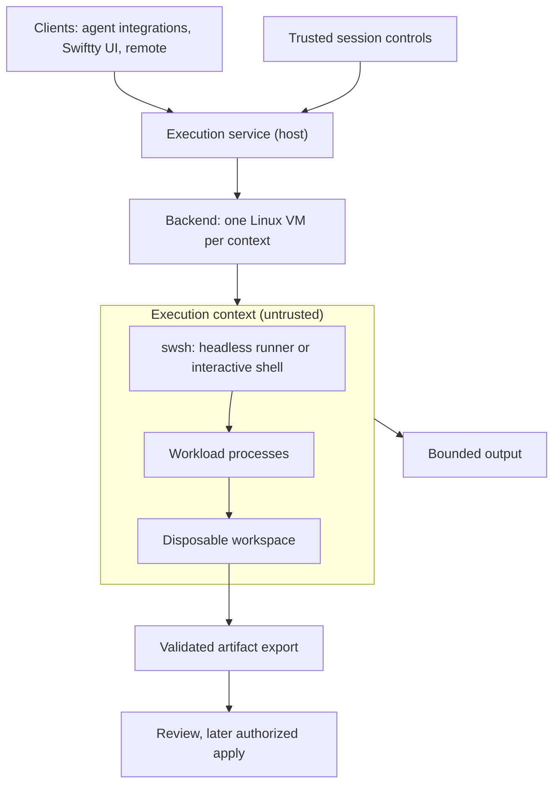

# Swift Native Shell — Revised Architecture Spec

**Updated:** 6 November 2026  
**Status:** Implemented on macOS and Linux; acceptance coverage is in §9, with recorded verification and scope limits in §10. §11 specifies confined execution for Swiftty (`SwifttyExec` execution contexts with `swsh` as the runner; proposed architecture, not an implemented security guarantee, with working-tree status in §11.6).  
**Baseline:** Swift 6.4.1, Swift 6 language mode, current Xcode 27 SDK/toolchain pairing, macOS 27.  
**References:** Brush for interpreter engineering; Swiftty for the native terminal application.  
**Architecture review revisions:** `78ee561d977bf4c1c25976126c07f8480370ec65` (shell baseline) and `ceb4c95ccb3940f112274a8064600e01a45c2b3d` (confined execution review).

## 1. Product and scope

Build `swsh`, a standalone Swift shell with its own documented language and conventional Unix process behavior. The same executable runs in an ordinary terminal and in a Swiftty terminal session. Swift owns parsing, expansion, evaluation, logical state, builtins, and job supervision. Darwin supplies processes, descriptors, pipes, terminals, and signals.

Bash and Zsh compatibility are outside the language roadmap. Their actual interpreters handle their scripts, startup files, plugins, and completion systems. The app continues to offer actual Bash/Zsh and the existing system-default/custom-shell route. Changing the preferred shell affects new sessions, not running processes or the account's system login shell.

Brush informs the separation of concerns, quoting discipline, descriptor planning, and tests. Its crate layout and compatibility goals are not requirements for this implementation. [Brush][brush]

### Baseline decision

Swift.org lists Swift 6.4.1, dated 12 October 2026; the Swift 6.4 release announcement confirms the relevant ownership and cleanup additions. Swiftty declares tools 6.4, macOS 27, and experimental `Lifetimes`. Use this current baseline and pin the exact compiler, SDK, and dependency revisions in CI. There is no older Swift or macOS implementation path. [Swift releases][swift-install] · [Swift 6.4][swift64] · [Swiftty manifest][swiftty-package]

The first runtime is Darwin. Organize Darwin-specific code clearly, but remove Linux parity from the initial acceptance gate. A future Linux backend requires its own launch and terminal proofs; the macOS design does not establish portability. This changes the previous sketch's early cross-platform commitment. The shell also builds, runs, and is tested on Linux (including interactive mode and job control), where `Package.swift` reduces itself to the shell targets (`Swsh`, `CSwshSupport`, `SwifttyExec`, `SwshAgent`, `SwshCLI`, `SwshTests`, and `SwifttyExecTests`) so `swift build` and `swift test` work unmodified; CI runs the `shell-linux` job and `Scripts/test-swsh-linux.sh` runs the same suite locally in Docker. Linux differs where Darwin facilities are missing (§11.6): signals arrive through a handler and a pipe read with `poll` instead of kqueue; a job-control launch forks and waits for `SIGCONT` before `execve` instead of starting suspended, so an `execve` failure is reported by the child with status 126 or 127; `exec` uses `execve`, installs a no-op handler for ignored signals and a recording handler for blocked ones before clearing the mask, and re-raises held signals under the restored mask if `execve` fails; the main thread only waits so an inherited signal mask is kept despite corelibs Dispatch; file names need not be valid UTF-8; and the editor display tests (which replay output through `SwifttyEngine`) are compiled out on Linux.

### Interpreter selection

| Invocation | Contract |
| --- | --- |
| `swsh file` or `swsh -c '…'` | Interpret the documented `swsh` language. |
| `swsh --agent` | Run the headless `swsh.run/1` runner loop for tools: no prompt, editor, history, completion, or startup files; preview typed pipelines and refuse `run` without a supplied execution context (§11.4). |
| `bash script.sh`, `zsh script.zsh`, or interpreter `-c` arguments | Resolve and execute the actual interpreter; pass the resulting argv without translating its program. |
| Executable script with a valid shebang | Use the OS interpreter-dispatch path. |
| Executable file with an unrecognized format | Report a launch error; do not retry with another shell. |
| `exec program args` in the main shell context | Replace the current process, preserving its PID and inherited job context. |
| Future `source`/`.` or `eval` | Evaluate `swsh` syntax in the specified `swsh` context. |

Extensions such as `.sh` never select an interpreter. Unsupported syntax is an error, not an automatic fallback. Child interpreters inherit the selected environment, cwd, descriptors, and job context; their private variables and directory changes do not mutate the parent shell. [Apple exec reference][execve]

## 2. Simplify the language deliberately

The initial release is a small native language, not a growing list of implicit Bash rules. These decisions replace the earlier default-IFS behavior.

### Initial language contract

- Source text is valid UTF-8, with byte offsets for diagnostics. Invalid source encoding and embedded NUL are rejected explicitly. Runtime arguments, environment values, filesystem names, and process output use byte-preserving representations; decoding for display is a separate operation. Reject NUL at argv/environment/path boundaries instead of silently truncating it.
- Support simple commands; single and double quotes; documented escapes; scalar assignments; `$NAME`, `${NAME}`, and `$?`; command lists; `&&`, `||`, and external pipelines. The growth contracts below add to this list.
- A scalar expansion contributes its bytes to one argument. It never undergoes implicit IFS splitting or becomes new syntax. An unset variable expands to an empty scalar; a word consisting only of that expansion is one empty argument. There is no implicit list expansion; the explicit `${name[@]}` form is specified in the second growth contract.
- Pathname expansion applies only to unquoted pattern syntax authored in the source. Initially support `*` and `?`; quoted characters and characters obtained from scalar values remain literal. A pattern with no matches is an expansion error. Sort matches by byte order, independent of locale. Bracket patterns, recursive globbing, brace expansion, and tilde rules can wait.
- A redirection target must expand to exactly one path. Zero or multiple matches are errors before that command launches.
- A standalone `NAME=value` updates shell state. `NAME=value external-command` supplies a temporary child-environment overlay. Prefix assignments to builtins are rejected initially, avoiding accidental special-builtin persistence rules.
- Resolve a command containing `/` as an explicit path. Otherwise resolve the fixed builtin set first, then PATH. Functions resolve after builtins and before PATH. Aliases, user-defined lookup hooks, and caches remain later features.
- Use `~/.swshrc` and a separate history store. Other interpreters own their startup files and completion frameworks.

For example, under this proposed language:

```sh
name='two words'
printf '<%s>\n' $name       # one argument after the format
printf '<%s>\n' "$name"     # also one argument
printf '<%s>\n' ""          # one empty argument
```

Removing implicit splitting reduces expansion contexts and surprises. Quoting still matters for whitespace in source, expansion suppression, and literal wildcard syntax. This is an intentional user-visible change from the previous sketch.

### Bound the first useful release

Initial stateful builtins: `cd`, `pwd`, `export`, `unset`, and `exit`. Simple utility builtins such as `:`, `true`, `false`, and a documented `printf` subset may be included when they eliminate a demonstrated cost. Explicit executable paths always permit an external utility.

External and supported builtin pipelines are implemented. Reject unsupported builtin stages before launching a pipeline. Functions, subshells, command substitution, and programmable completion follow the first contract below; arithmetic, heredocs, lists, control flow, traps, and automatic-exit policies follow the second.

### Language growth contract

Functions, subshells, command substitution, and native programmable completion are
part of the current scope. They do not introduce Bash compatibility.

- `name() { commands; }` defines or replaces a function, retaining its exact body
  source. Definitions are standalone, without redirects or `&`, and cannot replace
  fixed builtins. Lookup is explicit path, builtin, function, then PATH. A foreground
  standalone call runs in the current shell: assignments, exports, function definitions,
  completion registrations, and `cd` persist. Prefix assignments to functions are
  rejected. `$1` through `$9` and `$#` are scalar parameters; nested calls restore the
  caller's parameters. `return [0..255]` ends only the current function, defaulting
  to the last status. `exit` retains its shell-exit meaning. Function recursion and
  parsed compound nesting are limited to 16 levels, including the top parser level.
- Function redirections use supervised descriptor handoff and explicitly scoped I/O;
  they do not replace the shell process's standard descriptors. State still persists.
  Parent function redirects support destinations 0, 1, and 2; other destinations
  require a subshell or pipeline worker so they have a real process FD namespace.
  `exec` inside a redirected function is rejected until descriptor replacement and
  failure restoration have a separate proof. Pipeline/background function calls run
  in source workers and cannot mutate parent state.
- `( commands )` runs an isolated logical snapshot in a fresh source worker, preserving
  the inherited cwd and ordered redirects. It supports pipelines, background execution,
  nesting, and function lookup. The worker joins its outer job's process group; its
  children inherit that group. It has its own sole reaper and retires its children on
  exit. A child that stops itself also stops its supervising compound stage; resume
  continues the retained child. Ctrl-C ends the compound worker even before child
  launch. Terminal stop/continue signals reach the compound job. No Swift
  code runs between fork and exec. Worker nesting is bounded at 128 processes.
- `$( commands )`, also inside double quotes, starts a separately supervised expansion
  job. Each selected command expands assignments, words, and redirects once before
  launch; short-circuited commands do not expand. Output is drained while the worker
  runs, preserves arbitrary non-NUL bytes, removes trailing LF bytes, and contributes
  one scalar without splitting or value-origin globbing. Empty output is an empty
  scalar. A nonzero worker status, stopped substitution, NUL, or output above 1 MiB
  is an expansion error (status 2); a stopped/oversized producer is aborted and reaped.
  Completed substitution effects cannot be rolled back if a later expansion fails.
- Source workers receive exact body bytes and a value snapshot through the existing
  bounded, unlinked, exact-build payload file. They bypass startup/history/editor
  initialization and evaluate that body directly, without replaying already-expanded
  caller words. A private close-on-exec pipe announces that the worker has installed
  its child supervisor. The parent retains the read endpoint through reaping; EOF
  removes supervisor protection after `exec` or exit. Unannounced launchers remain
  abortable, including when blocked opening a redirect. `exec` replaces the worker
  only and still refuses live owned jobs.
- `complete command candidate ...` registers literal candidates (zero candidates
  suppresses fallback). `complete --function command provider` registers an existing
  function. The provider runs in an isolated worker with `$1` equal to the current
  unquoted token and `$2` equal to the input line. It prints one full candidate per
  LF-delimited line. Candidates are prefix-filtered, deduplicated, UTF-8 checked,
  and escaped before insertion; they are never parsed as executable source. Providers
  get `/dev/null` stdin/stderr, no terminal handoff, a one-second execution deadline,
  a 1 MiB output limit, and bounded job cleanup. Failure offers no completion and
  preserves the shell's status/state. Timeout terminates only the provider job.
  Quoted/escaped/expanded input remains outside the initial editor completion contract.

```sh
greet() { /usr/bin/printf 'Hello, %s\n' $1; }
greet 'two words'
value=$(greet world)
(cd /; pwd) | /bin/cat
complete greet Alice Bob
names() { /usr/bin/printf 'Alice\nBob\n'; }
complete --function greet names
```

### Second language growth contract

Arithmetic, heredocs, lists, control flow, traps, and automatic-exit policies are
part of the current scope. Like the first growth contract, they are native rules,
not Bash compatibility, and every ambiguity is an error instead of a guess.

- **Arithmetic.** `$(( expression ))` contributes one decimal scalar, also inside
  double quotes and unquoted heredoc bodies. Values are checked signed 64-bit
  integers: overflow, division or remainder by zero, a shift outside 0 through 63,
  and a non-integer operand are expansion errors (status 2). Operators, by rising
  precedence: `?:`, `||`, `&&`, `|`, `^`, `&`, `==` `!=`, `<` `<=` `>` `>=`,
  `<<` `>>`, `+` `-`, `*` `/` `%`, then unary `-` `+` `!` `~` and parentheses.
  Below them all, `,` runs both operands and yields the last, and assignment
  binds next loosest and to the right. `&&`, `||`, and `?:` evaluate only the
  selected operand. Literals are decimal or
  `0x` hexadecimal; a leading zero is decimal, never octal. Operands are `name`,
  `$name`, `${name}`, `name[index]`, `${#name[@]}`, and a nested `$(( ))`. An unset
  or empty name is 0. `name = value`, the compound forms `+=` `-=` `*=` `/=` `%=`
  `<<=` `>>=` `&=` `^=` `|=`, and prefix or postfix `++` and `--` assign a scalar
  `name` or a list element `name[index]` and yield the new value, or the old one
  for a postfix form. Only a bare name is assignable: `$name = 1` is an error, as
  are assigning a list without an index and an index beyond the list's end. `--`
  or `++` directly before a name is a decrement or increment; write `- -n` for
  two negations. Assignments happen in the current shell, in source order, as
  the command's words are expanded and before the command runs, so
  `echo $n $((n += 1)) $n` prints the old value, then the new one twice; a
  `${name[@]}` in the same command shows the list after all of them. In a
  substitution, pipeline stage, or other worker they change only that worker. An
  index in `name[index]=value` may assign too, as in `list[i++]=value`. Syntax is
  checked when the command is parsed. Text after `$((` that begins with a name or
  path and is not an expression remains a substituted subshell, as before; text
  that begins like an expression keeps its arithmetic diagnostic.
- **Heredocs.** `[n]<<word` and `[n]<<-word` supply the lines after the operator's
  line, up to a line equal to `word`, as descriptor `n` (default 0). `<<-` removes
  leading tabs from every body line and from the delimiter line. An unquoted
  delimiter expands `$name`, `${...}`, `$?`, `$( )`, and `$(( ))` in the body, with
  `\$`, `\\`, and backslash-newline as the only escapes; any quoting in the
  delimiter makes the body literal. Several heredocs on one line read their bodies
  in order. The body is one scalar: no splitting, no globbing, NUL rejected, at most
  1 MiB. It is delivered as a private unlinked file, so a body larger than a pipe
  buffer cannot block the launch. A heredoc body must end inside the function,
  subshell, substitution, or control-flow command that contains its operator,
  because a worker reparses exactly that source.
- **Lists.** `name=(words)` assigns an indexed list, `name+=(words)` appends, and
  `name[index]=value` replaces an element or appends at exactly the current count;
  `name+=value` appends bytes to a scalar. Indices are arithmetic. These forms are
  standalone assignments: they cannot prefix a command, and all updates in one
  command apply together or not at all. `${name[@]}` contributes every element as
  its own argument and must be an entire word, optionally double-quoted; an empty
  list contributes no arguments. This is the only expansion that produces more or
  fewer than one argument from a value. `${name[index]}` is one element and
  `${#name[@]}` the count. A name is a scalar or a list: `$name` on a list, a list
  form on a scalar, and an index outside the list are errors. Lists are not
  exported and cannot be assigned to an exported name; `unset` removes them. A list
  holds at most 65536 elements. Workers receive lists in their snapshot.
- **Control flow.** `if list; then list; [elif list; then list;]... [else list;] fi`,
  `while list; do list; done`, `until list; do list; done`, and
  `for name in words; do list; done`. The words `if`, `then`, `elif`, `else`, `fi`,
  `while`, `until`, `for`, `do`, and `done` are reserved only at command position.
  `for` expands its words once, as arguments, before the first iteration.
  `case word in [(]pattern[|pattern]...) list ;; ... esac` runs the list of the
  first clause with a matching pattern; the final `;;` is optional and a clause
  may be empty. A pattern matches the whole word: `*`, `?`, and bracket
  expressions written in the pattern are wildcards, while quoted characters and
  bytes from expansions are literal, as in pathname expansion. `{ list; }` groups a list. `case` and `esac`
  are reserved like the other words. A standalone foreground compound runs in the
  current shell, so assignments, `cd`, and function definitions persist. That
  includes one whose redirects name only descriptors 0, 1, and 2: they are scoped
  to the compound by the same supervised handoff as function redirects, so
  `while read line; do ...; done < file` keeps its variables. In a pipeline, with
  `&`, or with another redirected descriptor, the compound runs in a source worker
  and cannot change the parent. A compound's status is that of the last command
  run in its selected body, or 0 when no body ran. `break [n]` and `continue [n]`
  act on the `n`th enclosing loop of the current function (default 1); a count
  outside 1 through the number of enclosing loops, or use outside a loop, is an
  error. `! pipeline` inverts a pipeline's status. Ctrl-C ends
  a running loop: a batch shell exits with 130 and an interactive shell returns to
  the prompt with status 130, including when the signal was delivered only to the
  loop's foreground job. Control-flow lists count toward the 16-level nesting limit.
- **Bracket patterns.** An unquoted `[...]` in a word matches one character from
  the set, in pathname expansion and in `case` patterns: members, ranges such as
  `a-z`, and `[!...]` for any character outside the set. A `]` directly after
  `[` or `[!` is a member. The expression holds literal characters only, so a
  quote, backslash, or `$` inside it is a parse error, as is `[^`, which
  glob(3) and fnmatch(3) read differently. `[:class:]` members such as
  `[[:digit:]]` work in `case` patterns and are an expansion error in pathname
  expansion, where glob(3) does not honor them. A `[` with no `]` later in the
  same word, and any other `]`, are literal, so `[ -f file ]` runs the `[`
  program found on PATH. As with `*`, quote the brackets to pass them literally;
  a pattern without a match is an error, and brackets in a value never match.
- **Parameters.** `$$` is the process ID of the session's shell; workers report
  that same shell, not themselves. `swsh file argument...` runs the file with
  `$0` set to its path and the arguments as positional parameters;
  `swsh -c source [name [argument...]]` takes `$0` from `name`. Otherwise `$0` is
  `swsh` and there are no parameters. A function call replaces the positional
  parameters, not `$0`, until it returns. `$@` and `${@}` contribute every
  positional parameter as its own argument, under the whole-word rule of
  `${name[@]}`; with none they contribute nothing, also under `set -u`. `$@` is
  not limited to nine parameters, while `$1` through `$9`, also written `${1}`,
  remain the only numbered names; one past the last argument is unset, so
  `${2-word}` selects `word` and `set -u` rejects `$2`. `shift [n]` drops the
  first `n` parameters (default 1) and renumbers the rest; a count that is not
  0 through `$#` changes nothing and reports status 2. `local name[=value]...`,
  valid only in a function and not in a subshell inside one, saves each name's value,
  list, and export state and restores them when that function returns, however
  it ends; functions it calls see the local value. A name without a value
  starts unset. `shift` and `local` are rejected as pipeline stages. `${#name}` is a value's length in bytes.
  `${name-word}` uses `word` when `name` is unset, `${name=word}` also assigns it,
  `${name?word}` fails the expansion with `word` as its message (status 2), and
  `${name+word}` uses `word` only when `name` is set. With a colon (`:-`, `:=`,
  `:?`, `:+`) an empty value counts as unset. `word` extends to the closing brace:
  spaces are literal, quotes, escapes, and expansions apply, and it is a value,
  never a pattern. Only the selected `word` is expanded, so a substitution in an
  unused default does not run. These forms answer for an unset name themselves, so
  `set -u` does not apply to them; they are errors on a list, and a positional
  parameter cannot be assigned. Pattern-removal operators remain unsupported.
- **`read`.** `read [-r] name...` reads one line from standard input, without its
  newline, one byte at a time so the remaining input stays available to later
  commands. Backslashes are always literal, so `-r` is accepted and has no effect.
  One name receives the line exactly, including surrounding blanks. With several
  names, fields are separated by runs of spaces and tabs and the last name
  receives the rest of the line without surrounding blanks; names without a field
  become empty. Status 0 means a complete line; 1 means the input ended first,
  with whatever preceded it still assigned; 2 means a usage error, a line above
  1 MiB, or a NUL byte, with nothing assigned. `read` runs only in the current
  shell, so it is rejected as a pipeline stage: put the loop or a group in the
  pipeline instead. It polls for shutdown and Ctrl-C while waiting; an interrupt
  yields status 130 and ends an enclosing loop.
- **Policies.** `set -e`, `set -u`, and `set -o pipefail` (also `-o errexit` and
  `-o nounset`) enable a policy, `+` disables it, and `set` alone prints all three.
  `set` validates its whole request before changing anything and does not set
  positional parameters. Under `-e` a command that finishes with a nonzero status
  exits the shell with that status, except in an `if`/`elif`/`while`/`until`
  condition (including functions called from one), in any operand of `&&`/`||`
  but the last, after `!`, and for background jobs. Under `-u`, expanding an unset
  name is an expansion error; a name set to an empty value is not. Under
  `pipefail` a pipeline reports its last stage that failed, fixed when the job is
  launched. Workers inherit the policies with the rest of their snapshot.
- **Traps.** `trap source name...` registers `swsh` source for `EXIT` (or `0`),
  `HUP`, `INT`, and `TERM`, with or without a `SIG` prefix; `trap - name...`
  restores the default and `trap` alone lists registrations. Source is parsed when
  registered; an empty source ignores the signal. A trapped signal no longer shuts
  the shell down. Its trap runs at the next command boundary of the session
  driver, after any foreground job finishes, outside the interrupted function and
  loop, and `$?` is restored afterwards unless the trap calls `exit`. A trapped
  signal at the interactive prompt cancels the line being edited so the trap can
  run. The `EXIT` trap runs once when the shell exits normally, by `exit`, by
  `set -e`, or after a diagnostic, with `$?` set to the exit status, and may
  replace that status with `exit`. It does not run when an untrapped signal ends
  the shell. Traps are driver state: source workers start with none and run their
  own `EXIT` trap. `trap`, `set`, `read`, `break`, and `continue` are parent-shell
  builtins and are rejected as pipeline stages.

```sh
set -eu -o pipefail
trap '/usr/bin/printf "exit %s\n" $?' EXIT
files=(*.swift)
total=0
for file in ${files[@]}; do
  if /usr/bin/grep -q TODO $file; then total=$((total + 1)); fi
done
/bin/cat <<EOF
${#files[@]} files, $total with notes
EOF
count() {
  lines=0
  while read line; do
    case $line in
      '' | '//'*) continue ;;
      *) lines=$((lines + 1)) ;;
    esac
  done < ${1:?expected a file}
}
count ${files[0]}
{ /usr/bin/printf '%s: ' ${files[0]}; /bin/echo $lines; } >&2
```

## 3. Package shape

Start with two Swift targets and add a C target only for concrete operations that need it.

| Target or component | Responsibility |
| --- | --- |
| `Swsh` library | Concrete parser, syntax values, expansion, evaluator, builtin dispatch, logical state, Darwin/Linux process runtime, job supervision. Organize these into internal source directories. |
| `SwifttyExec` library | Confined-execution wire codec, `swiftty.exec/1` requests, grants, and context admission (§11.3). No dependency beyond SHA-256 on Linux; cannot reach the shell runtime or the app. |
| `SwshAgent` library | `swsh --agent` headless `swsh.run/1` request decoding, pure previews, and runner responses (§11.4). Depends on `SwifttyExec` only; holds no grants and no backend. |
| `swsh` executable (`SwshCLI`) | CLI arguments, interactive editor/history, startup policy, main session driver, private worker entry point, and `--agent` dispatch. |
| Optional `CSwshSupport` | Small C-only interfaces, macros, or truly async-signal-safe operations that cannot be expressed safely through existing imports. |
| Existing native app | SwiftUI/AppKit presentation, Swiftty, shell profiles, packaging, and optional presentation adapters. |

Do not create separate builtin, interactive, parser, and platform packages merely to mirror Brush. Extract a module when it has an independent consumer, a measured build-time benefit, or an invariant that access control cannot adequately express. Testing syntax does not itself require publishing a syntax module.

Use concrete types first. Delete the public `ShellParser` protocol, the general embedding/plugin registry, and the promise of arbitrary closure-based builtins. Those mechanisms create worker-serialization problems before there is a consumer. Keep test seams small and internal, such as a deterministic clock or a spawn-failure injection point.

Keep Swiftty out of the interpreter dependency graph. Do not import its terminal engine to borrow a small descriptor wrapper. Use Swift System where its path/error types earn a dependency, and a shell-owned resource owner for actual descriptor lifetime.

### Process library decision

Use one concrete Darwin job runtime for shell-owned processes. The inspected Swift Subprocess implementation monitors termination with `NOTE_EXIT` and reaps with `WEXITED`; that source review does not establish the stopped/continued event contract required by `fg`/`bg`. Its scoped execution API also has its own cleanup ownership. Do not combine its reaper with a second shell reaper for the same child. [Subprocess BSD monitor][subprocess-bsd] · [Subprocess Unix reaping][subprocess-unix]

Subprocess 1.0 remains a good candidate for isolated development tools or test helpers. Replacing the shell job runtime with it later is acceptable only if one owner can provide every required lifecycle operation. There is no speculative pluggable-backend framework in version 1. [Subprocess release][swift64]

## 4. Ownership and data representation

Use ordinary Swift values for information that should be copied and noncopyable values for resources that must have one owner.

| Data | Representation and invariant |
| --- | --- |
| Source and syntax | Owned UTF-8 buffer plus source ranges and value-type syntax nodes. A parsed program retains its source owner. |
| Parser cursor | Concrete synchronous parser; use `Span<UInt8>` for short-lived reads. A noncopyable cursor is reasonable if it owns scratch storage. |
| Variables and logical snapshots | Value types with ordinary arrays/dictionaries. Audit nested references so copy-on-write state is not secretly shared mutable state. |
| Owned OS descriptor | `OwnedFD: ~Copyable`; explicit adoption, duplication, consuming transfer, and close. Hide unrestricted raw-number construction. |
| Borrowed descriptor | Scope-bound access to an existing owner; no second owner constructed from its raw number. |
| Launch resource collection | `UniqueArray<OwnedFD>` or an equally small typed owner of descriptor slots. |
| Job/process identity | Stable shell `JobID` and child records; raw PIDs are OS coordinates, not persistent application identities. |
| UI snapshots | Small owned `Sendable` values, containing display data rather than live resources. |

Swift 6.4's `UniqueArray` can contain noncopyable elements, which makes the launch resource collection expressible without custom reference-counted FD bags. Swiftty already demonstrates a noncopyable descriptor with a destructor; it does not currently use `UniqueArray`, so that collection choice is a new proposal for `swsh`. [UniqueArray][unique-array] · [Swiftty descriptor][swiftty-fd]

An `OwnedFD` destructor is the synchronous close backstop. Explicit close/transfer operations handle operational errors and predictable timing. Process termination, terminal restoration, and child reaping are asynchronous lifecycle work and do not belong in a destructor. Duplication creates a new descriptor owner but can share the same underlying file offset and status flags; logical snapshot copying does not duplicate kernel state.

### Borrow locally, own across boundaries

Borrow bytes while parsing; store source ranges in long-lived syntax. Never put a borrowed span into a queued request, persistent AST, worker envelope, escaping closure, or UI model. End borrows before suspension, mutation, and transfer to another owner. Derive a new span from the retained owner at the point of use. [Span][span]

Use `InlineArray` only for genuinely fixed-size scratch storage. Do not encode arbitrary command length, pipeline width, or nesting as a fixed array. `OutputSpan`, `withTemporaryAllocation`, `Ref`/`MutableRef`, and borrow/mutate accessors can remove specific copies, but are not reasons to invent custom containers. Start with the smallest standard representation and measure hot paths. [Swift 6.4 ownership additions][swift64]

### Experimental feature policy

Adopt current language features without older substitutes. Keep Swiftty's existing `Lifetimes` setting for its custom borrowed APIs. Standard span/iteration use does not generally need custom lifetime annotations; user-defined lifetime dependencies still have experimental requirements in the implemented Iterable proposal. Enable them in `swsh` only when a concrete borrowing interface needs them. This is precise feature scoping, not an older-toolchain path. [Iterable][iterable] · [Swiftty snapshot][swiftty-snapshot]

## 5. State, execution, and error boundaries

Keep parser, expansion, builtin dispatch, and evaluator transformations synchronous within the session's ownership domain. Asynchronous operations wait for I/O or process state; they do not automatically imply independent actors.

One interactive session owns one process. Initially use a physical-cwd policy, with an owned directory handle and a display path that may need refreshing after external renames. Only the execution driver changes cwd; asynchronous completion scans use their captured directory context. The reusable library does not promise multiple full terminal sessions embedded in one process. This removes the need to virtualize every process-global operation for an unrequested embedding product.

A concrete parser returns complete, incomplete, or invalid input. Incomplete interactive input requests continuation. Parse and expansion failures produce diagnostics and status 2. A nonzero program exit remains ordinary result data. Internal syscall or transport failures may throw a specific error type where the failure set is useful and closed. Do not convert every result into typed throws.

Retain separate evaluator control flow for normal continuation, shell exit, and function return. Keep that internal. The public session result should report completed work, stopped jobs, or scheduled background work; it should not expose hypothetical loop-control cases before those language features exist.

### One command driver

A session actor may expose submission, cancellation of a queued request, job actions, and snapshots. One explicit FIFO driver is the only code permitted to execute top-level requests and mutate language state. A second submission may be queued during suspension but must not begin evaluation then.

Child notifications may update the job table while an execution awaits a foreground result. Reentrancy is useful for those notifications; it must not admit a second evaluator. Capture an immutable launch context before suspension. A snapshot states whether it describes committed shell state or an in-flight command; it must not expose half-applied mutations.

Use `nonisolated(nonsending)` where an async helper should stay in the caller's isolation, with the intended `NonisolatedNonsendingByDefault` behavior enabled explicitly. Keep the interpreter's default isolation non-main-actor. Use `@concurrent` for deliberately independent CPU work, not as a workaround for blocking reads or waits. Blocking OS operations need an appropriate dedicated thread/queue or event-driven bridge. [Async isolation][isolation]

Use `Sendable` for transferred values and `sending` for actual ownership transfer where needed. Neither makes a value serializable to a worker process.

### Separate three lifetimes

| Lifetime | Owner and completion |
| --- | --- |
| Submission/observer | A command ID and its waiters. Cancelling a waiter removes that waiter; it does not kill an already accepted job. |
| Foreground terminal ownership | A lease that ends when a job completes, stops, or is deliberately backgrounded. Restores shell foreground group and terminal modes. |
| Job | The session-lifetime supervisor until direct children have been reaped and the job reaches its final state. Stopped/background jobs remain registered. |

Foreground waiting returns a disposition such as `completed(JobResult)` or `stopped(JobID)`. `&`, introduced with interactive jobs, returns `scheduled(JobID)`. `fg` reacquires terminal ownership and resumes the existing job; it does not create a replacement process. Initially a stopped foreground job ends its current submission: remaining commands in that submission do not run automatically, and `fg` resumes the job rather than replaying that remaining source. This is an explicit native-language policy to test and document.

Keep separate terminal-mode snapshots for the shell's editor, the baseline used for new foreground commands, and each stopped job. Before launching a new foreground command, leave editor mode and install the command baseline. When a foreground job stops, capture its current modes before restoring the shell's foreground group and editor modes. On `fg`, transfer foreground ownership, restore that job's saved modes, then send SIGCONT; a mode-restoration failure must not resume the job. `bg` sends SIGCONT without installing job modes or transferring terminal ownership. On completion, restore the shell's modes without retaining a resumable job snapshot. Terminal operations must use the controlling-terminal handle, independent of command redirections. [Terminal mode handoff][job-terminal-modes]

A per-command task group must not own a job that can outlive the command's foreground wait. A session-scoped supervisor may use `withDiscardingTaskGroup` for its long-lived services, with explicit shutdown. A normal failed command must not throw out of that group and cancel unrelated jobs.

### Cancellation and cleanup

Swift task cancellation, terminal-generated signals, and explicit job termination are different actions:

- Ctrl-C while editing clears/cancels the edit.
- Ctrl-C while a job owns the terminal follows terminal/process-group signal delivery.
- Cancelling a completion request or UI wait does not send a signal.
- Interrupt/terminate actions target the identified live job deliberately.
- Closing a session runs the documented shutdown policy and awaits owned cleanup.

Use Swift 6.4 async calls in `defer` to await cleanup, and `withTaskCancellationShield` only around the critical cleanup that must finish despite caller cancellation. Keep that work bounded and define an escalation deadline; never shield an unlimited foreground wait. Do not use detached cleanup tasks. [Async defer][async-defer] · [Cancellation shields][shield]

Terminal reclamation occurs after both completion and stopping. Reaping occurs only after termination. If terminal restoration fails, report it and stop accepting interactive input rather than presenting a prompt as if the terminal were healthy. A process stuck in a kernel operation may outlast a teardown deadline; retain a responsible supervisor or terminate the session under an explicit failure policy instead of claiming all resources have been reclaimed.

### Session shutdown policy

An accepted `exit`, EOF at an empty interactive prompt, completion/EOF of batch input, terminal hangup, and an explicit app close request all initiate shutdown. EOF while a foreground command reads its input belongs to that command, not to the shell driver. Version 1 does not detach jobs or ask for a second exit confirmation. The app requests graceful shutdown and allows the deadline below before forcing termination; abrupt SIGKILL or app/process failure cannot promise shell-owned cleanup.

Shutdown is idempotent: stop accepting submissions, cancel queued work, abort unfinished launches, and retain the child-status owner until cleanup finishes. At shutdown time zero, send SIGHUP and SIGTERM to active owned jobs, then SIGCONT so stopped jobs can process termination. Children still behind the internal launch barrier receive SIGKILL directly and must never be released to execute user code. At two seconds, send SIGKILL to remaining external processes. A source worker that has announced an active child supervisor retains responsibility for its descendants and is allowed to finish reaping within the same five-second outer bound; do not kill its whole group while that supervisor is active. Its own supervisor escalates external leaves. An unresponsive supervisor still causes incomplete-cleanup status 1 at the deadline, never a false success. At five seconds, end the cleanup wait. These are monotonic deadlines from shutdown initiation; cancellation does not reset them. Explicit launch abort uses the same bounded cleanup, scoped to that launch.

In job-control mode, signal only registered, still-live job groups; in inherited-group mode, signal only individually tracked, unreaped children, never the shared process group. Serialize signaling and reaping through the supervisor so a retired PID/group record is never used for a later escalation. Descendants that leave a job group are outside this ownership guarantee; inherited-group mode guarantees cleanup only of direct children.

Reclaim foreground ownership and restore the pre-editor terminal modes before shell exit if the terminal remains available. A hangup makes terminal restoration best-effort but does not skip child cleanup. If all direct children are reaped and required restoration succeeds, preserve the requested exit status (or the last command status for normal EOF); hangup exits with `128 + SIGHUP`. If the five-second deadline expires or required restoration fails, report incomplete cleanup where an output channel remains, terminate the shell with status 1, and let the OS adopt any unreaped children. Do not report those children as reaped or retain detached cleanup tasks.

## 6. Process and pipeline runtime

### Native process boundary

Use `posix_spawn` to start external commands and fresh `swsh` workers. Do not continue executing Swift runtime code in a forked child before exec. A tiny C path is justified only for a proven setup gap and must remain within permitted low-level operations. [Apple Swift/fork guidance][fork]

The app starts the outer shell with a PTY and controlling-terminal setup. Inner jobs inherit that terminal session. They do not each get a new PTY or call `setsid`.

Specify two execution modes. Interactive job control assigns each job a distinct process group and owns foreground-terminal handoff. Batch and job-control-disabled execution keeps children in the inherited process group; it must not move them into a background group without a handoff or signal that shared group during cleanup. In inherited-group mode, cleanup addresses owned children individually. A nested interactive shell first checks that its group is foreground, waiting/stopping until foregrounded instead of stealing the terminal or spinning with SIGTTIN ignored.

Set child signal dispositions and masks explicitly before exec. Undo shell-installed ignored dispositions for signals that children must receive, including terminal job-control signals and SIGPIPE. No Swift allocation or actor operation runs from an async signal handler.

### Ordered descriptors and streaming

Represent redirects as an ordered action list. Apply pipeline wiring first, then command redirects. These must remain observably different:

```sh
command >out 2>&1
command 2>&1 >out
```

Use kernel pipes for command data. Do not route ordinary pipeline output through Swift strings, observation properties, or an unbounded async stream. Builtins use explicit I/O contexts; they do not temporarily redirect the app process's standard descriptors.

Set close-on-exec by default and explicitly pass required descriptors. Keep private worker/metadata descriptors disjoint from user-visible descriptor numbers, including when relocating them to avoid a redirection collision.

Filesystem redirections may block, including when a FIFO waits for a peer. Do not open user paths in the launch owner or in spawn file actions before the group barrier is released. For external commands with path-opening redirects, spawn a fresh private `swsh` launcher containing the resolved executable, argv/envp, and ordered descriptor actions. After release, each launcher independently applies its redirects and replaces itself with the external executable, retaining its PID and group. Pipe wiring and nonblocking descriptor duplication/closure may occur before release; preserve the specified redirect order afterward. A redirect-open failure prints a diagnostic through the descriptor state reached so far and exits with status 1; replacement failures use 126/127. Other stages continue and the ordinary last-stage status rule applies.

Use the bounded file payload from §7 for this launcher too, and close its private descriptors before replacement. This narrow external-launch path is required in slice 2; worker-backed builtins and user-facing `exec` remain slice 5. It runs in a freshly spawned process, never in a forked Swift runtime. A blocked launcher is already registered and independently signalable, so it cannot prevent later stages from starting or prevent the supervisor from initiating bounded cleanup. Moving a blocking open onto a parent thread alone does not meet this contract. [Spawn file actions][spawn-file-actions]

### Coordinated launch, not rollback

The launch owner allocates resources, prepares stages, registers each successful child before its next suspension, establishes the job group, and starts observation. It closes parent copies of pipe endpoints as soon as the launch no longer needs them.

An ordinary command lookup/permission failure without redirects records a synthetic completed result of 127/126 for that stage and closes its unused endpoints so neighbors see normal EOF/broken-pipe behavior. With redirects, a supervised private launcher applies the ordered actions before reporting the pending lookup failure; a redirect-open failure takes precedence with status 1. Remaining valid stages still launch; the last syntactic stage determines the final pipeline status even if that stage is a synthetic failure. If no stage creates a process, skip process-group creation and terminal handoff. An infrastructure failure that prevents a coherent launch terminates and reaps already-created children, including children still suspended during setup.

Cleanup cannot roll back a truncated output file or effects from a command that already ran. The spec therefore makes resource-cleanup guarantees, not transactional filesystem guarantees.

### Darwin launch synchronization candidate

For interactive job-control mode, the preferred prototype uses `POSIX_SPAWN_START_SUSPENDED` with explicit process-group attributes: create the first actual child as the suspended leader, join subsequent stages to that group, register every child, transfer foreground terminal ownership if required, and resume the assembled group with SIGCONT. This keeps the leader alive during group assembly and prevents user code from reading the terminal before handoff. Apple's documentation describes the suspension flag; the whole shell sequence still requires a runtime proof on the selected SDK. In inherited-group mode, do not use group-wide SIGCONT as a launch barrier. [Darwin spawn flags][spawn-flags]

The suspended child may be the private external launcher described above. No user-path open may precede its release. In inherited-group mode, start launchers without startup suspension and continue launching remaining stages without waiting for their redirects or replacement to finish. Prove both modes with an existing FIFO and `/bin/cat <fifo | /bin/sh -c 'echo ready >fifo'`, and prove shutdown with a FIFO that never acquires a peer. Do not substitute O_NONBLOCK for the command's requested blocking I/O semantics.

Treat setup suspension as internal launch state, distinct from a user stopping an active job. Explicit launch abort, session shutdown, or an infrastructure failure during a later spawn must also clean up the suspended children. Cancelling an observer is not a launch abort. If the probe fails, select a verified launcher barrier before shipping; do not introduce an untested generic portability layer.

### One child-status owner

One event source wakes the session's reaper, which drains nonblocking child-status operations for owned children and records exited, signaled, stopped, and continued states. Notifications can coalesce; correctness comes from draining kernel state, not counting notifications. Avoid blocking the cooperative executor and avoid competing reapers.

Keep individual stage results. A completed pipeline initially returns its last stage's status. A signaled process maps to `128 + signal` at the shell boundary while retaining its structured signal result internally. Stopping is a separate disposition, not a fabricated final exit status. [Job-control reference][job-control]

Aggregate state only after launch assembly has finished or entered abort cleanup. A pipeline is completed when every syntactic stage has a final result and every created direct child has been reaped; synthetic lookup failures count as final stages without children. It is stopped when at least one live child remains and every live child is stopped. Any running child keeps the job running, even if another stage is stopped or the last stage has exited. Internal setup suspension never produces a user-visible stopped disposition. Drain available child transitions before deriving the aggregate state and returning the foreground lease.

Preserve the last syntactic stage's final result while waiting for other stages; status selection is independent of completion detection. Before resuming with `fg` or `bg`, mark the resumed live children as awaiting continuation so stale stopped flags cannot immediately end the new wait; reconcile subsequent stopped, continued, and terminal events through the same status owner. A partially stopped pipeline keeps its foreground lease until all remaining children stop or finish, or an explicit job action backgrounds/terminates it.

### Literal exec

`exec` replaces the active shell image and preserves the root PID/session lifecycle. Spawning a child and exiting the shell is not an implementation of this contract. In a worker it replaces only that worker.

Begin with command replacement using inherited descriptors and explicitly constructed argv/envp. Reject exec-only descriptor changes and other decorations until failure behavior is proven. If a replacement attempt fails after cwd, descriptors, or signal policy changed, restore the required state before continuing or apply a specified terminal failure/exit policy. Explore Darwin `POSIX_SPAWN_SETEXEC` to reuse launch planning, but do not assume failed replacement is automatically reversible. [Apple exec][execve] · [Darwin flags][spawn-flags]

## 7. Private launchers and later worker execution

Slice 2 uses the private external launcher and bounded startup handoff described in §6. That launcher applies descriptor actions and replaces itself; it does not evaluate shell language or execute builtins. The remaining worker execution semantics below begin in slice 5.

Select private entry points before interactive initialization or startup-file loading. Neither launchers nor builtin workers read `~/.swshrc`, initialize history, emit prompt metadata, or create a new terminal session. Validate the payload kind and exact build identity before executing its actions. The external launcher closes its payload descriptor after decoding, applies redirects only after release, and restores the intended child signal mask/dispositions before replacement.

Real process workers remain the default for pipeline builtins and future compound stages. A Swift task cannot independently participate in Unix stop/continue, process groups, or process replacement. Do not add a second task-based pipeline backend before a concrete product requirement justifies its different semantics.

Start with an exact-build private request containing a builtin identifier, already-expanded argv, and the minimal isolated logical context it needs. Do not serialize the whole AST, arbitrary closures, or live job objects. The worker executes the received builtin directly and exits; it must not recursively re-enter the path that launches another worker for the same stage.

Scalar/path expansion remains synchronous. The driver resolves command substitutions through separately supervised expansion jobs, replacing each result with literal bytes before scalar/path expansion. Substitutions are never evaluated again by a launcher or builtin worker.

Compound workers send exact self-contained body source bytes with an untouched logical snapshot; diagnostics inside a body use byte offsets in that body. Reparse with the same executable/parser build; never reconstruct source by joining expanded argv. Source replay applies only when the parent has not already evaluated that source. A build mismatch is an error; there is no cross-version worker protocol promise.

### Simple startup handoff

Use a completely written, bounded payload in a private, immediately unlinked temporary file, one per worker, inherited through an explicitly assigned descriptor. Create it exclusively with mode 0600, include payload length and build identity, and validate bounds/truncation before allocating from claimed lengths. Reset the offset before handing it off and close the inherited payload descriptor before running user code or descendants. Do not share a mutable seek cursor between workers.

This removes a real deadlock: writing a large payload into a pipe while its reader is startup-suspended can block the parent before it sends SIGCONT. A later streaming transport must feed readers after resume and own its writers concurrently.

The file handoff has measurable I/O cost and may contain private session values. Keep payloads out of argv/logs, omit unnecessary state, and do not request durability synchronization. Optimize to anonymous memory-backed storage only if measurements justify it. Logical snapshots transfer values; descriptor mappings deliberately transfer access to OS resources.

## 8. Swiftty integration

Reuse `SwifttyMac`/`SwifttyCore` for the app. Keep terminal VT parsing, rendering, selection, scrollback, and input encoding in Swiftty. The shell owns command language, editing/history/completion, and its job table. [Swiftty manifest][swiftty-package]

Preserve each selected shell's executable, argv, environment, cwd, and login/interactive policy. Do not insert a `swsh` wrapper around actual Bash/Zsh or force new startup flags. Keep system-default and custom-shell selection. Bash/Zsh hosting remains an app regression requirement, independent of `swsh`'s language.

### Correct the lifecycle seam

The earlier direct `session.start(launch)` example avoids lossy string-based command parsing, but bypasses work performed by `TerminalView.start()`: grid preparation, lifecycle flags, color scheme, and frame driving. Replace that example with a small integration improvement: let `TerminalView.start` accept an explicit `SessionConfiguration` while retaining the complete existing start sequence in one place. This is a proposed API change, not an existing overload. [TerminalView][swiftty-view]

Construct/start once per session, outside repeated SwiftUI view updates. One app-owned coordinator owns start, event forwarding, resizing integration, stop, and teardown. If Swiftty is not edited, that coordinator must preserve the same lifecycle with the current APIs and prove it in integration tests.

### Reuse existing passive metadata

Swiftty already processes OSC 7 directory data and OSC 133 prompt/command boundaries. Its event extraction exposes working-directory and command-finished values; opt-in OSC 7501 offers program status. Use those for passive presentation before designing another IPC transport. Emit terminal metadata only through an optional terminal presentation component, never into redirected command data. [OSC dispatch][swiftty-osc] · [Semantic prompts][swiftty-shell] · [Terminal events][swiftty-state]

These values are display metadata: some are coalesced, and any terminal program can emit escape sequences. They are not a complete job log or an authoritative command/result API. Exact app-triggered or agent-triggered execution requires request IDs, submission rules, bounded transport, and a deliberate control protocol; §11 specifies that confined execution context (`SwifttyExec`) and the headless runner (`swsh --agent`).

`TerminalView` installs the session's event/update callbacks and currently forwards title/exit only. Add a small view-level terminal-event forwarding hook, or compose callbacks once after construction while preserving the installed handler. Do not overwrite it. Avoid calling the session's synchronous `snapshot()` from its own callback queue; use its documented safe state access and pass owned data to the main actor. [TerminalView][swiftty-view] · [TerminalSession][swiftty-session]

An app-local `@MainActor @Observable` model owns display state. Terminal bytes and child-state events remain explicit streams. Observation must not be used to deliver exactly-once job completion.

### Change boundary

Ordinary commands, pipelines, job control, and exec are implemented inside `swsh`. The app needs shell selection, distribution/signing, and lifecycle integration. The recommended launch-configuration and event-forwarding refinements are small Swiftty/app integration changes; they are not a new terminal command executor. A jobs inspector or structured execution API is additional work outside `swsh` as well as inside it (§11).

## 9. Implementation order and acceptance evidence

| Slice | Deliverable | Gate |
| --- | --- | --- |
| 0. Runtime proofs | Current toolchain smoke build; suspend/group/handoff probe; ownership and cleanup compile probes | Exact Swift/SDK build recorded; failure paths demonstrated in helper processes. |
| 1. Syntax and state | Concrete parser, source ownership, scalar expansion, builtin state, ordered redirects | Versioned fixtures; no implicit splitting; invalid input has deterministic diagnostics. |
| 2. External execution | External commands/pipelines, narrow redirect launcher, and one child-state owner | Streaming, FIFO progress/abort, FD cleanup, exit statuses, failure injection, and bounded launcher payloads. |
| 3. Interactive jobs | Editor/history, terminal lease, stopped/background jobs, `fg`/`bg` | Prompt returns after stop; jobs survive; modes and foreground group restore. |
| 4. Swiftty app integration | Exact launch profiles, correct view lifecycle, passive metadata | Real Bash/Zsh regressions plus `swsh`; ordinary execution also works in another terminal. |
| 5. Additional process semantics | Worker-backed builtin stages; separately proven exec | No startup-payload deadlock; no recursive worker launch; PID continuity and failed-exec policy. |
| 6. Language growth | Functions, subshells, command substitution, programmable completion | CompoundParserTests, LanguageGrowthTests, state/FD/signal isolation and bounded provider execution. |
| 7. Second language growth | Arithmetic, heredocs, lists, control flow, `set` policies, traps | LanguageGrowthSyntaxTests and process/PTY LanguageGrowthTests: checked arithmetic, body delivery above a pipe buffer, all-or-nothing list updates, parent versus worker state, `set -e` exemptions, trap ordering, and loop interruption. |
| 8. Parameters and input | `read`, `case`, `{ }`, `$@`, `$$`, `${name-word}` family, `break n`, parent redirects for compounds | ParameterSyntaxTests and process/PTY LanguageGrowthTests: lazy operand selection, literal values in patterns, state kept by redirected loops, unread input left for later commands, interruptible `read`. |
| 9. Scripts | `swsh file args`, `$0`, `shift`, `local`, arithmetic assignment, bracket patterns | ScriptSyntaxTests and process LanguageGrowthTests: assignment order within a command, worker isolation, restore of scalars, lists, and export state on every function exit, literal brackets from values and quotes. |
| Later language growth | Pattern-removal operators, positional `set`, `getopts` | Each feature requires its own semantics; no feature-parity gate. |

The app prototype can begin in parallel using an existing shell. Shipping with `swsh` depends on its interactive-job gate, not on every future language construct.

### Failure-focused verification matrix

Python test names refer to [Scripts/test-swsh.py](Scripts/test-swsh.py) and its
imported [language failure tests](Scripts/swsh_language_tests.py). Swift
suites are under [Tests/SwshTests](Tests/SwshTests) unless another target is named.
`RuntimeFaultTests` runs each named fault in an isolated helper process. The table
maps required behavior to executable assertions; recorded run scope is in §10.

| Case | Required evidence | Tests |
| --- | --- | --- |
| Empty/unset scalar; whitespace and wildcard bytes in values | Exact argument boundaries; no implicit splitting or value-origin glob syntax. | `test_scalars_and_assignment_state`, `test_environment_overlay_and_raw_bytes`, ExpansionTests, language-v1 fixtures |
| Redirect order; zero/multiple redirection targets | Correct stream routing and pre-launch diagnostics. | `test_redirect_order`, `test_prelaunch_rejection`, PreparationTests, ExpansionTests |
| FIFO reader and writer in different pipeline stages, in both execution modes | Opens occur after launch release; later stages execute and unblock earlier stages; no parent/spawn barrier deadlock. | `test_fifo_launch_progress`, `test_interactive_fifo_and_background` |
| FIFO with no peer; redirect open or launcher replacement fails | Supervisor remains responsive; bounded abort reaps the launcher; failure yields the specified stage status without aborting valid neighbors. | `test_fifo_without_peer_is_interruptible`, `test_parent_builtin_fifo_and_shutdown`, `test_redirect_failure_keeps_neighbor`, `test_private_launcher_replacement_failure_keeps_neighbor` |
| `yes \| head -n 1`; large binary/stderr output | Streaming, SIGPIPE/EOF behavior, no buffer deadlock. | `test_pipeline_streaming_and_status` |
| Missing middle stage; failed later spawn | Documented per-stage status versus infrastructure cleanup. | Pipeline streaming test; RuntimeFaultTests `later-spawn` |
| Fast first stage with delayed later stages | Stable group assembly with no vanished leader race. | SpawnTests `suspendedGroupAssemblyAndRelease` |
| Explicit abort/session shutdown during suspended launch | Every created child is registered, terminated, and reaped. | SpawnTests `abortDoesNotExecuteSuspendedChild`; RuntimeFaultTests `shutdown-before-release` |
| Batch execution attached to a TTY; background-started nested shell | Inherited groups behave correctly; the nested shell does not steal the terminal. | `test_batch_attached_to_tty_keeps_inherited_foreground_group`, `test_background_nested_shell_waits_for_foreground` |
| Ctrl-Z then prompt, `jobs`, `bg`, `fg` | Stopped job outlives the original wait and resumes correctly. | `test_stop_background_foreground_and_interrupt` |
| Raw-mode helper stopped and resumed through `fg`/`bg`; injected terminal-mode failure | Job modes saved before editor restoration and restored before foreground SIGCONT; `bg` leaves shell modes intact; failed restoration does not resume the job. | `test_raw_job_modes_survive_fg_and_bg`, RuntimeFaultTests `restore-before-resume` |
| Mixed running/stopped/exited stages; last stage exits first; synthetic failures; coalesced notifications | No premature prompt or completion; all live children must stop for stopped disposition; all created children reaped for completion; last-stage result retained. | JobStateTests, `test_mixed_pipeline_waits_for_all_live_stages`, RuntimeFaultTests `coalesced-status` (20 child exits accumulated before servicing notifications) |
| Repeated stop/resume and setup suspension | Stale stopped flags do not end a new foreground wait; launch suspension never appears as a user stop. | `test_repeated_stop_resume_does_not_use_stale_flags`, JobStateTests, suspended-launch probes |
| `exit`, prompt EOF, batch EOF, hangup, app close with running/stopped jobs | Shared shutdown policy, correct group versus individual targeting, and requested exit status retained on successful cleanup. | `test_shutdown_triggers_retire_running_and_stopped_jobs` (exit, prompt EOF, hangup), `test_batch_completion_retires_running_and_stopped_jobs`, `test_shutdown_escalates_for_term_ignoring_child`, `test_hangup_and_foreground_eof`; SwifttyCoreTests ShellShutdownTests |
| Shutdown during launch; TERM-ignoring child; injected missed cleanup deadline | Barrier children never execute; escalation at two seconds and failure exit at five; no detached cleanup or false reaping report; no signals to retired identities. | RuntimeFaultTests `shutdown-before-release`, `missed-cleanup-deadline`; supervisor signals only stages retaining live PID |
| Cancelling a UI observer/completion task | No accidental job termination. | RuntimeFaultTests `cancel-observer` |
| Cancel during terminal cleanup | Awaited cleanup; no detached work or unbounded shield. | RuntimeFaultTests `cancel-before-cleanup`, `cancel-during-cleanup`, `cancel-cleanup-restore-failure` |
| Worker payload larger than a pipe buffer; truncated/wrong-build payload | No startup deadlock and deterministic rejection. | LauncherPayloadTests; builtin-worker large-payload process tests |
| Builtin pipeline state changes | Parent variables/cwd unchanged; no recursive worker spawn. | BuiltinWorkerTests; `test_builtin_workers_isolate_state_and_select_last_status` |
| Repeated jobs and failed launches | Stable FD/child counts and bounded completed-job retention. | RuntimeFaultTests `batch-retention`, `redirect-retention` |
| Actual Bash/Zsh invocation and profiles | Real interpreter, exact arguments/startup/environment/cwd; no emulation. | `test_real_interpreters_and_no_format_fallback`; SwifttyAppTests ShellViewLifecycleTests |
| Swiftty start/stop/reattach and callback activity | Correct layout/lifecycle, preserved callbacks, no synchronous queue deadlock. | ShellViewLifecycleTests, ShellShutdownTests, workspace coordinator/attachment suites |
| Prompt/status metadata bursts and forged sequences | Display-only interpretation; never mistaken for authoritative control responses. | ShellViewLifecycleTests `forgedCompletionBurstDoesNotEndSession` |
| Exec success/failure in main and worker contexts | Expected PID continuity, close-on-exec policy, and failed-replacement behavior. | Python ExecTests (PID, environment, descriptors, masks, recovery, live-job refusal) |
| Lookup failures with redirects | Apply ordered redirects before reporting 126/127; redirect-open failures return 1; FIFO setup remains supervised. | `test_lookup_failures_apply_ordered_redirects`, `test_missing_command_fifo_redirect_remains_supervised` |
| Wrapped editing, scrolling, and resize | Backspace, Ctrl-U, completion, and history leave no stale editor rows; width/height changes preserve repaint origin. | `EditorDisplayTests` (rendered through SwifttyEngine), `test_wrapped_editing_completion_history_and_resize` |
| Idle input and flushed readiness | Shutdown interrupts idle batch input; editor reads cannot block after Ctrl-C flushes the input queue. | `test_shutdown_while_batch_source_pipe_is_idle`; RuntimeFaultTests `nonblocking-editor-input` |
| History/completion edge cases and low FD limits | Persistence across processes; byte/entry eviction; safe candidate insertion; partial allocation failure leaves FD inventory unchanged. | HistoryCompletionTests, LanguageGrowthTests history reload, RuntimeFaultTests `low-fd-pipe`, `low-fd-payload`, `low-fd-handoff` |
| Compound language and programmable completion | Parent state versus worker isolation, scoped redirects, return/recursion, single byte-preserving capture, stop/resume/interrupt, bounded provider execution. | CompoundParserTests, LanguageGrowthTests |
| Nested source-worker cleanup | TERM-resistant descendants disappear after batch TERM/HUP, PTY hangup, substitution overflow, and provider timeout; no surviving/zombie PIDs or shell FD leaks; unrelated background jobs survive. | LanguageLifecycleTests |
| Source-worker startup and exec | Context/build/kind/encoding/depth validation, oversized snapshots, supervisor announcement/EOF, and exec replacements remain subject to escalation. | SourceWorkerPayloadTests, WorkerLeaseTests, LanguageLifecycleTests |
| Compound interactions | Nested ordered redirects restore parent I/O, cwd isolation, background function state, redirect substitutions, exact capture limit, and repeated stop/resume preserving PID. | LanguageInteractionTests, CompoundParserTests |
| Completion provider contract | Token/line parameters, status preservation, exact byte limit, malformed candidates, escaped metacharacters, quoted-input suppression, and repeated invocation without FD/child retention. | CompletionContractTests |
| Descriptor ownership | Transfer preserves CLOEXEC; destroying the resource collection closes every writer without test-runner spawn interference. | `OwnershipTests`; RuntimeFaultTests `owned-resource-collection` |

Use Swift Testing parameterized fixtures for deterministic language cases. Run PTY, signal, cwd, and environment mutation tests in isolated helper processes. Do not assume a serialized suite protects process-global state from every other concurrently running test. Use release-build measurements for startup cost, per-worker latency, allocations, throughput, and peak memory; ownership features do not establish a performance win by themselves. [Swift Testing parallelism][testing]

## 10. Implementation record

Implemented on macOS, with language-growth validation recorded on 2 November
2026. This section records selected mechanisms, verification scope, and limitations;
§9 remains the acceptance contract.

### Selected mechanisms and integration

- `ShellSession` owns a dedicated serial executor; `SessionDriver` alone evaluates
  commands and mutates logical state. Awaited async `defer` shields only bounded
  cleanup. Swsh enables `NonisolatedNonsendingByDefault` without MainActor default.
- `DarwinSpawn` uses suspended process groups for interactive launches and inherited
  groups for batch execution. `JobSupervisor` is the sole reaper and signal owner.
  Helper-process probes verify assembly, coalesced status transitions, terminal-mode
  handoff, cancellation, and the two-/five-second cleanup deadlines.
- Redirect launchers defer user-path opens until release. Parent builtins use a
  private descriptor handoff and explicit `BuiltinIO`; they do not redirect parent
  standard descriptors. Redirected lookup failures use the same supervised setup.
- Private entry selection precedes startup/history initialization. Exact-executable
  SHA-256 identity and an 8 MiB bound protect the unlinked mode-0600 payload format.
  Builtin workers execute their minimal context directly. Literal exec uses SETEXEC;
  main-shell replacement refuses to abandon live owned jobs.
- Terminal input and presentation have separate handles. Nonblocking editor reads
  tolerate Ctrl-C flushing after readiness, and batch source reads poll for shutdown.
  Editor repainting tracks occupied rows and a saved origin through scrolling and
  resize; ordinary appends remain incremental.
- Shell profiles preserve literal executable, argv, environment, cwd, and startup
  policy for future sessions. `TerminalView.start(SessionConfiguration)` retains its
  complete lifecycle; forwarded events preserve installed callbacks. The app-local
  `WorkspaceDisplayState` is MainActor/Observable and holds passive display state.
- Packaging signs and bundles `swsh`; installer and update validation require it.
  Direct PTY shutdown and explicit mux pane termination allow five seconds for shell
  cleanup. Closing a mux frontend retains the existing detach behavior.

The `Swsh` library depends only on `CSwshSupport` (and `Crypto` on Linux). `SwifttyEngine` is a test-only dependency on macOS for rendered editor assertions. `SwifttyExec` and `SwshAgent` add the effect-free context and runner protocol modules (§11.6) without importing the shell runtime or the app. No public plugin/embedding framework or second process backend was introduced in `Swsh`.

### Earlier recorded verification

| Scope | Recorded evidence and limits |
| --- | --- |
| Baseline and CI | Swift 6.4.1 (`swift-6.4.1-RELEASE`) and Apple Swift 6.4.2 (`swiftlang-6.4.2.1.9`), paired with Xcode 27.2 (`27B52`) and macOS SDK 27.2. CI selects the newest installed Xcode, requires at least Xcode 27 / Swift 6.4 and enforces `Package.resolved`; `shell-baseline` verifies the Swift.org package checksum. These are local validation results, not a claim of a remote CI run. |
| Native integration | All 13 native test bundles passed during implementation, including a rerun of integration tests after aligning their timing bounds with the five-second host grace. Actual Bash/Zsh startup profiles, session lifecycle, metadata forwarding, and running/stopped-job shutdown are covered by `ShellProfileTests`, `ShellViewLifecycleTests`, `ShellShutdownTests`, and workspace suites. Unrelated live-server tests remain opt-in. |
| Review regressions | 43 Swift tests in 13 suites and 44 process/PTY tests passed after fixing lookup-failure redirects and wrapped editor repainting. The process/PTY suite ran against debug and release binaries. This later run does not imply the complete native suite or signed bundle was rerun after those fixes. |
| Distribution | Before the review fixes, the ad-hoc app bundle passed `codesign --verify --deep --strict`, and its embedded shell passed the process/PTY suite. |
| Repository checks | Swift formatting, Sendable documentation, and whitespace checks passed after review; workflow validation passed during implementation. |

### Language-growth verification — 2 November 2026

The initial language-growth implementation was validated locally with the following gates (the additional failure-focused validation follows below):

| Scope | Evidence |
| --- | --- |
| Shell unit/runtime tests | 50 Swift tests in 15 suites, including 16 isolated runtime-fault cases, passed. |
| Full native integration | All 13 native bundles passed: 3,006 tests, including app lifecycle and integration suites. |
| Process/PTY acceptance | All 56 tests passed independently against debug, release, and the shell embedded in the ad-hoc app bundle. |
| Distribution | A fresh local app bundle passed `codesign --verify --deep --strict`; no installation, publication, or remote CI run is claimed. |
| Repository checks | Strict Swift formatting, unchecked-Sendable documentation, Python compilation, and whitespace checks passed. |
| Release measurements | `baseline-2026-11-02.json` records 360 timing samples plus allocation/RSS observations, including function calls, subshells, and substitutions. The final measurement run followed completion of the test suites. |

The new regressions also drove fixes for explicit-path hidden-file completion,
live-history byte eviction, dangling operators before compound delimiters,
recursion limits appropriate to the dedicated executor stack, child-stop propagation,
and Ctrl-C arriving before a compound worker starts its child. Completion providers
use the function call path, including positional arguments and `return`.

### Failure-focused follow-up — 2 November 2026

The expanded tests verify behavior beyond prompt return or broad test counts:

- Lifecycle fixtures publish readiness after installing TERM/HUP resistance, then
  record the nested worker PIDs before triggering failure. Assertions check that all
  recorded processes, including zombies, are absent before fixture cleanup. Overflow
  and timeout cases also compare descriptor inventories and remaining direct children.
- Provider timeout runs alongside an unrelated background job and must preserve it.
  Oversized source snapshots must fail without launching a worker or retaining FDs.
  Nested `exec` replacements must still terminate under escalation.
- Repeated child self-stops retain one PID across three foreground resumes. Nested
  function redirections verify both redirect orders and restoration; cwd checks
  explicitly distinguish parent functions from isolated subshells.
- Provider tests assert the actual command-output region, excluding editor echoes.
  They cover `$1`/`$2`, exact/over-limit output, invalid UTF-8/NUL/CR candidates,
  nonzero provider status, literal insertion of metacharacters, quoted-input
  suppression, and repeated invocations with stable descriptors and no children.
- Source payload tests cover byte-preserving snapshots, mismatched kind/build,
  truncation, invalid contexts, exact nesting limits, and oversized snapshots.

These tests reproduced premature termination of nested reapers and duplicate
SIGCONT delivery skipping subsequent child stops. Supervisor leases now preserve
reapers during escalation, close automatically on exec, and are released when the
owner reaps the child. Group continuation is sent only by the outer job owner.
Payload validation also rejects NUL-bearing function arguments/opaque environment
entries and a snapshot that would exceed the worker-depth limit.

Follow-up validation completed locally:

| Scope | Evidence |
| --- | --- |
| Shell Swift tests | 57 tests in 17 suites passed, including source-payload validation and supervisor-lease tests. |
| Process/PTY tests | All 73 tests passed against debug, release, and the embedded shell in a newly signed local app bundle. These include 17 new interaction, lifecycle, and completion-contract tests. |
| Full native integration | All 13 bundles passed: 3,013 tests across the repository. This total includes the shell tests and is not a shell-specific coverage count. |
| Distribution and repository checks | Deep/strict ad-hoc signature verification, strict Swift formatting, Python syntax checks, Sendable documentation, and whitespace checks passed. |

The earlier performance measurements predate these lifecycle corrections; they
were not rerun or relabeled as measurements of this follow-up. No remote CI run
or publication is claimed.

Reproduce the relevant gates from the repository root:

```sh
Scripts/test-native.sh --disable-automatic-resolution
swift build -c release --product swsh --disable-automatic-resolution
python3 Scripts/test-swsh.py "$(swift build -c release --show-bin-path)/swsh"
python3 Scripts/measure-swsh.py --output /tmp/swsh-measurements.json
```

The [shell-baseline CI job](.github/workflows/ci.yml) records the exact Swift 6.4.1
checksum, extraction steps, toolchain path, and SDK arguments.

### Measurements

The [language-growth baseline before failure hardening](Benchmarks/Swsh/baseline-2026-11-02.json)
records its measured source/binary hashes and toolchain metadata. It predates the
supervisor-lease and resume corrections above and is not a measurement of those changes.
It adds function-call, subshell, and command-substitution workloads to the original
measurement set. The same instrumentation limits below apply; these observations
are not performance thresholds or a controlled comparison with the older baseline.

The [release baseline](Benchmarks/Swsh/baseline-2026-11-01.json) retains 270 raw timing
samples, allocation/RSS samples, source and binary hashes, dependency revisions,
and compiler/SDK/host metadata. It measures startup, worker handoff, parent builtins,
redirect helpers, streaming throughput, and per-process peak memory on an Apple M5
Max with 128 GiB RAM. The [README](README.md) summarizes the measurements.

This is a historical **pre-review** baseline: its hashes identify the measured
implementation, not the later redirection/editor fixes. Instrumentation uses a
separate scratch build; timing uses the uninstrumented release executable.
Allocation counts exclude work outside the probe lifetime, RSS is per process,
and the observations are neither regression thresholds nor proof of an ownership
feature's performance advantage.

### Coverage additions and remaining scope

The prior coverage gaps now have regression assertions:

- `HistoryCompletionTests` covers malformed/truncated history, reloads, entry/byte
  eviction, candidate escaping, Unicode prefix boundaries, hidden files, and duplicate
  PATH entries. `LanguageGrowthTests` reloads history in a fresh shell process.
- Isolated `RuntimeFaultTests` low-FD cases cover pipe creation with one free slot,
  payload creation at exhaustion, and descriptor-channel duplication failure after
  socket creation; descriptor inventories must match before and after failure.
- `LanguageGrowthSyntaxTests` covers the second growth contract without launching a
  process: arithmetic values and failures, heredoc body expansion and resumption,
  whole-word list expansion, all-or-nothing list updates, `set` validation,
  `nounset`, and `pipefail` selection. Process/PTY `LanguageGrowthTests` cover the
  same features end to end, including heredocs for externals, builtins, functions
  and subshells, a 200 kB body, `set -e` exemptions, signal and `EXIT` traps, and
  Ctrl-C ending batch and interactive loops.
- `ParameterSyntaxTests` covers `case`, groups, `$@`, `$$`, and the parameter
  operators without launching a process. Process/PTY `LanguageGrowthTests` cover
  them end to end with `read`: field splitting, end-of-input status, NUL and usage
  errors, input left unread for the next command, loops redirected from a file or
  heredoc that keep their variables, counted `break`/`continue`, and `read`
  interrupted by shutdown and by Ctrl-C at a terminal.
- `ScriptSyntaxTests` covers arithmetic assignment and its rejection outside the
  driver, bracket-expression parsing, and `shift` without launching a process.
  Process `LanguageGrowthTests` cover script and `-c` arguments, `shift` in
  functions and its errors, assignment ordering and worker isolation, `local`
  across nested, recursive, early-returning, and piped functions, and bracket
  patterns against real directories and `case` words.
- `CompoundParserTests` and process/PTY `LanguageGrowthTests` cover the added syntax,
  state and cwd isolation, function parameters/return, recursion bounds, ordered
  function redirects, binary/NUL/oversized substitutions, single evaluation, compound
  stop/resume/interrupt, and programmable completion isolation and timeout.

`SourceWorkerPayloadTests`, `WorkerLeaseTests`, `LanguageInteractionTests`,
`LanguageLifecycleTests`, and `CompletionContractTests` provide the additional
failure/interaction coverage described above. Broad repository test totals include
app and terminal tests; they are not shell-specific coverage counts. These checks
are regression evidence for the listed cases, not exhaustive scheduling or input proofs.

Validation of the expanded implementation is recorded above. Bash-specific
history formats/completion protocols and arbitrary embedding/plugins
remain outside this release scope (Linux support and platform differences for
`swsh` are recorded in §11.6). So do pattern-removal operators such as
`${name%pattern}`, character classes in pathname expansion, positional `set`,
`getopts`, `read` options other than `-r`, and traps for signals other than HUP,
INT, and TERM.

## 11. Confined execution: an execution context, with `swsh` as its runner

**Status:** Proposed architecture; not an implemented security guarantee. §11.6 lists what exists in the working tree.  
**Review date:** 6 November 2026 · **Source baseline:** [`ceb4c95ccb3940f112274a8064600e01a45c2b3d`](https://github.com/chr33s/swiftty/commit/ceb4c95ccb3940f112274a8064600e01a45c2b3d).

Based on static inspection of the shell, launcher, multiplexer, and JavaScript integration sources at that commit, plus a headless Linux build of `swsh`. No isolation tests were run. Names, profiles, and messages below are proposals.

### 11.1 Direction

The design has one seam, the **execution context**: a confined place to run programs, with a fixed set of inputs, resources, and output channels. Two parts meet at it and share nothing else.

- **The Swiftty execution service** creates, bounds, observes, and destroys contexts. It manages contexts, not commands: it never parses a pipeline, resolves an executable, or decides whether an argv looks safe.
- **`swsh`** runs inside a context it was handed. It makes execution precise, predictable, and inspectable (§11.4). It holds no grant and cannot create, widen, or replace a context.

The guarantee belongs to the context:

> A workload can use only the data, resources, and output channels granted to its context, even if the model, repository, build script, or launched program behaves maliciously.

It is narrower than "the agent does what the user intended". A permitted program can corrupt its disposable work tree, produce misleading output, or copy every admitted input into its permitted output.

Why this shape:

- **Policy is about resources, not commands.** A command name or syntax tree cannot predict what arbitrary code does. The context's mounts, network, and budgets can bound it. So the service needs no command planner and no per-command approval.
- **Everything inside is untrusted, including `swsh`.** A bug in the shell cannot widen the context, so shell features need no security review of their own: substitutions, globs, functions, and `exec` all run confined.
- **One mechanism for agents and people.** A confined pane is a terminal attached to a context. An agent task is a headless `swsh` in a context. Both use the same creation, limits, teardown, and export.
- **No host fallback.** Every machine-access path offered to an agent identity leads into a context. An interface that cannot reach the service reports `service_unavailable`; it never runs the request on the host.

Human interactive `swsh` on the host is unchanged and keeps its ambient authority.



### 11.2 The execution context contract

#### What a context is

| Part | Content | Fixed by |
| --- | --- | --- |
| Runtime | A pinned, read-only image containing `swsh` and the toolchain. | Grant |
| Inputs | Immutable snapshots selected under trusted control. | Grant |
| Workspace | A disposable writable copy, a fresh temporary directory, and an artificial home. | Service |
| Environment | An allowlist: fixed PATH, locale, temporary directory, home. Nothing inherited from the host. | Service |
| Network | None by default. | Grant |
| Budgets | Wall time, memory, CPUs, scratch size, output bytes, export bytes and file count. | Grant, reducible by the client |
| Channels | Standard streams or one PTY; one control channel for the runner; one export channel. | Service |
| Lifetime | A lease held by the service. | Service |

Nothing in a context is ambient. It never contains the live checkout, the host home, SSH or cloud credentials, authentication agents, the keychain, container or service control sockets, or the service's own configuration.

#### Required properties

1. **Bounded filesystem reach.** Only the image, the admitted snapshots, and the workspace are visible.
2. **Bounded network reach.** The offline profile has no IPv4 or IPv6 egress, no DNS, no host or local services, no metadata endpoints, no inherited sockets, and no proxy. The management channel carries only the context protocol.
3. **No ambient credentials.**
4. **Transitive confinement.** Children, interpreters, plugins, and daemonized descendants stay inside.
5. **Bounded resources and lifetime.** Host-side controls set VM memory, CPUs, attached storage, and the deadline. A limit the workload could change from inside is not advertised as enforced.
6. **Controlled export.** Nothing inside chooses a host destination or becomes a host instruction (§11.3).
7. **Fail closed.** A backend that cannot establish a required control returns `unsupported_enforcement`. There is no weaker fallback.
8. **Teardown is the recovery model.** Cancellation, expiry, revocation, a lost lease, and a service crash all destroy the whole context. Nothing is reconciled or resumed, and no grant is restored because a VM could be.

#### Trust

Untrusted: model-generated requests and shell text; repository content, filenames, symlinks, scripts, dependencies, and caches; everything running in a context, including `swsh` and any guest agent; all output, terminal escape sequences, statuses, manifests, and exported files crossing back to the host.

Trusted: the service, its authenticated session controls, the backend, the host operating system and hypervisor, and the export validator. Keep these small. The host establishes security-relevant facts (confined, expired, cleaned up) from its own backend state and never from a guest's statement.

#### Limits of the claim

The design does not prove programs correct, and does not stop admitted data from appearing in permitted output: stdout, logs, artifacts, and later model context are export channels even with networking off. It does not make a compromised host or hypervisor safe, and does not cover tools outside the service.

### 11.3 The service

A Swiftty component in its own process, separate from the unsandboxed app and from any shell, reached over an authenticated local connection. It links no shell module.

#### Operations

| Operation | Effect |
| --- | --- |
| `create` | Check the grant, reserve budget, and start a context from an image and snapshots. Returns a context ID. |
| `attach` | Connect the caller to a context's channels: headless control and output, or a PTY. |
| `status`, `cancel` | Report backend-established state; destroy the context. |
| `export` | Stop the workload, transfer selected files through the validator, and return immutable artifact IDs. |

There is no `execute` operation. What runs inside a context is a matter between the client and the runner (§11.4), carried as opaque bytes over `attach`.

Results distinguish policy denial, unsupported enforcement, runtime failure, timeout, cancellation, output exhaustion, and `cleanup_incomplete`. State may be reported as unknown after lost observability; it is never reported as "nothing ran" without evidence.

#### Grants

A grant is trusted, service-owned state that binds: the authenticated caller and session, permitted images and snapshots, the backend and its required controls, network and export policy, a cumulative budget, and an expiry.

- Repository files and clients can request or narrow authority. They cannot grant it. Fields such as `approved` or `backendVerified` are not accepted from a caller.
- Standing session grants cover routine work, so there is no per-command prompt. A new decision is needed only to exceed the scope: another snapshot, a network fetch, applying an artifact to a live checkout. It creates a new context or a separately admitted operation; a running workload is never upgraded.
- Budget is reserved atomically at `create` and stays charged until the context is known to be destroyed. A repeated request ID returns the first result. A new context ID does not escape session accounting.
- Session and global caps bound active contexts, queued requests, and total VM allocation.

Illustrative starting limits for a small-command profile; tuning values, not measurements:

| Resource | Limit |
| --- | --- |
| Control frame | 1 MiB |
| Wall time | 120 seconds per context, with a cumulative session budget |
| VM allocation | 2 vCPUs, 2 GiB RAM |
| Writable scratch | 1 GiB |
| Captured stdout and stderr | 1 MiB combined |
| Artifact export | A separately granted file-count and byte budget |

Every limit has a defined overflow result. Output exhaustion ends the context with a structured result; the service does not keep allocating or wait on an unserviced pipe.

#### Backends

**First backend: one Linux VM per context on Apple silicon**, using Apple's Containerization stack. [E-container] [E-containerization] Pin the release, image digest, and launch configuration, and verify each advertised control with a test. Inspect defaults before inheriting them: Apple's container machine mode shares the host home read/write and forwards `SSH_AUTH_SOCK`, which this profile must not do. [E-machine]

The lease is the VM's owning connection. When the service exits or the lease expires, the VM stops. That removes the need for a separate reconciling supervisor in the first release; whether the backend guarantees it is a decision to validate (§11.6).

Linux cgroups organize accounting and teardown inside the guest but are one component, not the boundary. [E-cgroup]

**Native macOS workloads** need a separate macOS VM backend. [E-macosvm] A sandboxed helper suits narrow fixed operations only: subprocesses inherit their parent's sandbox, XPC separates privilege but is not task policy, and the sandbox profile language is unsupported. [E-process] [E-xpc] [E-seatbelt]

**Remote clients** such as iOS submit to an authenticated remote service ([spec.roaming.md §2](spec.roaming.md#2-minimum-scope-and-exclusions)). SSH authenticates and transports; it confines nothing.

#### Ingress and export

Snapshots are built under trusted control by explicit selection. `.gitignore`, repository instructions, and secret scanning are not access policy. Stage Git metadata deliberately instead of mounting live configuration or hooks. Filenames are data; account for case and Unicode differences between macOS and Linux.

Export copies selected regular-file bytes into immutable host objects over a bounded protocol. A privileged host process never mounts a guest filesystem. Stop the workload first, then validate:

- Resource-relative paths; no traversal and no absolute paths.
- No symlinks, hard links, devices, sockets, or FIFOs initially.
- Ownership, modes, ACLs, xattrs, and executable bits against an explicit list.
- File count, path length, per-file and total size, and manifest complexity.
- Case and normalization collisions on the destination.

Review refers to exactly those bytes, with content hashes and provenance. Previews of HTML, SVG, Markdown, and other active formats are inert: no script, no remote fetch, no native bridge. Shared writable caches between contexts are not provided; use read-only content-addressed inputs or per-context caches.

Applying artifacts to a live checkout, and fetching dependencies over the network, are later, separately granted operations (§11.6). Apply must bind approval to immutable artifacts and check base versions under a lock. Fetch is a fixed operation with an approved manifest and an isolated cache, not a general proxy, and it does not disclose credentials to the context.

#### Output

Output is bounded and carried as data. It is never parsed as control messages, approvals, or notifications ([spec.md](spec.md#osc-7501-program-status)). Terminal control sequences from a context are escaped or contained so they cannot draw approval state, open URLs, set the clipboard, or trigger UI actions. The configurable JavaScript filter ([spec.javascript.md §3.1](spec.javascript.md#31-stream-filters)) passes original data through on error, so it is a convenience and not a redaction boundary. Raw output, display transformations, and audit records are kept separate.

### 11.4 `swsh` in the context

`swsh` answers "exactly what will run, with which bytes and streams, and exactly what happened". The service answers "where it runs and what it can reach".

| Responsibility | Meaning | Today | Work |
| --- | --- | --- | --- |
| Clear argument and expansion semantics | Values are bytes. A value never becomes syntax: no field splitting, no globbing of expanded bytes, a pattern without a match is an error. | In place (§2). | Keep these rules as syntax grows. |
| Bounded parsing and useful errors | Every input has size and nesting bounds, is parsed completely before it has an effect, and fails with a located diagnostic. | Nesting, heredoc, and capture bounds; byte offsets in diagnostics; a strict bounded request decoder. | Stable machine-readable error codes for headless use. |
| Explicit pipelines and stream routing | Stages, order, and the destination of each standard stream are stated, not inferred. | Explicit in the syntax tree. | Report routing per stage in results. |
| Machine-readable results | Per-stage status, signal, termination reason, truncation, and whether anything started. | Batch mode returns one exit status. | A result record; separate failure to launch from a failing program. |
| A headless interface for tools | No prompt, editor, history, completion, or startup files. Framed requests and results on a control channel, apart from workload output. | `swsh --agent` reads `swsh.run/1` frames, previews typed pipelines, and refuses to run (§11.6). | Execute requests; settle framing. |
| Honest previews | A preview is pure. Known values are shown exactly; a value that needs execution, the filesystem, or mutable state is marked unresolved with the reason. | Typed pipelines only, where every value is literal. For shell source it is missing: preparation runs substitutions, arithmetic assignment, and `${name=word}`. | A planning pass over shell source that shares no code path with preparation. |
| Integration with an established context | Environment, working directory, descriptors, and limits come from the context. | Missing. The shell inherits the ambient environment. | Take the context from the runner channel; refuse to execute without one. |

`swsh` does not take on grants, approvals, backend selection, isolation, cross-request budgets, export, or audit.

#### Headless rules

- The mode is selected before any shell state exists. It builds no interactive session and reads no configuration or history.
- Requests are either typed pipelines (literal argv, explicit streams) or shell source. Both run with ordinary shell semantics, because the whole shell is inside the context. There is no lowering step and no restricted dialect to maintain.
- A preview has no effects anywhere and needs no context.
- Without a context, `swsh` previews and refuses to execute. This prevents an accidental host run; it is not a security boundary. `swsh` cannot prove it is confined, and nothing relies on its word.
- `swsh` never authors statements about policy. "Confined", "approved", and cleanup state come from the service.

#### Linux

The context is Linux, so `swsh` must run there. It does, including interactive mode and job control, so a confined pane can run `swsh` too (§11.6).

### 11.5 Swiftty

The app ([spec.md](spec.md#architecture-and-ownership)), the multiplexer service ([spec.multiplexer.md](spec.multiplexer.md)), and the JavaScript runtime ([spec.javascript.md](spec.javascript.md)) are clients of the execution service and gain no path around it.

- A confined pane is a PTY attached to one context. Input goes to that context only.
- An agent identity is never given pane writes into a host pane, the JavaScript bridge, or SSH as a way to reach the host. Today's JavaScript actions can write to panes and receive the service environment; both must be closed for agent identities.
- Scope, backend, expiry, and cleanup state are drawn from service state in UI that terminal output cannot imitate.
- Configuration and completion do not run on behalf of an agent outside a context.
- The multiplexer's peer-signing policy ([spec.multiplexer.md §4](spec.multiplexer.md#4-owned-frames-and-local-messages)) can identify callers of the service. Code identity is not task authorization, and development same-user fallbacks must not become production assumptions. [R-peer]

### 11.6 Delivery

Two tracks that meet at the contract. Neither blocks the other until the join.

#### Track A: `swsh`

| Step | Work | Exit condition |
| --- | --- | --- |
| A1 | Result records and stable error codes for headless and batch runs. | A tool can tell launch failure, signal, timeout, and truncation apart without parsing text. |
| A2 | Pure previews. | Previewing source with substitutions, globs, and assignments creates no marker, process, or file, and marks each unresolved value. |
| A3 | Headless execution inside a supplied context, for typed pipelines and shell source. | Runs only with a context; refuses otherwise; output never appears on the control channel. |
| A4 | Linux as a supported target: unit tests and CI on Linux, then job control and interactive mode. | The Linux build passes the same suites as macOS, apart from documented platform differences. |

#### Track B: service

| Step | Work | Exit condition |
| --- | --- | --- |
| B1 | Context contract, grants, budget reservation, and a backend that can start nothing. | Denied and unsupported requests have no effects, shown with host canaries. |
| B2 | Service process, Linux VM backend, lease teardown, snapshots, export validator. | Adversarial programs stay inside the boundary; cancel and service-crash tests end with the context gone. This is the first basis for a confinement claim. |
| B3 | Confined panes; close pane-write, JavaScript, and host-execution paths for agent identities; trusted scope and status UI. | The same policy applies from every client, and each refuses when the service is unavailable. |
| B4 | Brokered dependency fetch; reviewed apply to a live checkout. | Neither can act as a general proxy or host execution. |
| Later | Persistent contexts, a native macOS backend. | Each specifies its authority and lifecycle first and leaves the offline profile intact. |

**Join:** after A3 and B2, the image's runner is `swsh`. A host command filter must not ship under a confinement label before B2.

#### Acceptance tests

Tests use externally observable canaries. Asserting that a decision said "deny" does not show that nothing ran.

| Scenario | Required result |
| --- | --- |
| Denied or unsupported `create` | No VM, process, or file; `unsupported_enforcement` where a control is missing. |
| Preview of source with substitutions and redirections | Unresolved values reported; nothing executed, created, or truncated. |
| Oversized frame, argv, nesting, pipeline, or manifest | Bounded rejection without large allocation or partial effect. |
| Metacharacters, newlines, non-UTF-8 bytes, misleading Unicode in operands | Exact bytes preserved; display cannot imitate trusted controls. |
| Hostile PATH, loader, or startup variables on the host | Not present in the context. |
| Reads of host home, credentials, agents, or service sockets | Host canaries unreachable; no such endpoint exists inside. |
| Fork, daemonize, `setsid`, nested shells | Descendants stay confined and disappear with the context. |
| Service crash, client disconnect, timeout, app restart, expired lease | The context is destroyed; no running orphan; budget still charged. |
| IPv4, IPv6, DNS, localhost, metadata, inherited socket, proxy | All blocked in the offline profile. |
| Guest status or output shaped like an approval or control message | Treated as data; no service state changes. |
| Pane write, JavaScript callback, or escape sequence from an agent | Cannot reach a host shell or a trusted action. |
| Symlink swap, hard link, special file, traversal, or name collision at export | Rejected by the validator. |
| File changed in the guest during review | Review refers to the exported bytes. |
| Repeated requests or new context IDs beyond the budget | Denied; the budget does not reset. |
| Guest alters its own supervisor or limits | Advertised limits still hold, or the backend fails certification. |
| Output contains an admitted source file | Reported as permitted export, not as impossible. |
| Concurrent edits during a later apply | Conflict; no silent overwrite. |

#### Working-tree status

Uncommitted. Nothing here confines a workload, and nothing runs one through the headless interface.

- **Linux (A4).** `swsh` builds, runs, and is tested on Linux (Swift 6.4.2, Ubuntu 26.04, arm64), including interactive mode and job control. On Linux `Package.swift` reduces itself to the shell targets, so `swift build` and `swift test` work unmodified. The Swift unit tests (81 + 10) and all 93 acceptance tests pass there; macOS is unchanged (83 + 10 and 93). CI has a `shell-linux` job, and `Scripts/test-swsh-linux.sh` runs the same thing locally in Docker. Platform differences:
  - Signals arrive through a handler and a pipe read with `poll`, not kqueue, so a signal is observed shortly after it is sent, not at the moment of sending.
  - Job-control launches fork and wait for `SIGCONT` before `execve`, in place of a suspended `posix_spawn`. An `execve` failure in such a launch is reported by the child with status 126 or 127.
  - `exec` uses `execve`. Ignored signals get a no-op handler and blocked ones a recording handler before the mask is cleared, so a failed `exec` never exposes the shell to a default action; a held signal is raised again under the restored mask.
  - The main thread only waits, so an inherited signal mask is kept; corelibs Dispatch would otherwise unblock every signal.
  - A file name that is not valid UTF-8 is accepted, where APFS rejects it.
  - The editor display tests replay output through Swiftty's terminal engine and are compiled out. Porting the engine (Apple's Compression framework, Mach memory accounting, Dispatch process and memory-pressure sources) is a separate project and not needed to run `swsh`. `EditorDisplay` has no platform-specific code, so the macOS run covers it.
- **`Sources/SwifttyExec` (B1).** The service's side of the contract. `ContextRequest` decodes `swiftty.exec/1` requests: `create`, `attach`, `status`, `cancel`, and `export`. No operation names a command. `ContextService` admits `create` against grants (images, snapshots, limits, expiry), replays a repeated request ID, reserves session budget before asking the backend, and requires every control of every context. The only backend advertises no control, so every `create` ends `unsupported_enforcement`; the other operations answer `unknown_context`. No process hosts the service yet. The module also holds the shared wire codec: a strict bounded JSON reader, identifiers, byte values, canonical SHA-256 identity, and ASCII-only output.
- **`Sources/SwshAgent` (A1 to A3, partly).** `swsh --agent` reads newline-delimited `swsh.run/1` requests: `run` or `preview` of either a typed pipeline (literal argv) or shell source. A preview of a typed pipeline returns each argument exactly, as text or base64, with nothing unresolved. A preview of shell source is refused as not implemented, and `run` is refused with `no_context`, because no context input exists. It holds no grant and makes no policy statement.
- **Checks.** `Scripts/check-agent-purity.sh` runs in CI and forbids process, filesystem, environment, and network APIs in both modules. `Tests/SwifttyExecTests` has 10 tests over both request formats and admission ordering; `AgentProtocolTests` drives the binary with host canaries.

Not started: the service process and its transport, any real backend, export, previews of shell source, result records for executed work, and the context input.

#### Decisions to validate

- The supported macOS baseline and the pinned Containerization release, image provenance, and update policy.
- Whether closing the owning connection reliably stops a VM, or a separate lease supervisor is needed.
- The service's process model and transport (launch agent or XPC service) and how clients authenticate.
- How `swsh` receives its context inside the guest: a descriptor from the guest init, or a record on the control channel.
- The framing of both protocols. The working tree uses newline-delimited JSON: `swiftty.exec/1` for the service and `swsh.run/1` between client and runner.
- Whether native macOS execution is a first requirement.
- How input selection and export interact with the model provider's data boundary.
- The cost of a fresh context per task against later persistent contexts.

Unsupported functionality stays unavailable until its enforcement is demonstrated.

## Primary sources

Source status was checked on 1 November 2026 (and 6 November 2026 for §11). Swiftty links are pinned to the inspected commits (`78ee561d977bf4c1c25976126c07f8480370ec65` for §§1–10 and `ceb4c95ccb3940f112274a8064600e01a45c2b3d` for §11). Subprocess monitoring links are pinned to `dbe21bd7dfd4ffef8c32588918542a8abfa1b54c`. Evolution proposals are living documents; the release pages and status headers establish the stated implementation versions. Apple archived manuals describe interfaces but do not substitute for selected-SDK/runtime tests.

[brush]: https://github.com/reubeno/brush
[swift-install]: https://www.swift.org/install/macos/
[swift64]: https://www.swift.org/blog/swift-6.4-released/
[unique-array]: https://github.com/swiftlang/swift-evolution/blob/main/proposals/0527-rigidarray-uniquearray.md
[span]: https://github.com/swiftlang/swift-evolution/blob/main/proposals/0447-span-access-shared-contiguous-storage.md
[iterable]: https://github.com/swiftlang/swift-evolution/blob/main/proposals/0516-borrowing-sequence.md
[isolation]: https://github.com/swiftlang/swift-evolution/blob/main/proposals/0461-async-function-isolation.md
[async-defer]: https://github.com/swiftlang/swift-evolution/blob/main/proposals/0493-defer-async.md
[shield]: https://github.com/swiftlang/swift-evolution/blob/main/proposals/0504-task-cancellation-shields.md
[spawn-flags]: https://developer.apple.com/library/archive/documentation/System/Conceptual/ManPages_iPhoneOS/man3/posix_spawnattr_getflags.3.html
[spawn-file-actions]: https://developer.apple.com/library/archive/documentation/System/Conceptual/ManPages_iPhoneOS/man3/posix_spawn_file_actions_addopen.3.html
[job-terminal-modes]: https://sourceware.org/glibc/manual/latest/html_node/Foreground-and-Background.html
[execve]: https://developer.apple.com/library/archive/documentation/System/Conceptual/ManPages_iPhoneOS/man2/execve.2.html
[fork]: https://developer.apple.com/forums/thread/688534
[job-control]: https://sourceware.org/glibc/manual/latest/html_node/Launching-Jobs.html
[testing]: https://developer.apple.com/documentation/Testing/Parallelization
[subprocess-bsd]: https://github.com/swiftlang/swift-subprocess/blob/dbe21bd7dfd4ffef8c32588918542a8abfa1b54c/Sources/Subprocess/Platforms/Subprocess%2BBSD.swift
[subprocess-unix]: https://github.com/swiftlang/swift-subprocess/blob/dbe21bd7dfd4ffef8c32588918542a8abfa1b54c/Sources/Subprocess/Platforms/Subprocess%2BUnix.swift
[swiftty-package]: https://github.com/chr33s/swiftty/blob/78ee561d977bf4c1c25976126c07f8480370ec65/Package.swift
[swiftty-fd]: https://github.com/chr33s/swiftty/blob/78ee561d977bf4c1c25976126c07f8480370ec65/Sources/SwifttyEngine/Process/FileDescriptor.swift
[swiftty-snapshot]: https://github.com/chr33s/swiftty/blob/78ee561d977bf4c1c25976126c07f8480370ec65/Sources/SwifttyCore/Renderer/RenderSnapshot.swift
[swiftty-view]: https://github.com/chr33s/swiftty/blob/78ee561d977bf4c1c25976126c07f8480370ec65/Sources/SwifttyMac/TerminalView.swift
[swiftty-session]: https://github.com/chr33s/swiftty/blob/78ee561d977bf4c1c25976126c07f8480370ec65/Sources/SwifttyCore/Session/TerminalSession.swift
[swiftty-osc]: https://github.com/chr33s/swiftty/blob/78ee561d977bf4c1c25976126c07f8480370ec65/Sources/SwifttyEngine/Terminal/TerminalState%2BOSC.swift
[swiftty-shell]: https://github.com/chr33s/swiftty/blob/78ee561d977bf4c1c25976126c07f8480370ec65/Sources/SwifttyEngine/Terminal/TerminalState%2BShell.swift
[swiftty-state]: https://github.com/chr33s/swiftty/blob/78ee561d977bf4c1c25976126c07f8480370ec65/Sources/SwifttyEngine/Terminal/TerminalState.swift
[R-parser]: https://github.com/chr33s/swiftty/blob/ceb4c95ccb3940f112274a8064600e01a45c2b3d/Sources/Swsh/Syntax/Parser.swift
[R-expansion]: https://github.com/chr33s/swiftty/blob/ceb4c95ccb3940f112274a8064600e01a45c2b3d/Sources/Swsh/Expansion/Expansion.swift
[R-prepare]: https://github.com/chr33s/swiftty/blob/ceb4c95ccb3940f112274a8064600e01a45c2b3d/Sources/Swsh/Evaluation/CompoundEvaluation.swift
[R-command]: https://github.com/chr33s/swiftty/blob/ceb4c95ccb3940f112274a8064600e01a45c2b3d/Sources/Swsh/Evaluation/PreparedCommand.swift
[R-driver]: https://github.com/chr33s/swiftty/blob/ceb4c95ccb3940f112274a8064600e01a45c2b3d/Sources/Swsh/Evaluation/SessionDriver.swift
[R-lookup]: https://github.com/chr33s/swiftty/blob/ceb4c95ccb3940f112274a8064600e01a45c2b3d/Sources/Swsh/Runtime/ExecutableLookup.swift
[R-launcher]: https://github.com/chr33s/swiftty/blob/ceb4c95ccb3940f112274a8064600e01a45c2b3d/Sources/Swsh/Runtime/PrivateLauncher.swift
[R-cwd]: https://github.com/chr33s/swiftty/blob/ceb4c95ccb3940f112274a8064600e01a45c2b3d/Sources/Swsh/Runtime/WorkingDirectory.swift
[R-supervisor]: https://github.com/chr33s/swiftty/blob/ceb4c95ccb3940f112274a8064600e01a45c2b3d/Sources/Swsh/Runtime/JobSupervisor.swift
[R-payload]: https://github.com/chr33s/swiftty/blob/ceb4c95ccb3940f112274a8064600e01a45c2b3d/Sources/Swsh/Runtime/LauncherPayload.swift
[R-main]: https://github.com/chr33s/swiftty/blob/ceb4c95ccb3940f112274a8064600e01a45c2b3d/Sources/Swsh/Evaluation/ShellMain.swift
[R-js]: https://github.com/chr33s/swiftty/blob/ceb4c95ccb3940f112274a8064600e01a45c2b3d/Sources/SwifttyJS/JavaScriptRuntime.swift
[R-muxjs]: https://github.com/chr33s/swiftty/blob/ceb4c95ccb3940f112274a8064600e01a45c2b3d/Sources/SwiftMuxService/MuxService+JavaScript.swift
[R-peer]: https://github.com/chr33s/swiftty/blob/ceb4c95ccb3940f112274a8064600e01a45c2b3d/Sources/SwiftMuxService/PeerSigningPolicy.swift
[R-package]: https://github.com/chr33s/swiftty/blob/ceb4c95ccb3940f112274a8064600e01a45c2b3d/Package.swift
[R-shellspec]: https://github.com/chr33s/swiftty/blob/ceb4c95ccb3940f112274a8064600e01a45c2b3d/spec.shell.md
[R-readme]: https://github.com/chr33s/swiftty/blob/ceb4c95ccb3940f112274a8064600e01a45c2b3d/README.md
[E-container]: https://opensource.apple.com/projects/container/
[E-containerization]: https://developer.apple.com/videos/play/wwdc2025/346/
[E-machine]: https://github.com/apple/container/blob/main/docs/container-machine.md
[E-macosvm]: https://developer.apple.com/documentation/virtualization/virtualize-macos-on-a-mac
[E-process]: https://developer.apple.com/documentation/foundation/process
[E-xpc]: https://developer.apple.com/documentation/xpc
[E-seatbelt]: https://developer.apple.com/forums/thread/661939
[E-cgroup]: https://docs.kernel.org/admin-guide/cgroup-v2.html

### Confined-execution sources (`ceb4c95ccb3940f112274a8064600e01a45c2b3d`)

- [Parser][R-parser] and [expansion semantics][R-expansion].
- [Effectful command preparation][R-prepare] and [prepared commands/environment][R-command].
- [Session execution][R-driver], [executable lookup][R-lookup], and [redirection launcher][R-launcher].
- [Working directory][R-cwd], [job supervision][R-supervisor], and [launcher payloads][R-payload].
- [Shell startup][R-main], [JavaScript runtime][R-js], and [pane action integration][R-muxjs].
- [Peer identity policy][R-peer], [package configuration][R-package], [shell specification][R-shellspec], and [project README][R-readme].
- [Apple Container overview][E-container], [Apple: Meet Containerization][E-containerization], and [Apple container machine-mode documentation][E-machine] (inspected for its explicit host-sharing defaults).
- [Apple: Virtualize macOS on a Mac][E-macosvm], [Apple Process documentation][E-process], [XPC documentation][E-xpc], and [Apple DTS guidance about sandbox profile support][E-seatbelt] (historical support-policy rationale, not a claim about every current virtualization capability).
- [Linux kernel cgroup v2 documentation][E-cgroup].
